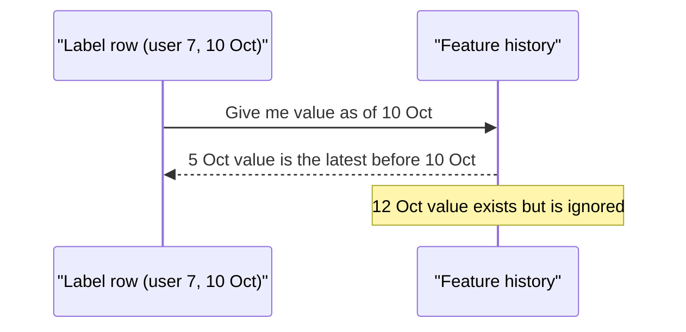

# Point-in-Time Correctness

Suppose you build a model to predict if a user will cancel a subscription. If your training data uses the user's activity from after the cancellation, the model looks brilliant. In real life it will fail, because it cannot see the future.

## What it is

**Point-in-time correctness** means: for every training example, use only feature values that were known at that example's timestamp. Using later information is called **data leakage** (or "future leakage").

A **point-in-time join** is the operation that does this. Feast describes it as reconstructing what feature values looked like at specific past moments, so training data matches what was known at each event.

## How it works

You give the store an **entity dataframe**: the entities, the event timestamp of each row, and the label. For each row, the store looks backward from that row's timestamp and picks the latest feature value at or before it.



*Figure: The join looks only backward in time.*

*Example* feature history for user 7 (`logins_7d`):

| Feature timestamp | Value |
|---|---|
| 1 Oct | 9 |
| 5 Oct | 6 |
| 12 Oct | 1 |

For a label on 10 Oct, the correct value is 6 (from 5 Oct). A normal join on `user_id` alone might pick 1 (the latest value). That value was not known on 10 Oct. It is leakage.

## TTL and created timestamps

Feast's docs add two details:

- **TTL (time to live)** on a feature view limits how far back the join looks. It is measured from each entity row's timestamp, not from the time you run the query. If the nearest feature row is older than the TTL, that row does not join and gets no value.
- **Created timestamp.** By default the join only checks the feature's event timestamp. A value that was backfilled or corrected after the row's timestamp can still be returned. Feast offers `filter_by_created_timestamp=True` so each row sees only values created at or before its own timestamp. Rows with a NULL created timestamp are excluded when it is on, and offline stores that do not support the flag raise an error.

A short call looks like this:

```python
training_df = store.get_historical_features(
    entity_df=entity_df,   # has entity ids and event_timestamp
    features=["driver_hourly_stats:conv_rate"],
).to_df()
```

## Trade-offs

- **Cost.** Point-in-time joins over large histories are heavy. They run in the offline store or warehouse, so plan compute for them.
- **Needs history.** If you only keep the latest value, you cannot rebuild the past. Store feature history or event logs.
- **Late data.** Data that arrives late creates two clocks: when it happened and when you learned it. Decide which one matters for your use case.

## Common mistakes

- Random train/test split on data that has time order. Split by time instead.
- Computing a feature like "average over all data" using the whole dataset, including the future.
- Backfilling features with corrected values and forgetting that production never had them.

> [!TIP]
> **Key takeaways**
> - Each training row must see only feature values known at its own timestamp.
> - Point-in-time joins look backward, and TTL limits how far.
> - Watch for late or corrected data. Use created timestamps where supported.
