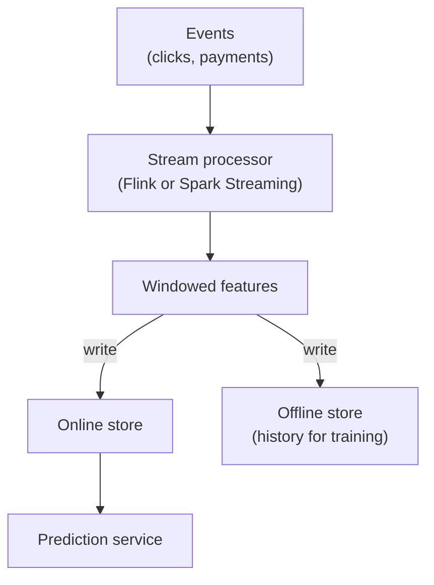

# Streaming and Real-Time Features

UPI fraud checks cannot wait for tonight's batch job. If a card or account makes 8 payments in 2 minutes, the system should know now, not tomorrow.

## What it is

A **streaming feature** is computed continuously from an event stream (for example Kafka or Kinesis) and written to the online store within seconds or minutes. A typical streaming feature is a **windowed aggregate**: "number of payments in the last 10 minutes".

## How it works



*Figure: One stream job writes to both stores.*

The important point is the **dual write**. The same computed value goes to the online store for serving and to the offline store, so training later uses the same numbers the model saw live.

Feast calls this a **push source**. Its docs describe a streaming job that transforms raw events and writes the result to the online store, and optionally to the offline store as a historical log. The destination is chosen with `PushMode.ONLINE`, `PushMode.OFFLINE` or `PushMode.ONLINE_AND_OFFLINE`.

```python
from feast.data_source import PushMode

fs.push("txn_push_source", features_df,
        to=PushMode.ONLINE_AND_OFFLINE)
```

Feast also has a `StreamFeatureView`, which has both a stream source and a batch source. Its docs describe time-windowed aggregations such as sum and average. The Feast docs mark `StreamFeatureView` as Alpha at the time of writing (November 2026), so check its status before you rely on it.

Uber's Palette talk describes the same sync idea: real-time features ingested into the online store are ETL'd back to the offline store. The speaker also said Flink suits near-real-time processing of Kafka data.

## Batch vs streaming

| Point | Batch features | Streaming features |
|---|---|---|
| Freshness | As old as last job | Seconds to minutes (depends on your pipeline) |
| Complexity | Lower | Higher: state, late events, replays |
| Backfill for training | Easy: rerun the SQL | Harder: must replay history with the same logic |
| Best for | Slow signals: 90-day averages | Fast signals: fraud, surge, trending |

## Trade-offs

- **Two implementations of one feature.** If you write the streaming logic in Flink and the training logic in SQL, skew returns. Try to use one definition. See [Training-Serving Skew](04-training-serving-skew.md).
- **Late and out-of-order events.** A mobile app may send an event minutes late. Decide how long windows wait.
- **Cost.** Always-on stream jobs and state stores cost more than a nightly job. Use streaming only where freshness changes the decision.
- **Request-time alternative.** If the signal is already in the incoming request (such as the payment amount), compute it in the request instead of streaming it.

## Common mistakes

- Making every feature real-time "just in case".
- Forgetting the offline write, so there is no history to train on.
- Not monitoring stream lag. A stalled job silently serves stale values.

For the underlying queues and logs, see [Chapter 2](../../module-1/02-storage.md).

> [!TIP]
> **Key takeaways**
> - Streaming features come from event streams, often as windowed aggregates.
> - Write to both online and offline stores so training matches serving.
> - Use streaming only where freshness matters, and watch lag.
