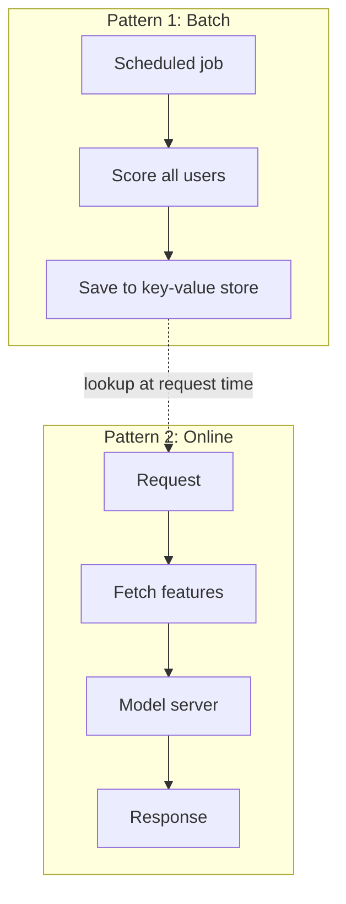

# Model Serving Patterns

Some answers can be cooked in advance, like a tiffin prepared in the morning. Others must be made fresh when the customer orders. Models are the same.

## What it is

**Model serving** means making a trained model available to produce predictions. There are three common patterns. Batch versus online prediction is also covered in [Chapter 4](../04-ml-pipelines.md); here we look at how they connect with features and servers.

## How it works



*Figure: Batch precomputes predictions. Online computes them per request.*

**Pattern 1: Batch prediction.** A scheduled job scores many entities and saves the results. The app later just looks them up. Google's Vertex AI docs describe batch inference as asynchronous: it needs no deployed endpoint and suits cases where you do not need an immediate response and want to process accumulated data in one request.

**Pattern 2: Online prediction.** The model sits behind an endpoint and answers each request. Vertex describes online inference as synchronous: the model must be deployed to an endpoint, and it suits requests that need a timely result.

**Pattern 3: Hybrid.** Precompute the heavy part in batch (for example, item embeddings), and run a light model online. Many recommenders work this way. See [Two-Stage Recommenders](10-two-stage-recommenders-and-ann.md).

| Pattern | Latency | Freshness | Cost | Good for |
|---|---|---|---|---|
| Batch | Instant lookup | As old as last run | Pay for every entity, even unused ones | Daily emails, churn lists |
| Online | Model time plus feature fetch | Fresh | Always-on servers | Fraud checks, ranking |
| Hybrid | Low | Mixed | Medium | Feeds, search |

## The request path

An online request normally goes: app, then feature lookup (feature server or online store), then model server, then response. The feature fetch is usually a key lookup, as seen in earlier pages.

## Model servers

You rarely write the serving loop yourself. Two examples:

- **NVIDIA Triton Inference Server** has a **dynamic batcher**. It combines inference requests on the server into batches, which usually increases throughput. With `max_queue_delay_microseconds` it may hold requests briefly to form a batch, and no request waits longer than that value. Triton's docs say the dynamic batcher is meant for stateless models.

  ```text
  dynamic_batching {
    max_queue_delay_microseconds: 100
  }
  ```

- **KServe** is a Kubernetes platform for serving predictive and generative models. Its `InferenceService` resource handles autoscaling, networking, health checks and server configuration. It supports frameworks such as TensorFlow, PyTorch, scikit-learn, XGBoost and ONNX, plus canary rollouts and scale-to-zero. Its README describes it as a CNCF incubating project.

Batching is a deal: you give up a little latency per request to gain throughput. Triton's own delay setting is how you control that deal.

## In the AI era

LLM servers need extra care (token streaming, KV cache, GPU memory). That is the topic of [Chapter 6](../../module-3/06-llm-serving.md). Not every predictive model needs a GPU. Pick hardware by measuring, not by habit.

## Common mistakes

- Using online serving when a nightly batch would do. You pay for idle servers.
- Pushing heavy feature computation into the request.
- No fallback. If the model server fails, what does the user see? See [Chapter 3](../../module-1/03-reliability.md) for timeouts, retries and circuit breakers.

> [!TIP]
> **Key takeaways**
> - Batch precomputes predictions, online computes per request, hybrid mixes both.
> - Model servers such as Triton and KServe handle batching, scaling and rollouts.
> - Dynamic batching trades a little latency for more throughput.
