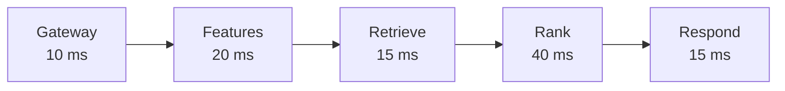

# Latency Budgets and Tail Latency

When you tap "Pay" in a UPI app, you do not want to wait. A recommendation or fraud check inside that flow gets only a small slice of the total time.

## What it is

A **latency budget** is the maximum time the whole request may take, split among its steps. If the product needs a response in 100 ms, every step must fit inside that.

The Google paper *The Tail at Scale* says responses within about 100 ms feel fluid to users. It also warns that keeping the slowest responses low gets harder as systems grow bigger and busier.

## How it works

Start from the end goal and divide the time. This is an *example* budget. Assume a 100 ms limit:

| Step | Budget (example) |
|---|---|
| Network and gateway | 10 ms |
| Fetch features (online store) | 20 ms |
| Retrieval (ANN search) | 15 ms |
| Model scoring (ranking) | 40 ms |
| Business rules and response | 15 ms |

*Figure: Example budget of 100 ms, split across steps.*

Steps that do not depend on each other can run **in parallel**. Fetching user features and item features together takes the time of the slower one, not the sum.

## Averages hide pain: percentiles

Report latency as percentiles. **p50** is the median. **p99** means 99 out of 100 requests were faster than this value. Set targets on p95 or p99, not the average. For SLOs and the idea of "nines", see [Chapter 3](../../module-1/03-reliability.md).

## Why the tail grows with fan-out

*Example* (simple maths, assumed numbers): a request calls 100 services in parallel. Each service is slow in 1 in 100 calls. The chance that at least one is slow is 1 - 0.99^100, about 63%. So a "rare" slowness of 1% becomes the normal case for the user. This is the core worry of *The Tail at Scale*: rare slowdowns that barely matter in a small system can dominate in a large one.

The paper's answer is **tail-tolerant** design: build a predictably responsive whole out of less predictable parts, much like fault-tolerant design builds reliable systems from unreliable parts.

## Practical ways to protect the budget

- **Precompute** what you can. Feast has an option `precompute_online=True` that stores each entity's full feature vector in the online store, so serving needs fewer reads.
- **Batch key lookups.** One call for 50 keys beats 50 calls.
- **Set timeouts per step**, and have a **default** feature value or a fallback model if a step is late.
- **Keep the model small enough.** A smaller model that meets the budget often beats a larger one that sometimes misses.
- **Cache** hot entities close to the service.
- **Load test** with realistic traffic and watch p99.

| Trade | Gain | Cost |
|---|---|---|
| Fallback on timeout | Predictable latency | Lower quality on those requests |
| Larger batch size | Better throughput | Longer wait per request |
| More features | Better accuracy | More lookups and more latency |

## In the AI era

LLM-based features add large delays (hundreds of milliseconds or more). Keep them off the critical path where possible, or stream partial results. See [Chapter 6](../../module-3/06-llm-serving.md).

> [!TIP]
> **Key takeaways**
> - Divide the total time into a budget per step, and run independent steps in parallel.
> - Track p95 and p99, not the average.
> - Fan-out makes rare slowness common, so use timeouts, fallbacks and precomputation.
