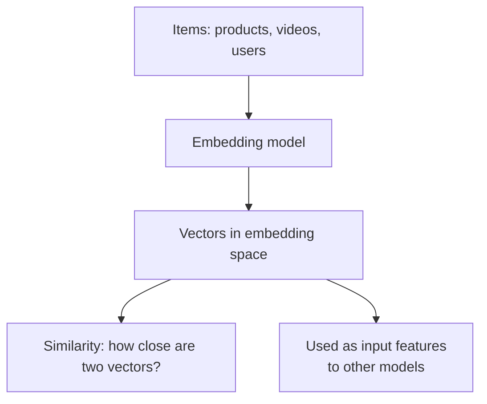

# Embeddings

How would you tell a computer that "biryani" is closer to "pulao" than to "idli"? Give each food a list of numbers, so similar foods get similar lists.

## What it is

An **embedding** is a vector (a list of floating-point numbers) that represents an item such as a word, product, user or image. The space of all such vectors is the **embedding space**. Google's ML Crash Course explains that distance between embedding vectors is a measure of how similar two items are: items that sit close together are more closely related in the model's representation.

Models usually reduce high-dimensional data into a lower-dimensional space. The individual numbers are often hard for humans to interpret. What matters is the distance between vectors.

## How it works

A model learns the vectors from data. Items that tend to be used together, or by the same users, end up close.

*Figure: A model turns items into vectors. Closeness means similarity.*

### Measuring similarity

Google's recommendation course lists three common measures:

| Measure | Idea | Note |
|---|---|---|
| Cosine | Angle between two vectors | Ignores vector length |
| Dot product | Depends on angle and on vector length | For normalised vectors it equals cosine |
| Euclidean distance | Straight-line distance; smaller is closer | For normalised vectors it relates to dot product by a constant |

The course points out these can rank the same items differently. Dot product is sensitive to vector length. Popular items often have large norms, which captures popularity but can let popular items dominate. Pick the measure that your model was trained with.

## Embeddings and the feature store

Embeddings are features, so they need the same care:

- **Store them.** User and item embeddings can live in the online store, looked up by key. Feast's push source docs mention that embeddings can be features that exist only online, so you can omit the batch source.
- **Version them.** Vectors from one embedding model are not comparable with vectors from another. If you retrain the embedding model, re-compute everything that depends on it. This is a design rule that follows from how the vectors are learned, so always tag vectors with the model version.
- **Keep timestamps.** A user's embedding changes as behaviour changes. Training with a future embedding is leakage; see [Point-in-Time Correctness](05-point-in-time-correctness.md).

## Trade-offs

| Choice | Benefit | Cost |
|---|---|---|
| Bigger vectors (more dimensions) | Can hold more information | More memory, slower search |
| Precompute item embeddings | Fast at request time | Stale until the next refresh |
| Compute query embedding per request | Uses fresh context | Model runtime counts against the latency budget |

Google's retrieval guide notes that for a DNN-based model, the system computes the query embedding at serving time by running the network on the input features.

## In the AI era

Text embeddings from language models power semantic search and RAG. The idea is the same as above, but at larger scale and with a vector database as the store. Chunking, vector indexes and hybrid search are in [Chapter 7](../../module-3/07-rag-architectures.md).

## Common mistakes

- Mixing vectors from two model versions in one index.
- Comparing vectors using a different measure than the one used in training.
- Treating dimension numbers as meaningful features by themselves.

> [!TIP]
> **Key takeaways**
> - An embedding is a vector where distance means similarity.
> - Cosine, dot product and Euclidean distance can rank items differently.
> - Treat embeddings as features: store, version and timestamp them.
