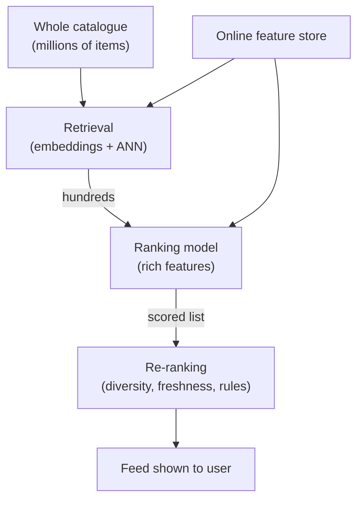

# Two-Stage Recommenders and ANN Search

A shopping app may have crores of products. You cannot run a heavy model on every product for every user within 100 ms. So you first pick a short list, then judge it carefully.

## What it is

A **two-stage recommender** splits the job:

1. **Retrieval (candidate generation):** quickly pick a few hundred or thousand likely items from the whole catalogue.
2. **Ranking:** a more accurate (and heavier) model scores only those candidates and orders them.

The YouTube paper *Deep Neural Networks for YouTube Recommendations* is organised in this classic two-stage form: one deep network narrows the catalogue to a smaller set of videos, and a separate deep model scores them. Google's recommendation course describes the same idea and adds **re-ranking**, which can help ensure diversity, freshness and fairness.

## How it works

*Figure: A funnel. Each stage sees fewer items but uses more compute per item.*

*Example* funnel (assumed numbers): 10 million items, retrieval returns 500, ranking keeps the best 50, and the screen shows 10.

**Two-tower retrieval.** Google's course describes one network that maps query features (user and context) to a query embedding, and a second network that maps item features to an item embedding. The score is the dot product of the two. Because the item tower depends only on item features, item embeddings can be computed ahead of time and indexed. At request time you compute only the query embedding and search.

## ANN: finding neighbours fast

Finding the top-k closest item vectors is a **nearest neighbour** problem. Google's guide says exhaustive scoring can be expensive for very large corpora. **Approximate nearest neighbour (ANN)** search trades a little accuracy for a lot of speed: it may miss a true neighbour sometimes, but it is much faster than checking every vector.

Common ideas, as named in the Faiss wiki and the HNSW paper:

| Idea | In one line |
|---|---|
| Brute force (flat) | Compare with every vector. Exact, slow at scale. |
| IVF (inverted file) | Group vectors into clusters, search only the nearest clusters. |
| PQ (product quantisation) | Compress vectors lossily to save memory and speed up distance checks. |
| HNSW | A layered graph of neighbours. The authors claim logarithmic search-cost scaling. |

Open tools include Faiss (a library for similarity search on dense vectors, developed primarily at Meta AI Research) and ScaNN (named in Google's guide). Index internals, vector databases and filtering are covered in [Chapter 7](../../module-3/07-rag-architectures.md).

## Where features fit

- Retrieval uses mostly user and item embeddings.
- Ranking uses rich features: user history, item stats, context, cross features. They come from the online store, within the latency budget. See [Latency Budgets](08-latency-budgets-and-tail-latency.md).

## Trade-offs

| Choice | Gain | Cost |
|---|---|---|
| Retrieve more candidates | Higher chance the best item is included | Ranking takes longer |
| Higher ANN accuracy settings | Better recall | More latency or memory |
| Heavier ranker | Better ordering | Needs a smaller candidate set |

## Common mistakes

- Evaluating only the ranker. If retrieval misses the right item, ranking cannot fix it.
- Letting item embeddings go stale after a model update.
- Skipping re-ranking, so the feed shows ten near-identical items.

A full worked design is in [Chapter 14](../../module-6/14-case-studies.md).

> [!TIP]
> **Key takeaways**
> - Retrieve a short list cheaply, then rank it carefully, then re-rank for diversity.
> - Two-tower models allow item embeddings to be precomputed and searched with ANN.
> - ANN trades small accuracy loss for large speed gains.
