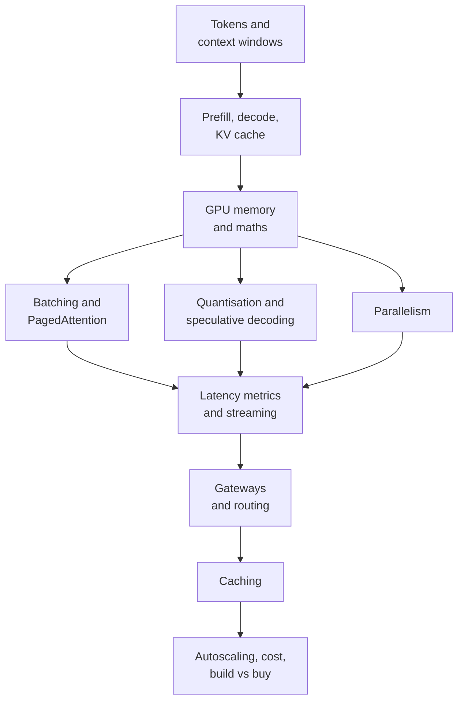

# Chapter 6: LLM Serving Infrastructure

Training a model gets the headlines. Serving it is where the money goes every day. Each chat message, each RAG answer and each agent step is an inference request that occupies expensive GPUs for seconds.

LLM serving is different from the serving of the predictive models in [Chapter 5](../module-2/05-feature-stores.md). The output is not one number. It is a long stream of tokens, produced one at a time. The model also carries a growing memory (the KV cache) for every active user. Because of this, a few ideas decide almost everything: GPU memory, memory bandwidth, and how well you keep the GPU busy.

This chapter builds those ideas from the ground up, and then moves to the system around the engine: gateways, caching, autoscaling and cost. [Chapter 7](07-rag-architectures.md) will then use this serving layer for retrieval-based systems, and [Chapter 8](../module-4/08-agentic-architectures.md) for agents.

*Figure: the chapter moves from one GPU, to many GPUs, to a full production system.*

## What you will learn

- [Tokens and Context Windows](06-llm-serving/01-tokens-and-context-windows.md): the unit of cost, memory and time.
- [Prefill, Decode and the KV Cache](06-llm-serving/02-prefill-decode-and-kv-cache.md): why generation has two phases.
- [GPU Memory and Throughput Maths](06-llm-serving/03-gpu-memory-and-throughput-maths.md): how to size a GPU on paper.
- [Batching and PagedAttention](06-llm-serving/04-batching-and-paged-attention.md): keeping the GPU full.
- [Quantisation and Speculative Decoding](06-llm-serving/05-quantisation-and-speculative-decoding.md): smaller and faster decode.
- [Parallelism: Splitting a Model Across GPUs](06-llm-serving/06-parallelism.md): tensor, pipeline, data and expert splits.
- [Latency Metrics and Streaming](06-llm-serving/07-latency-metrics-and-streaming.md): TTFT, ITL, throughput and SSE.
- [LLM Gateways and Routing](06-llm-serving/08-llm-gateways-and-routing.md): one front door for many models.
- [Caching: Prefix, Prompt and Semantic](06-llm-serving/09-caching.md): not paying twice.
- [Autoscaling, Cost Control and Build vs Buy](06-llm-serving/10-autoscaling-cost-and-build-vs-buy.md): running it in production.
- [Recap & Practice](06-llm-serving/11-recap.md): revision, interview questions and sources.
