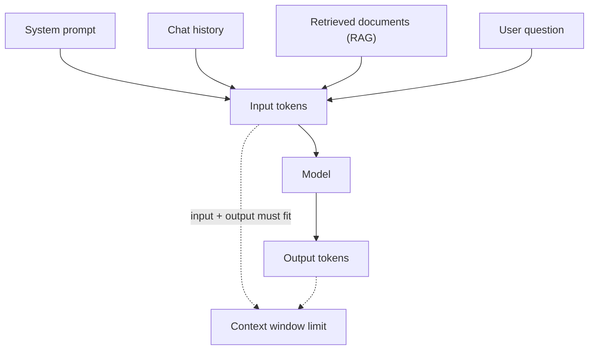

# Tokens and Context Windows

When you send a parcel, the courier does not care about the *item*. He charges by weight and size. An LLM works the same way. It does not see words or sentences. It sees tokens, and everything it costs you (time, memory, money) is counted in tokens.

## What it is

A **token** is a small piece of text. It can be a whole word, part of a word, a number, or a punctuation mark. A rule of thumb from NVIDIA: one token is roughly four English characters. This is only a rough guide.

A **tokenizer** converts text into a list of token IDs before the model sees it. Most modern tokenizers use subword methods such as **byte pair encoding (BPE)**. BPE starts with single characters and keeps merging the most frequent neighbouring pair, until it reaches a target vocabulary size. Common words stay as one token. Rare words are split into pieces.

Two things follow from this:

- Every model family has its own tokenizer and vocabulary. The same sentence can have different token counts in different models.
- The token count also depends on the language and content. Code, numbers and non-English text can behave very differently from plain English. Always count with the real tokenizer.

```python
from transformers import AutoTokenizer

tok = AutoTokenizer.from_pretrained("gpt2")  # any model you use
ids = tok.encode("Namaste, how are you?")
print(len(ids), tok.convert_ids_to_tokens(ids))
```

The **context window** is the maximum number of tokens the model can handle in one request. Input and output share this budget. If the window is 100,000 tokens and your prompt uses 98,000, only about 2,000 are left for the answer.

## How it works

Everything you send is packed into one sequence: system prompt, tool definitions, chat history, retrieved documents, and the user's question. The model then adds its answer, one token at a time, at the end.



*Figure: input and output tokens share one context window.*

## Why this matters for serving

Tokens are the unit of almost every serving cost:

| Resource | How tokens affect it |
|---|---|
| Latency | Longer prompts take longer to process. Longer answers take longer to generate. |
| GPU memory | The model stores per-token state (the KV cache) for every token in the window. See the [next page](02-prefill-decode-and-kv-cache.md). |
| Money | APIs bill per input token and per output token, usually at different rates. Check your provider's price list. |
| Throughput | Each long request holds GPU memory for longer, so fewer requests run together. |

A bigger window is a capability, not a free gift. A request that fills a 1-million-token window costs far more to serve than a short one, even if the model supports it.

## In the AI era

- **Long window does not mean good recall.** A research paper ("Lost in the Middle") found that models do best when the relevant fact is at the start or end of the input, and do worse when it sits in the middle. Even models built for long inputs showed this. So do not just stuff everything in.
- **Agents grow context fast.** Each tool call and result is appended to the history. A long agent run can quietly reach a very large prompt. [Chapter 8](../../module-4/08-agentic-architectures.md) covers how to manage this.
- **RAG is partly a token-saving tool.** Instead of pasting a whole library, you retrieve only the relevant pieces. See [Chapter 7](../../module-3/07-rag-architectures.md).

## Common mistakes

- Estimating cost by counting words instead of tokens.
- Forgetting that `max_tokens` (output cap) and the prompt together must fit the window.
- Using one model's tokenizer to count tokens for a different model.
- Sending the same large, unchanged prompt on every call (caching fixes this; see [Caching](09-caching.md)).

> [!TIP]
> **Key takeaways**
> - A token is a subword piece. Count tokens with the model's own tokenizer, not by words.
> - The context window is one shared budget for input and output.
> - Tokens drive latency, GPU memory and cost, so every serving trick in this chapter is about handling tokens better.
