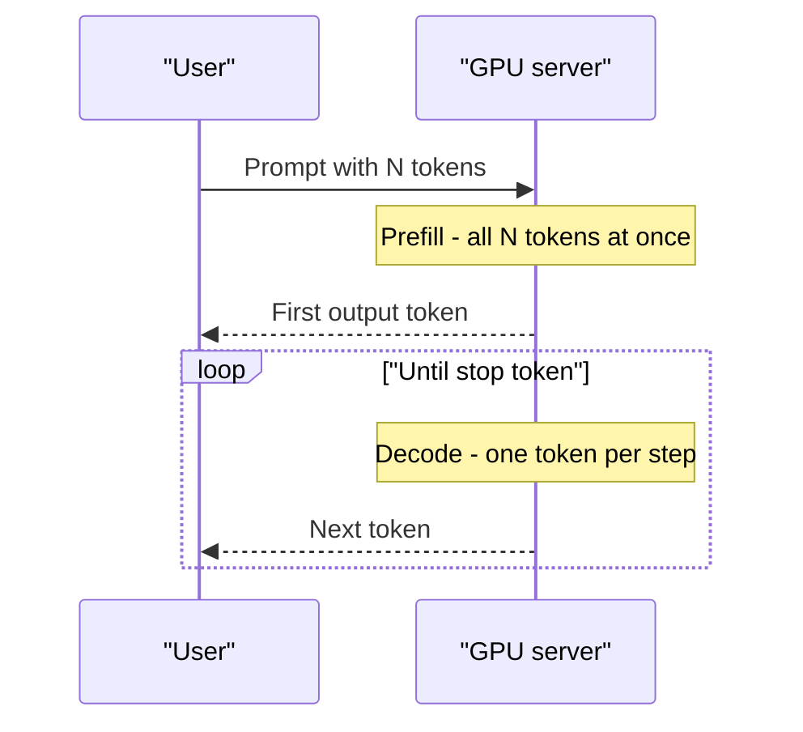
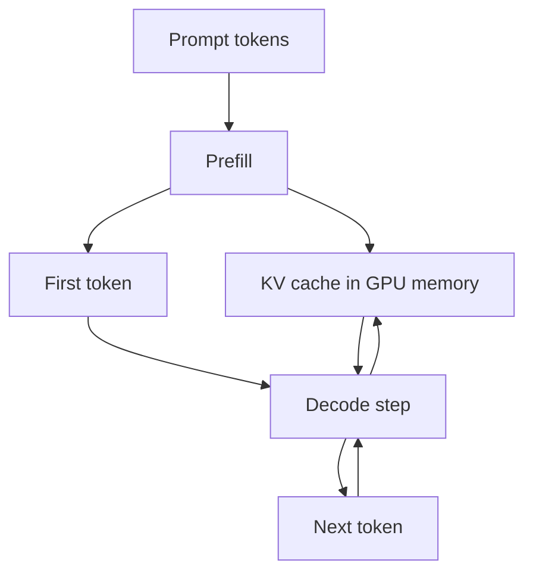

# Prefill, Decode and the KV Cache

Think of a cricket commentator reading a long scorecard before the match. He reads the whole card once (slow, but he can scan it all at once). After that he calls the game ball by ball, one at a time. LLM inference has these same two stages.

## What it is

An LLM generates text **autoregressively**: it produces one token, appends it to the input, and then produces the next token. This continues until it emits a stop token or hits a length limit.

Serving this has two phases:

- **Prefill**: the model reads the whole prompt in one go. All prompt tokens are processed in parallel. This is large matrix-by-matrix work that can keep the GPU's compute units busy.
- **Decode**: the model generates output tokens one by one. Each step handles only one new token per request, so the GPU spends most of its time moving model weights from memory rather than calculating. NVIDIA calls decode memory-bound.



*Figure: one prefill step, then many decode steps.*

## How the KV cache fits in

Inside each transformer layer, attention compares the current token with all earlier tokens. For that, each earlier token needs a **key** (K) and a **value** (V) vector. These do not change once computed.

Recomputing K and V for the whole history at every step would be wasteful. So the server stores them. This store is the **KV cache**.

- Prefill *fills* the cache for all prompt tokens.
- Each decode step *reads* the whole cache and *adds* one new entry.

Size of the cache per token (NVIDIA's formula):

```text
KV bytes per token = 2 x num_layers x (num_kv_heads x head_dim) x bytes_per_value
```

The "2" is for K and V. Total cache = bytes per token x tokens in the sequence x number of sequences. So the cache grows linearly with both sequence length and batch size.



*Figure: decode reads the KV cache every step and appends to it.*

## Prefill vs decode at a glance

| | Prefill | Decode |
|---|---|---|
| Work per step | Many tokens at once | One token per request |
| Main limit | Compute | Memory bandwidth |
| Felt by user as | Wait before first word (TTFT) | Speed of words appearing (ITL) |
| Gets worse with | Longer prompts | Longer answers, bigger KV cache |

The metrics TTFT and ITL are explained in [Latency Metrics and Streaming](07-latency-metrics-and-streaming.md).

## Shrinking the cache

Because the KV cache is such a big memory user, model designers and engineers attack it:

- **Multi-query attention (MQA)**: all attention heads share one set of keys and values. Smaller cache, but quality may drop and the model usually needs to be trained for it.
- **Grouped-query attention (GQA)**: a middle path. Query heads are split into groups, and each group shares one K/V head. The GQA paper reports quality close to full multi-head attention with speed comparable to MQA. NVIDIA notes Llama 2 70B uses GQA.
- **FlashAttention**: computes the same exact attention result, but with fewer slow memory reads. It does not shrink the cache, it speeds up attention.
- **Cache quantisation and paging**: covered in later pages.

## In the AI era

Two problems become sharper with modern workloads:

- **Long prompts** (RAG, agents) make prefill expensive and the KV cache big.
- **Long outputs** (reasoning models that "think" before answering) make decode dominate the bill, since decode time grows with every output token.

Some systems also run prefill and decode on separate GPU pools so the two phases do not disturb each other. See [Parallelism](06-parallelism.md).

> [!TIP]
> **Key takeaways**
> - Prefill reads the prompt in parallel (compute-heavy). Decode writes one token at a time (memory-heavy).
> - The KV cache stores past keys and values so they are not recomputed. It grows with sequence length and batch size.
> - GQA and MQA shrink the cache by sharing K/V heads.
