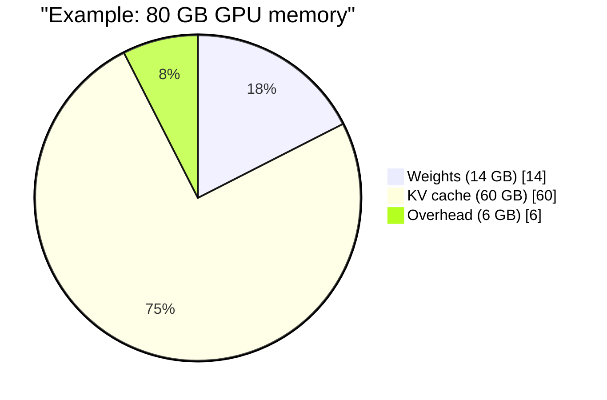
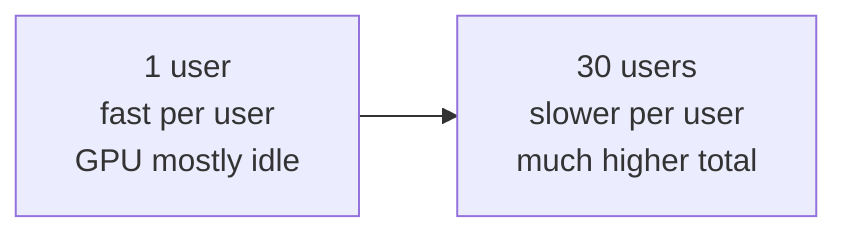

# GPU Memory and Throughput Maths

Before you buy or rent a GPU, you should be able to answer two questions on paper: "Will this model fit?" and "How fast can it talk?" Both need only school-level arithmetic.

> [!NOTE]
> All numbers marked *Example* or *Assume* below are made up to teach the method. Hardware figures are from NVIDIA's H100 product page (as of November 2026).

## What it is

A GPU has a fixed amount of fast memory (HBM) and a fixed memory bandwidth, which is how many bytes per second it can read. For serving, three things share that memory:

1. **Weights**: the model itself.
2. **KV cache**: per-request state, as seen in the [previous page](02-prefill-decode-and-kv-cache.md).
3. **Other**: activations, framework overhead, buffers.

## Step 1: weights

```text
weight memory = number of parameters x bytes per parameter
```

Bytes per parameter: 2 for 16-bit (FP16/BF16), 1 for 8-bit, 0.5 for 4-bit (Databricks).

*Example:* a 7-billion-parameter model in BF16 needs 7 x 2 = 14 GB. A 70-billion-parameter model in 16-bit needs 140 GB, which does not fit on one 80 GB GPU. That is when you need [parallelism](06-parallelism.md) or [quantisation](05-quantisation-and-speculative-decoding.md).

## Step 2: KV cache per token

Use the formula from the last page. For Llama 2 7B (32 layers, 32 KV heads, head size 128, 2 bytes per value):

```text
2 x 32 x (32 x 128) x 2 bytes = 524,288 bytes = 0.5 MB per token
```

For 4,096 tokens that is 2 GB, which matches NVIDIA's worked example.

Now compare Mistral 7B, which uses GQA (32 layers, 8 KV heads, hidden size 4096 over 32 heads gives head size 128):

```text
2 x 32 x (8 x 128) x 2 bytes = 131,072 bytes = 0.125 MB per token
```

Four times smaller, purely because it has fewer KV heads.

## Step 3: how many requests fit?

*Assume* an 80 GB H100 SXM, the 14 GB BF16 model, and about 6 GB for overhead. That leaves about 60 GB for the KV cache.



*Figure: example split of GPU memory for a 7B model in BF16.*

| Model type | KV per token | Tokens that fit in 60 GB | Sequences of 4,096 tokens |
|---|---|---|---|
| Full multi-head (0.5 MB) | 0.5 MB | about 120,000 | about 30 |
| GQA with 8 KV heads (0.125 MB) | 0.125 MB | about 480,000 | about 117 |

So memory, not compute, often decides how many users one GPU can serve at the same time.

## Step 4: how fast can it decode?

In decode, every step must read all the weights (and the KV cache) from memory. Databricks defines achieved bandwidth as (weights + KV cache) divided by time per output token (TPOT). Turn it around and you get a speed limit:

```text
min time per step = bytes read per step / memory bandwidth
```

*Example, one user:* H100 SXM bandwidth is 3.35 TB/s. Reading 14 GB of weights takes 14 / 3,350 = about 4.2 ms. So the upper limit is about 240 tokens per second for one request. Real systems reach only a fraction of the peak. Databricks' own worked example is at 50% of peak bandwidth (they call it MBU, model bandwidth utilisation).

*Example, 30 users together:* each step now reads the 14 GB weights **once** for everyone, plus each user's cache. If all 30 sit at 4,096 tokens, the cache read is 30 x 2 GB = 60 GB. Per step: (14 + 60) / 3,350 = about 22 ms. In 22 ms the server produces 30 tokens, about 1,350 tokens per second in total, but each user gets only about 45 tokens per second.



*Figure: batching trades per-user speed for total throughput.*

Two lessons:

- Sharing the weight read across many users is why batching raises total throughput. See [Batching and PagedAttention](04-batching-and-paged-attention.md).
- At long contexts, reading the KV cache costs more than reading the weights. That is why GQA, KV-cache quantisation and prefix reuse matter.

## Common mistakes

- Counting only weights and forgetting the KV cache.
- Assuming peak bandwidth is achievable. Always leave room for overhead.
- Using FLOPS to predict decode speed. Decode is limited by memory bandwidth at small batch sizes.

> [!TIP]
> **Key takeaways**
> - Weights = parameters x bytes per parameter. KV cache = bytes per token x tokens x sequences.
> - Decode speed limit is roughly memory bandwidth divided by bytes read per step.
> - Memory usually limits how many users fit. Bandwidth limits how fast each one gets tokens.
