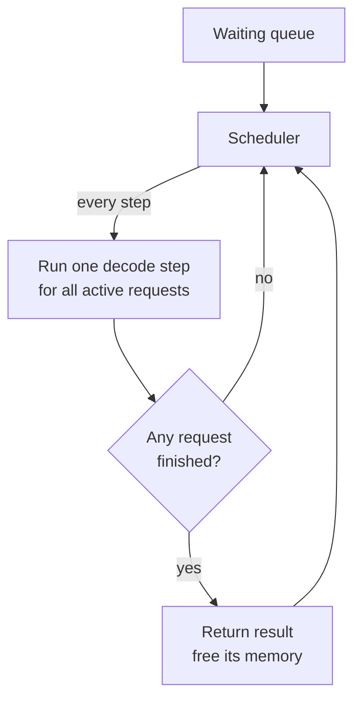
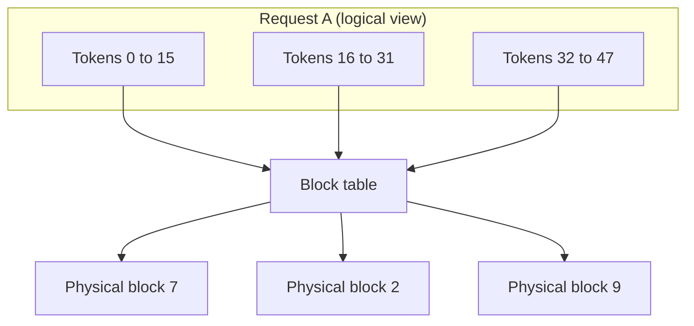

# Batching and PagedAttention

A Mumbai local train runs the same whether it carries 50 people or 500. The cost of the trip is mostly fixed, so you want the train full. A GPU decoding one request at a time is a nearly empty train. Batching fills it.

## What it is

**Batching** means running many requests through the model in the same step. The weights are read from memory once and used for everyone, so each extra request adds little cost (see the [maths page](03-gpu-memory-and-throughput-maths.md)).

But LLM requests are different from normal API calls. Their outputs have different lengths, and nobody knows in advance how long an answer will be. This makes batching tricky.

## Static vs continuous batching

- **Static batching**: collect N requests, run them together, and return results when *all* are done. Short requests wait for the longest one. The GPU slots of finished requests sit idle.
- **Continuous batching** (also called in-flight batching or iteration-level scheduling): the scheduler decides after *every* decode step. Finished requests leave at once. Waiting requests join at once.

The idea comes from the Orca paper (OSDI 2022), which schedules at the granularity of one iteration instead of one request. The Orca authors report up to 36.9 times higher throughput than NVIDIA FasterTransformer on a GPT-3 175B model at the same latency. Databricks calls continuous batching the state of the art for shared LLM services.

*Figure: the scheduler re-fills the batch after every step.*

## The memory problem

Continuous batching needs a lot of KV cache, and each request's cache grows token by token. If every request gets one big contiguous block, two kinds of waste appear. Memory is reserved but not used (over-provisioning), and gaps appear between blocks (fragmentation). NVIDIA and the vLLM authors both point to this waste as a limit on batch size.

## PagedAttention

The vLLM paper (SOSP 2023) borrowed an idea from operating systems: **paging**. Instead of one big block, the KV cache is cut into small fixed-size blocks, which need not sit next to each other in memory. A **block table** maps a request's logical token positions to physical blocks, like a page table maps virtual memory to RAM.

*Figure: logical blocks map to scattered physical blocks. The block size of 16 tokens is only illustrative.*

Benefits claimed by the vLLM authors:

- Near-zero waste of KV cache memory, so bigger batches fit.
- Blocks can be shared inside and across requests (for example, the same system prompt).
- Throughput 2 to 4 times higher than FasterTransformer and Orca at the same latency, with larger gains for longer sequences and bigger models.

PagedAttention is now standard in modern engines. For example, Hugging Face's TGI lists continuous batching and paged attention among its features.

## Chunked prefill

A long prompt can hog a step for a long time, and every user in decode waits. **Chunked prefill** cuts the prompt into pieces and mixes one piece with ongoing decodes in each step. The SARATHI paper introduced the idea. In vLLM's V1 engine it is enabled by default whenever possible: decodes are scheduled first, then prefill chunks fill the remaining token budget.

The knob `max_num_batched_tokens` sets that budget. vLLM docs say smaller values (for example 2048) improve inter-token latency, while larger values improve time to first token.

## When memory runs out

If the KV cache is full, vLLM **preempts** a request, which means it drops that request's cache and recomputes it later (the default in V1 is recompute, not swap). Frequent preemption hurts latency. vLLM's tuning advice: raise `gpu_memory_utilization`, lower `max_num_seqs`, or add GPUs via parallelism.

## Trade-offs

| Choice | Gain | Cost |
|---|---|---|
| Bigger batch | More total tokens per second | Each user gets tokens slower |
| Bigger token budget per step | Faster first token | Slower streaming for others |
| More KV memory reserved | Fewer preemptions | Less room for other things on the GPU |

> [!TIP]
> **Key takeaways**
> - Continuous batching re-forms the batch every step, so finished requests free their slot immediately.
> - PagedAttention stores the KV cache in small blocks with a block table, which removes most memory waste.
> - Chunked prefill stops long prompts from stalling users who are already getting tokens.
