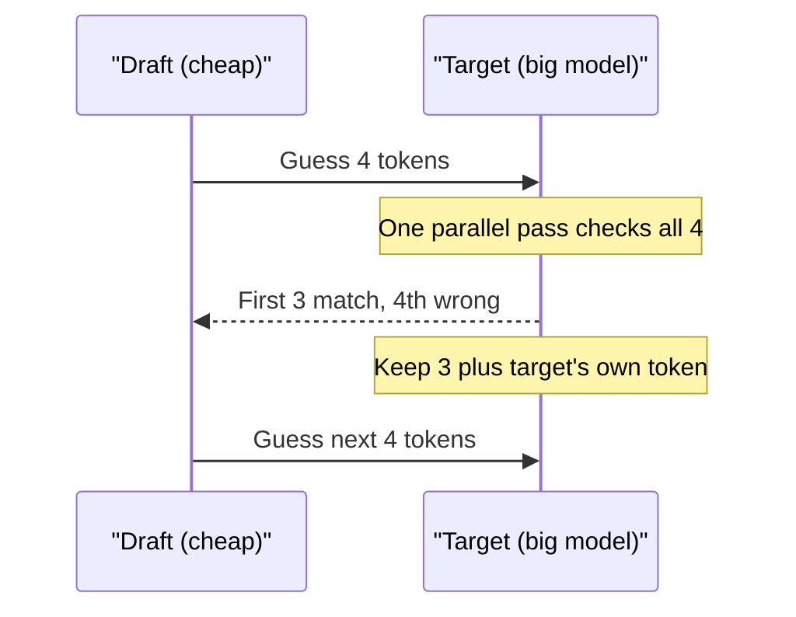

# Quantisation and Speculative Decoding

Decode is slow for two reasons: each step moves a lot of bytes, and the steps must happen one after another. Quantisation attacks the first reason. Speculative decoding attacks the second.

## Part 1: Quantisation

### What it is

**Quantisation** stores numbers in fewer bits. A weight that took 16 bits now takes 8 or 4. The model becomes smaller, and each decode step reads fewer bytes from memory.

| Format | Bytes per parameter | 70B model weights |
|---|---|---|
| 16-bit (FP16/BF16) | 2 | 140 GB |
| 8-bit (INT8 or FP8) | 1 | 70 GB |
| 4-bit (INT4) | 0.5 | 35 GB |

(Bytes per parameter are from Databricks. The last column is simple multiplication.)

Databricks notes that going from 16-bit to 8-bit can halve the GPUs needed in memory-limited setups, and 4-bit can make consumer hardware viable.

### How it works

Common names you will see in serving docs:

- **Weight-only** (for example "W4A16": 4-bit weights, 16-bit activations). Easiest, because weights are easier to quantise than activations. NVIDIA notes activations often have outliers.
- **Weights and activations** (for example "W8A8": INT8 or FP8). Can use faster low-precision hardware. In vLLM, FP8 W8A8 is listed for Ada and Hopper GPUs, not older ones.
- **KV cache quantisation**: store the cache in 8-bit. Databricks' example for Llama-2-70B at 1,024 tokens: a batch of 32 needs 10 GiB of KV cache in FP16 and 5 GiB in INT8.

Two well-known weight-quantisation methods:

- **GPTQ**: the paper reports 3 or 4 bits per weight with little accuracy loss, and a 175B model quantised in about four GPU hours.
- **AWQ**: protects the small set of "salient" weight channels (found from activation statistics) by scaling them, which keeps error low at low bit width.

vLLM supports many formats, including AWQ, GPTQ, FP8 and INT8 through LLM Compressor. Hardware support differs by method, so check the support table for your GPU.

### Trade-offs

- Less memory, faster decode, more room for KV cache.
- Possible quality loss. Databricks warns that naive quantisation can noticeably hurt quality, and the effect varies by model. **Test on your own task**, not only on public benchmarks.

## Part 2: Speculative decoding

### What it is

A big model needs one full pass per token. But many tokens are easy to guess ("New" is likely followed by "Delhi"). **Speculative decoding** uses a cheap *draft* to guess several tokens ahead, and the big *target* model checks all guesses in a single pass.

### How it works

*Figure: the target verifies many guesses in the cost of one step.*

Matching tokens are accepted. The first mismatch and everything after it are discarded (NVIDIA). In the original paper (Leviathan et al., ICML 2023) the method keeps the output distribution unchanged. They report a 2x to 3x speed-up on T5-XXL, with no retraining or architecture change. vLLM's docs say it is lossless up to hardware numerical precision.

### Where the guesses come from

vLLM lists these methods (as of November 2026):

| Method | Idea |
|---|---|
| Draft model | A small separate model proposes tokens |
| N-gram | Simple lookup of repeated text patterns, no extra model. Modest speed-ups |
| EAGLE, MTP | Model-based proposers. See the vLLM docs for how each is set up |

### When it helps

vLLM's docs say model-based methods (EAGLE, MTP, draft model) give the largest latency cut at **medium-to-low load** on memory-bound workloads, while n-gram methods give modest speed-ups and add little work at peak traffic. Gains are smaller at high request rates, probably because a busy GPU has less spare capacity to check guesses. The docs do not give exact numbers, so measure with your own traffic.

## Choosing

| Problem | Try first |
|---|---|
| Model does not fit on GPU | Quantise weights, or use [parallelism](06-parallelism.md) |
| KV cache limits concurrency | KV cache quantisation, GQA models |
| Single-user latency too high, load is low | Speculative decoding |
| Load is high, GPUs always busy | Quantisation and [batching](04-batching-and-paged-attention.md), not speculation |

> [!TIP]
> **Key takeaways**
> - Quantisation shrinks bytes per parameter, so models fit in less memory and decode faster. Always check quality on your task.
> - Speculative decoding drafts several tokens cheaply and verifies them in one pass of the big model, without changing the output distribution.
> - Speculation helps most at low-to-medium load. Quantisation helps at every load.
