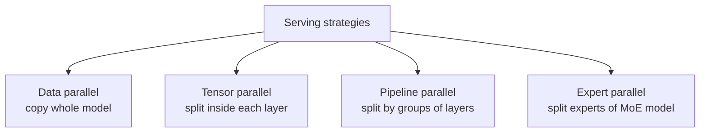
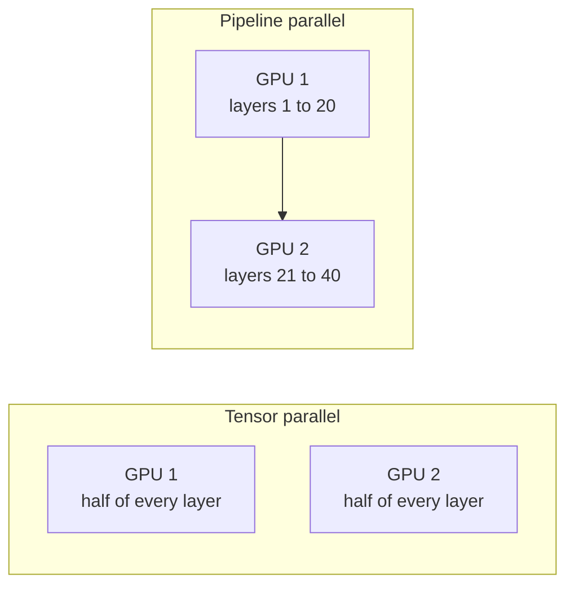

# Parallelism: Splitting a Model Across GPUs

A 70-billion-parameter model in 16-bit needs about 140 GB for weights alone. One 80 GB GPU cannot hold it. So you must split the work across several GPUs. There are a few ways to split, and each has a different cost.

## What it is

**Parallelism** means using more than one GPU to serve one model. You do it for two reasons:

1. **Fit**: the weights (and the KV cache) do not fit on one GPU.
2. **Speed or capacity**: you want lower latency or more requests per second.

## The main strategies

*Figure: four ways to use many GPUs.*

**Data parallelism**: every GPU (or group) holds a full copy of the model. A router sends each request to one copy. This scales throughput, not model size. vLLM's setting is `data_parallel_size`. This is the same idea as running many replicas behind a load balancer.

**Tensor parallelism (TP)**: each layer's big weight matrices (and attention heads) are cut into slices, one per GPU. All GPUs work on every token and combine partial results. The idea was shown for transformers in the Megatron-LM paper (for training). NVIDIA notes that two-way splitting halves the weight memory per GPU. It also frees room for the KV cache. The cost is synchronisation between GPUs at every layer. vLLM calls this the way to go when the model does not fit on one GPU, and says it is essential for models like 70B.

**Pipeline parallelism (PP)**: the layers are divided into stages. GPU 1 holds layers 1 to 20, GPU 2 holds layers 21 to 40, and so on. A request flows through the stages in order. The problem is **pipeline bubbles**: while GPU 2 is working, GPU 1 may sit idle. NVIDIA notes that splitting the batch into micro-batches reduces bubbles but does not remove them. vLLM suggests PP after TP is maxed out, or to scale across machines, and it can be combined with TP (for example TP 4 and PP 2 on 8 GPUs).

**Expert parallelism (EP)**: for **mixture-of-experts (MoE)** models, which have many expert sub-networks where each token uses only a few. Different experts live on different GPUs. vLLM supports it for MoE models only.

*Figure: tensor parallel splits across the width of each layer. Pipeline parallel splits across the depth.*

## How to choose

| Situation | Choice |
|---|---|
| Model fits on one GPU, need more traffic | Data parallel (more replicas) |
| Model does not fit on one GPU | Tensor parallel inside one machine |
| Model too big for one machine | Add pipeline parallel across machines |
| MoE model | Add expert parallel |

A simple rule: **use the fewest GPUs that hold the weights plus a healthy KV cache, then scale out with replicas.** More GPUs per replica adds communication cost. Databricks measured diminishing returns: for a 7B model at batch size 1, going from 2 to 4 GPUs cut token latency by only about 12% (A100 results from 2023, so treat as an illustration).

## Splitting by phase: disaggregated serving

Prefill and decode have different needs (see [Prefill, Decode and the KV Cache](02-prefill-decode-and-kv-cache.md)). When mixed on the same GPUs, a heavy prefill can slow other users' decoding.

**Disaggregation** runs prefill and decode on separate GPU pools. Each pool can have its own parallel settings. The cache computed in prefill is sent to a decode GPU.

*Figure: prefill and decode run on different GPUs.*

The DistServe paper reports serving 7.4 times more requests, or meeting a 12.6 times tighter latency target, than the systems it compared against. These are the authors' numbers under their setup. vLLM's docs mark its disaggregated prefill as experimental, and say it helps control tail ITL but does **not** improve throughput. The cost is moving the KV cache between GPUs, so it needs fast links.

## Common mistakes

- Adding GPUs to one replica when you only needed more replicas.
- Ignoring the cost of GPUs talking to each other. vLLM warns of synchronisation overhead with TP and latency penalties with PP.
- Buying GPUs for weights only, and having no memory left for the KV cache.

> [!TIP]
> **Key takeaways**
> - Data parallel copies the model (more traffic). Tensor parallel splits each layer (fit and speed). Pipeline parallel splits layers into stages (multi-machine).
> - Use the fewest GPUs per replica that work, then add replicas.
> - Disaggregating prefill and decode helps tail latency but costs KV cache transfer.
