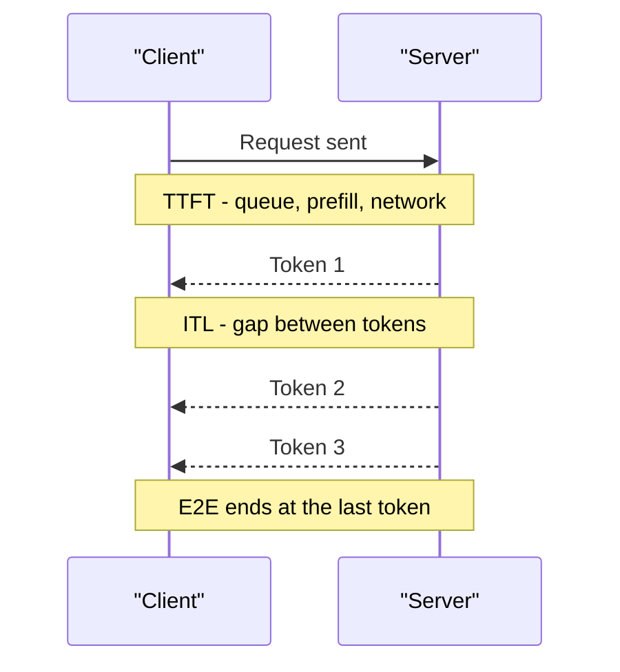

# Latency Metrics and Streaming

When you order on Swiggy, two times matter: how long before the restaurant accepts the order, and how long until the food reaches you. LLM serving has the same split. You need different numbers for "how soon does it start" and "how fast does it flow".

## What it is

Four metrics cover most LLM serving work. The definitions below follow NVIDIA's benchmarking docs.

| Metric | Meaning | Mostly shaped by |
|---|---|---|
| **TTFT** (time to first token) | Time from sending the request to the first token arriving. Includes queueing, prefill and network delay | Prompt length, queue, prefill speed |
| **ITL** (inter-token latency), also called **TPOT** (time per output token) | Average gap between consecutive output tokens, after the first | Decode speed, batch size, KV cache size |
| **E2E latency** | Time until the full response arrives | TTFT plus ITL times the output length |
| **Throughput** | Tokens per second across all users (TPS), or requests per second (RPS) | GPU count, batching, memory |

NVIDIA's formula: ITL = (E2E latency - TTFT) / (output tokens - 1). Rearranged:

```text
E2E latency = TTFT + ITL x (output tokens - 1)
```

*Example:* TTFT = 0.5 s, ITL = 30 ms, answer = 300 tokens. E2E = 0.5 + 0.03 x 299 = about 9.5 s. Per user, 1 / 0.03 = about 33 tokens per second. Databricks gives a handy benchmark: 100 ms per token means about 10 tokens per second per user.



*Figure: where TTFT, ITL and E2E sit on a request timeline.*

## Which one should you watch?

It depends on the product:

- **Chat assistant**: TTFT and ITL. The user is watching text appear.
- **Code autocomplete**: TTFT, because the suggestion must appear while you type.
- **Batch jobs** (summarising 1 million documents overnight): throughput and cost. Latency barely matters.
- **Agents**: E2E latency per step, because steps run one after another and delays add up.

## Latency vs throughput

These pull in opposite directions. A bigger batch increases total tokens per second but slows each user (see [Batching](04-batching-and-paged-attention.md)). So set a target first, for example "p95 TTFT under 1 second and p95 ITL under 50 ms" (assumed numbers, choose yours), then find the highest throughput that meets it. Use percentiles (p50, p95, p99), not averages, as a few slow requests hide inside an average.

NVIDIA warns that tools define these metrics slightly differently. Compare results only when the definitions match.

vLLM exposes these as Prometheus histograms, such as `vllm:time_to_first_token_seconds` and `vllm:inter_token_latency_seconds`, so you can chart them directly. [Chapter 11](../../module-5/11-observability.md) covers the monitoring side.

## Streaming

If a 300-token answer takes about 9.5 seconds, would you want a blank screen for 9.5 seconds? No. **Streaming** sends tokens as they are generated. Total time stays the same, but the user sees the first words after the TTFT.

The usual transport is **Server-Sent Events (SSE)**: a one-way HTTP stream from server to client. The server replies with `Content-Type: text/event-stream` and sends messages as `data:` lines separated by a blank line (MDN). Claude's Messages API streams this way when you set `"stream": true`, and Hugging Face TGI lists token streaming over SSE as a feature. Why SSE suits LLMs is explained in [Chapter 1](../../module-1/01-networking.md).

A simplified stream looks like this:

```text
data: {"text": "Namaste"}

data: {"text": " India"}
```

Practical notes:

- Every proxy and gateway between the model and the user must pass chunks through without buffering them. Test this early.
- A user can close the tab mid-answer. The server should detect the closed connection and stop generating, so GPU time is not wasted. (Check how your engine and gateway handle cancellation.)
- Streaming makes the first token matter more than the last. It is why TTFT is often the headline metric for chat.

> [!TIP]
> **Key takeaways**
> - TTFT is "how soon it starts". ITL is "how fast it flows". E2E = TTFT + ITL x (tokens - 1).
> - Throughput and latency trade against each other. Set a latency target first, then maximise throughput under it.
> - Stream with SSE so users see words early. Make sure no proxy buffers the stream.
