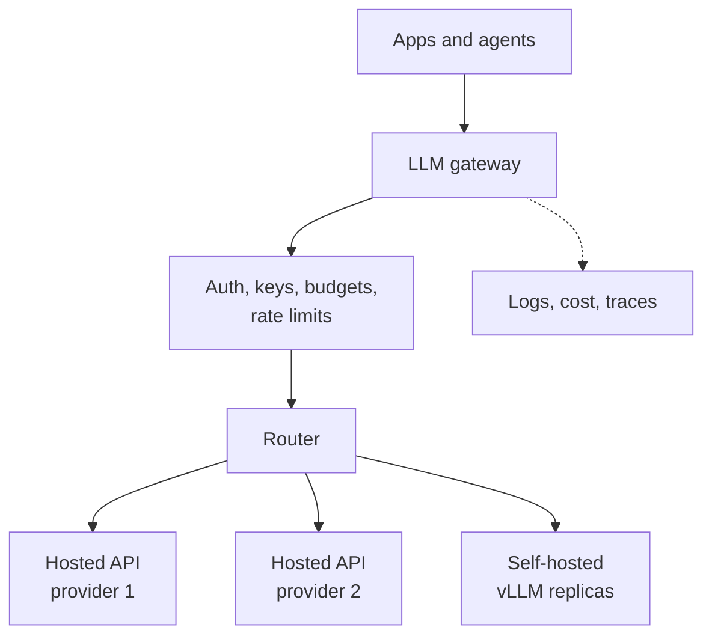

# LLM Gateways and Routing

A large company may use many models: a cheap one for tagging, a strong one for hard questions, a self-hosted one for private data, and a backup from another provider. If every team calls each model directly, you get chaos. Keys are everywhere, nobody knows the total bill, and one provider outage breaks many apps. An LLM gateway brings order.

## What it is

An **LLM gateway** (also called AI gateway) is a service that sits between your applications and the models. Apps talk to one endpoint. The gateway decides which model or replica serves each request.

It is a special kind of API gateway. For general API gateway and rate-limit ideas, see [Chapter 1](../../module-1/01-networking.md). Here we focus on what is new for LLMs.

LiteLLM is one popular open-source example. Its docs describe a self-hosted gateway that gives one OpenAI-compatible endpoint for 100+ providers, with these features:

- load balancing, retries and fallbacks between deployments
- spend tracking by key, team, user and tag
- virtual keys, one per user, team or project
- per-key budgets, model access and rate limits

## How it works

*Figure: one front door, many back ends.*

Typical jobs of the gateway:

1. **One API shape.** Apps write to one format, so changing a model is a config change.
2. **Identity and quotas.** Limits are often counted in tokens per minute as well as requests per minute, because one request can be tiny or huge. LiteLLM supports both rpm and tpm limits.
3. **Reliability.** Timeouts, retries, cooldowns for failing back ends, and fallback to another model. The general patterns are in [Chapter 3](../../module-1/03-reliability.md).
4. **Cost and usage records.** Every call is tagged with who made it.
5. **Policy hooks.** Content filters and data rules can run in one place. See [Chapter 10](../../module-4/10-security-governance.md) and [Chapter 12](../../module-5/12-evaluation-safety.md).

## Routing strategies

"Routing" has three levels. Do not mix them up.

**1. Pick a deployment of the same model.** LiteLLM lists strategies such as weighted pick (its default, recommended for production), least-busy, lowest-latency, rate-limit-aware, and lowest-cost. For self-hosted engines, round-robin ignores that requests differ a lot in size. The Kubernetes Gateway API Inference Extension project addresses this: its endpoint picker chooses the best endpoint using signals such as prefix cache status and LoRA adapter availability. It also supports routing by model name and serving priority, so chat can outrank summarisation.

**2. Pick a model by request type.** Simple rules work well: "classification goes to the small model, coding goes to the strong model."

**3. Pick a model by predicted difficulty.** A learned router decides per query. The RouteLLM paper trains routers on human preference data to choose between a strong, costly model and a weak, cheap one. The authors report cost cut by over 2 times in certain cases without lowering response quality. Treat that as a result from their setup, not a guarantee.

| Level | Decides | Example signal |
|---|---|---|
| Replica | Which copy of the model | Queue length, cache state |
| Model | Which model family | Task type, user tier, data sensitivity |
| Query | Strong vs cheap model | Predicted difficulty |

## Trade-offs

- **Extra hop**: a gateway adds a little latency and is one more thing to run. Make it stateless and scale it horizontally.
- **Single point of failure**: run several instances.
- **Lowest common denominator**: a unified API can hide provider-specific features such as special caching controls. Check what passes through.
- **Fallbacks can change quality**: a backup model may answer differently. Log which model served each call.

## Common mistakes

- Giving every team the raw provider key.
- Falling back to a different model silently, with no record.
- Routing by round-robin to self-hosted replicas that have very different queue lengths.

> [!TIP]
> **Key takeaways**
> - A gateway gives one endpoint, keys, budgets, retries, fallbacks and usage records for all models.
> - Routing works at three levels: replica, model, and query difficulty.
> - Limit by tokens, not only by requests. Always log which model actually served the call.
