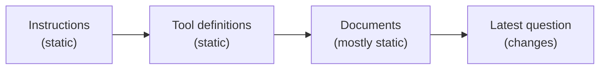
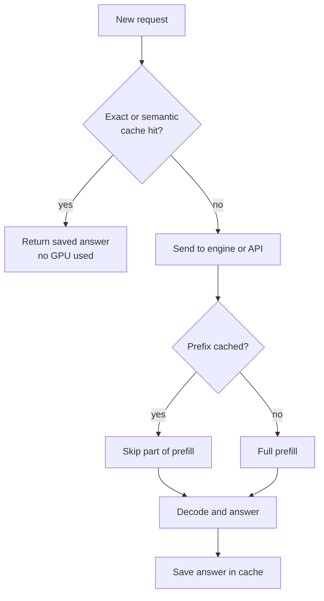

# Caching: Prefix, Prompt and Semantic

Every Tatkal booking page starts with the same header, the same train list and the same footer. Nobody rebuilds those for each user. LLM requests also repeat large parts: the same system prompt, the same tool list, the same policy document. Caching avoids paying for that repeated work again.

## What it is

There are three different caches in LLM systems. They work at different layers and are often confused.

| Cache | What it stores | Match rule | Where it lives |
|---|---|---|---|
| **Prefix cache** (KV reuse) | KV cache of an earlier prompt's beginning | Exact same token prefix | Inside the serving engine |
| **Provider prompt caching** | The same idea, offered as an API feature with a price discount | Exact same prefix | At the model provider |
| **Semantic cache** | Complete answers to earlier questions | Similar meaning (by embeddings) | In your app or gateway |

## Prefix caching in the engine

Remember that prefill is expensive for long prompts. If a new request starts with the same tokens as an earlier one, the engine can reuse the stored KV cache and skip recomputing that part.

vLLM's Automatic Prefix Caching does this (enabled with `enable_prefix_caching=True`). Its docs say it helps with:

- many questions over one long document
- multi-turn chat, where earlier history is reused

It speeds up only prefill. If most time goes to generating long answers, the gain is small. SGLang's RadixAttention is another KV reuse design. Its paper reports up to 6.4 times higher throughput than other systems on workloads such as multi-turn chat and agent control.

vLLM also exposes counters (`vllm:prefix_cache_queries` and `vllm:prefix_cache_hits`) so you can calculate your hit rate.

## Provider prompt caching

Hosted APIs offer the same idea. The shared facts, from Anthropic's and OpenAI's docs (as of November 2026):

- The cache hit needs an **exactly identical prefix**. One changed character early on breaks the match for everything after it.
- Cached input is billed at a fraction of normal input price, and there is a minimum prefix length that varies by model.
- Entries expire. Anthropic's default lifetime is 5 minutes, refreshed on each use, with a 1-hour option at a higher write cost. OpenAI lists its own retention options.
- Anthropic charges a premium to write the cache (1.25 times base input for the 5-minute option) and a discount to read it. The read multiplier differs by model, so check the current price page.
- Anthropic returns `cache_creation_input_tokens` and `cache_read_input_tokens` in the response usage. If both are zero, the prompt was not cached, and falling below the minimum length is the most common reason.

**Prompt design rule:** put stable content first (instructions, tool definitions, reference documents) and changing content last (timestamp, user name, current question). OpenAI's guide says the same. Append new turns instead of rewriting old ones.

*Figure: a cache-friendly prompt. Static parts first, changing parts last.*

## Semantic caching

A **semantic cache** stores whole answers. When a new question arrives, it converts the question to an embedding (a list of numbers capturing meaning), searches for a similar earlier question, and returns the old answer if the match is close enough. GPTCache is an open-source example of this approach.

The risk is real. GPTCache's own docs list false positives (a wrong answer returned for a different question) and false negatives. The similarity threshold needs careful tuning. Vector search itself is covered in [Chapter 7](../../module-3/07-rag-architectures.md).

*Figure: layered caching. The answer cache is checked first, prefix cache second.*

## When to use what

| Use case | Best fit |
|---|---|
| Same big system prompt on every call | Prefix or provider prompt caching |
| Long document with many follow-up questions | Prefix or provider prompt caching |
| FAQ-style, public, non-personal questions | Semantic cache, with a strict threshold |
| Personalised, time-sensitive or permission-controlled answers | Avoid semantic caching, or scope it per user |

## Common mistakes

- Putting the current time or a user ID at the top of the prompt, which breaks the prefix.
- Serving a cached answer to a user who should not see that data. Scope caches by tenant.
- Setting the semantic threshold too loose and returning wrong answers.

> [!TIP]
> **Key takeaways**
> - Prefix caching reuses the KV cache of a repeated prompt start. It saves prefill time and cost, not decode.
> - Provider caching needs an identical prefix. Put static text first, changing text last.
> - Semantic caching returns saved answers for similar questions. It is fast but can be wrong, so use it carefully.
