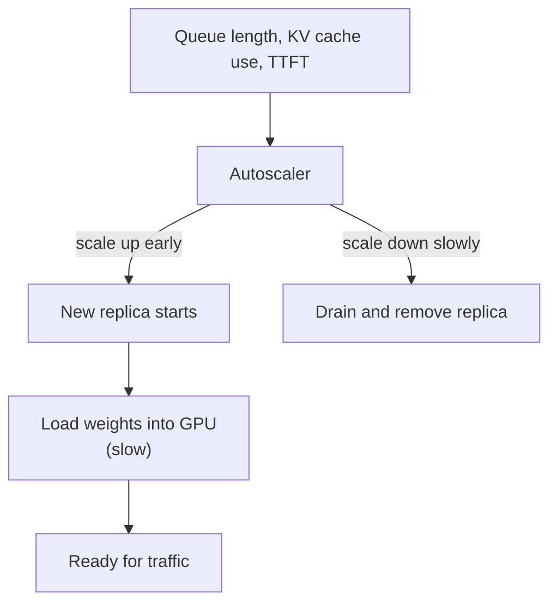
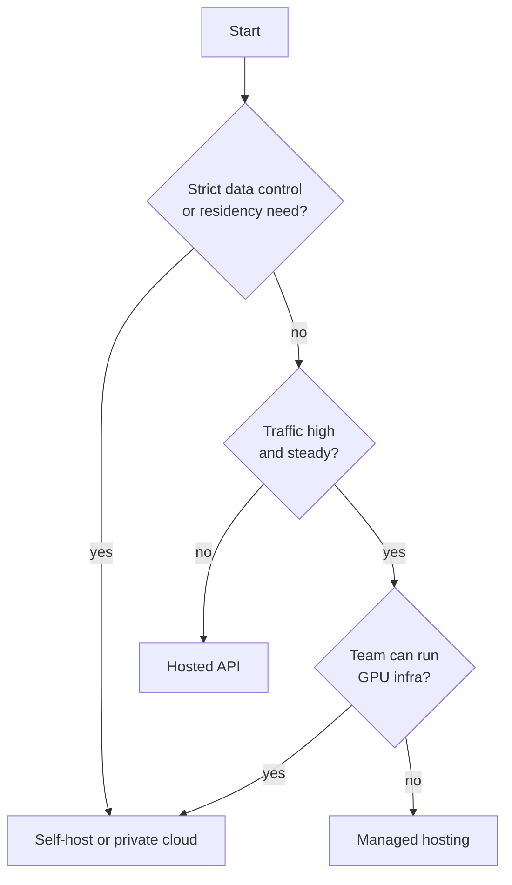

# Autoscaling, Cost Control and Build vs Buy

A GPU is like a taxi on rent. If you hire too few, customers wait. If you hire too many, you pay for taxis standing idle. The art is matching the number of GPUs to the traffic, and deciding whether to rent from a provider or own the fleet.

## Autoscaling GPU replicas

**Autoscaling** adds or removes serving replicas as traffic changes. General ideas are in [Chapter 3](../../module-1/03-reliability.md). LLMs add three twists.

**1. CPU and memory are poor signals.** vLLM pre-allocates a fixed share of GPU memory for the KV cache at start-up (`gpu_memory_utilization`), so memory use stays flat whatever the load. Use the engine's own metrics instead. vLLM exposes, among others:

| Metric | Meaning |
|---|---|
| `vllm:num_requests_waiting` | Requests queued, not yet running |
| `vllm:num_requests_running` | Requests being processed |
| `vllm:kv_cache_usage_perc` | Share of KV cache blocks in use (0 to 1) |
| `vllm:time_to_first_token_seconds` | TTFT histogram |

A growing queue or a nearly full KV cache means you need more replicas. Rising TTFT is the symptom users feel.

**2. Kubernetes can scale on custom metrics.** The Horizontal Pod Autoscaler (HPA) supports resource, custom and external metrics, and checks every 15 seconds by default. It also has a stabilisation window for scale-down, so replicas do not flap. Teams often feed engine metrics to HPA via a metrics adapter, or use tools such as KEDA. GPU nodes themselves are added by a node autoscaler.

**3. Cold starts are slow.** A new replica must get a GPU, pull a large container image, and load many GB of weights into GPU memory before it can serve. Reports on how long this takes vary a lot, so measure it for your model.



*Figure: because start-up is slow, scale up early and scale down slowly.*

Practical rules:

- Keep a minimum number of warm replicas for latency-sensitive traffic.
- Scale up on the queue, not after TTFT has already broken.
- Drain a replica before removing it, so running streams finish.

## Cost control

Your cost per million tokens depends mostly on how busy the GPU is.

```text
cost per million tokens = GPU cost per hour / (tokens per hour / 1,000,000)
```

*Example (all numbers assumed):* a GPU costs Rs 250 per hour and, with good batching, produces 2,000 output tokens per second. That is 7.2 million tokens per hour, so Rs 250 / 7.2 = about Rs 35 per million tokens. If traffic is so low that the GPU is only 25% busy, you still pay Rs 250 per hour, and the same maths gives about Rs 139 per million tokens. Utilisation decides the price.

Cost levers, from cheapest to try:

| Lever | Idea | Page |
|---|---|---|
| Shorter prompts and capped output | Fewer tokens in and out | [Tokens](01-tokens-and-context-windows.md) |
| Prompt and prefix caching | Do not pay twice for the same prefix | [Caching](09-caching.md) |
| Route easy work to a small model | Right-size the model | [Routing](08-llm-gateways-and-routing.md) |
| Quantisation | Fit on fewer GPUs | [Quantisation](05-quantisation-and-speculative-decoding.md) |
| Batching and high utilisation | Share the weight read | [Batching](04-batching-and-paged-attention.md) |
| Batch APIs for non-urgent work | Anthropic's Message Batches API cuts cost by 50 percent, and most batches finish within an hour (as of November 2026) | |

## Build vs buy

| Option | Good when | Watch out for |
|---|---|---|
| **Hosted API** (pay per token) | Low or spiky traffic, need top-quality models, small team | Per-token cost at high volume, data leaves your boundary, provider limits |
| **Managed hosting of open-weights models** | Want open models without running GPUs | Vendor lock-in, less tuning control |
| **Self-host** (vLLM, SGLang on your GPUs) | High steady traffic, strict data control, custom models or fine-tunes, tight latency control | You own on-call, upgrades, scaling, and idle GPU cost |

For self-hosting engines, Hugging Face has put its TGI into maintenance mode and recommends vLLM and SGLang going forward (TGI docs, as of November 2026). Engines move fast, so re-check before choosing.



*Figure: a simple decision path. Real decisions also depend on model quality needs.*

**Do the break-even maths with your own numbers:** expected tokens per month x API price, against GPU cost + engineers' time + idle capacity. Many teams start with an API, add a gateway so models can be swapped, and move steady heavy workloads to self-hosting only when the numbers justify it.

> [!TIP]
> **Key takeaways**
> - Autoscale on queue length, KV cache use and TTFT, not on CPU or memory. Scale up early because cold starts are slow.
> - Cost per token falls as GPU utilisation rises. Batching, caching and right-sized models are the main levers.
> - Start with an API behind a gateway. Self-host when volume, privacy or latency control make the maths work.
