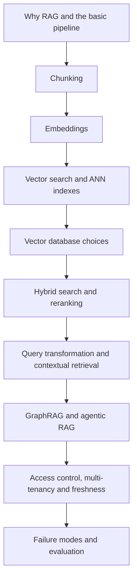

# Chapter 7: Advanced RAG Architecture Patterns

A large language model (LLM) knows only what it saw during training. It does not know your company policies, yesterday's orders or the PDF your customer just uploaded. Retrieval-Augmented Generation (RAG) fixes this. Before the model answers, the system looks up the right facts and puts them in the prompt.

Think of an open-book exam. The student (the LLM) is clever, but the marks depend on finding the right page quickly. Most of RAG engineering is about finding that page: cutting documents well, searching them well, and keeping the library correct and secure.

In the AI era, RAG is the default way to connect a model to private and changing data. Almost every enterprise assistant uses some form of it. A basic RAG demo takes an afternoon. A RAG system that is accurate, fast, safe and fresh takes real architecture. This chapter covers that gap.

*Figure: The chapter moves from the basic pipeline, to better retrieval, to advanced patterns, to running RAG in production.*

## What you will learn

- **Why RAG and the basic pipeline:** when to use RAG, and the ingest and query flow.
- **Chunking:** how to cut documents so that search finds the right piece.
- **Embeddings:** how text becomes vectors, and how to pick and size a model.
- **Vector search and ANN indexes:** HNSW, IVF and quantisation, and the memory maths.
- **Vector database choices:** pgvector, dedicated vector stores and search engines compared.
- **Hybrid search and reranking:** BM25 plus vectors, rank fusion and cross-encoders.
- **Query transformation and contextual retrieval:** rewrite the question, enrich the chunk.
- **GraphRAG and agentic RAG:** for whole-corpus questions and multi-step search.
- **Access control, multi-tenancy and freshness:** who may see what, and how new data gets in.
- **Failure modes and evaluation:** where RAG breaks, and how to measure it.

This chapter covers retrieval systems. Serving the LLM itself is in [Chapter 6](../module-3/06-llm-serving.md). Deep evaluation is in [Chapter 12](../module-5/12-evaluation-safety.md), and agents are in [Chapter 8](../module-4/08-agentic-architectures.md).
