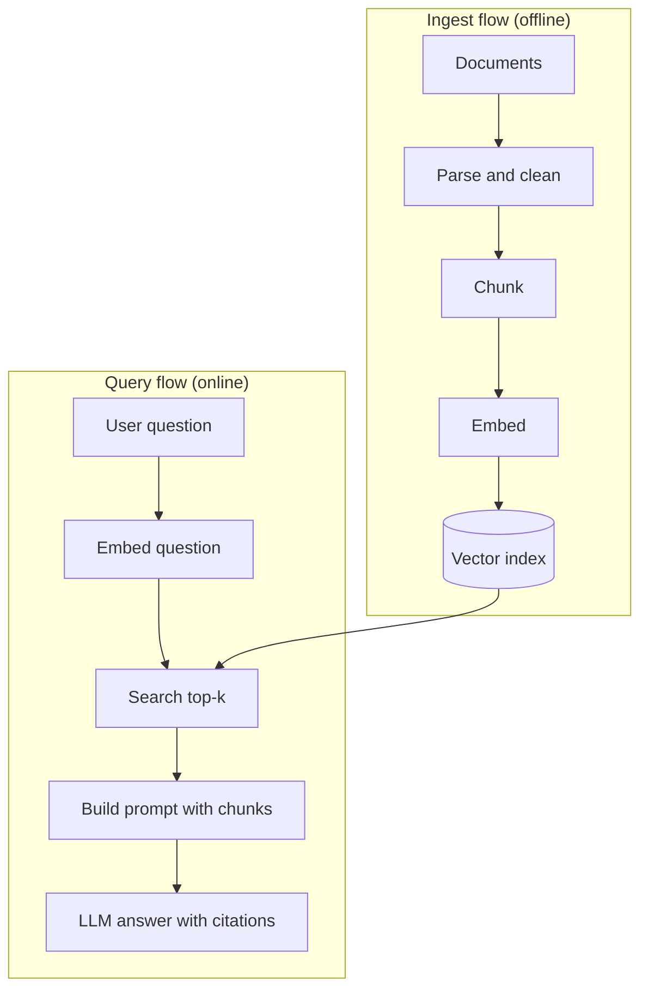

# Why RAG and the Basic Pipeline

Imagine asking a very smart friend about your company's leave policy. He is clever, but he has never seen your policy document. He will guess. Give him the document first, and he will answer correctly. RAG does exactly that, for every question.

## What it is

Retrieval-Augmented Generation (RAG) is a pattern where the system first retrieves relevant text from an external source, and then asks the LLM to answer using that text. The term comes from a 2020 paper by Lewis et al., which combined a generator model with a searchable index of Wikipedia.

AWS lists four reasons teams use RAG:

- **Cost:** adding your own knowledge does not need retraining a large model.
- **Current information:** the model can use data newer than its training cut-off.
- **Trust:** answers can carry citations that the user can check.
- **Control:** developers can change sources and limit retrieval by user permission.

## How it works

RAG has two flows. The **ingest flow** runs ahead of time and prepares the library. The **query flow** runs on every question.

*Figure: Ingest prepares searchable chunks. Query finds the best chunks and hands them to the LLM.*

Step by step:

1. **Parse and clean:** pull text out of PDFs, web pages, tickets and so on.
2. **Chunk:** split long text into smaller pieces (next page).
3. **Embed:** turn each chunk into a vector, a list of numbers that captures meaning.
4. **Index:** store the vectors and the original text, plus metadata such as source and date.
5. **Retrieve:** embed the question and fetch the top-k closest chunks (k is how many you keep, often 5 to 20).
6. **Generate:** put the chunks in the prompt and ask the model to answer only from them.

## When to use what

RAG is not the only way to give a model knowledge.

| Option | Good for | Weak at |
|---|---|---|
| Put everything in the prompt | Small knowledge bases | Cost and latency grow with size |
| RAG | Large or changing private data, citations | Needs a retrieval system to build and tune |
| Fine-tuning | Style, format, behaviour | Poor for facts that change; no easy citations |
| Tools and live APIs | Real-time data like order status | Needs a known API for each need |

For small data, skip RAG. Anthropic advised in September 2024 that a knowledge base under about 200,000 tokens (roughly 500 pages) can go straight into the prompt. Context windows keep changing, so check the limit for your model. Prompt caching also makes repeated long prompts cheaper. See [Chapter 6](../../module-3/06-llm-serving.md) for caching and context windows.

Even with big windows, more text is not always better. The "Lost in the Middle" study (Liu et al.) found that models use information best at the start and end of a long input, and worse in the middle. Sending fewer, better chunks is often safer than sending everything.

## In the AI era

Most real systems mix these options. An assistant may use RAG for policy documents, a tool call for order status, and a tuned model for tone. RAG is one building block of the "augmented LLM" that Anthropic describes in its agent guidance, where the model is given search, tools and memory. Agents are covered in [Chapter 8](../../module-4/08-agentic-architectures.md).

## Common mistakes

- Building RAG when the data fits in the prompt.
- Skipping metadata (source, date, owner). You will need it for filters and citations.
- Treating retrieval as solved because the demo worked on five documents.

> [!TIP]
> **Key takeaways**
> - RAG = retrieve relevant text first, then let the LLM answer from it.
> - Two flows: offline ingest (parse, chunk, embed, index) and online query (embed, search, prompt, answer).
> - RAG suits large or changing private data. Small data can go straight into the prompt.
