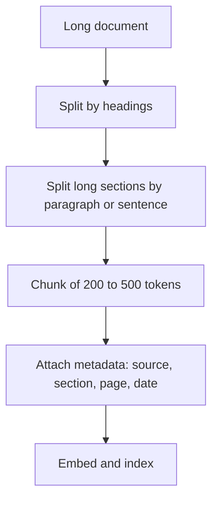
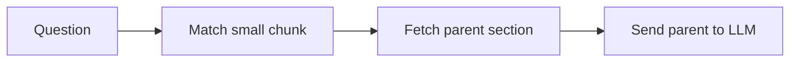

# Chunking

You cannot hand a 300-page manual to a search index and expect a precise answer. You cut it into pieces first. How you cut decides what search can find.

## What it is

Chunking means splitting documents into smaller pieces (chunks). Each chunk is embedded and stored on its own. At query time, the system retrieves chunks, not whole documents.

There is a tension:

- **Too small:** a chunk loses context. "It increased by 20%" means nothing without knowing what "it" is.
- **Too big:** one chunk holds many topics, so its vector is a blurry average. It also wastes prompt space.

## How it works

Common strategies, from simple to smart:

| Strategy | Idea | Notes |
|---|---|---|
| Fixed-size | Cut every N tokens | Simplest. Pinecone's guide suggests starting here |
| Recursive | Split on paragraph, then sentence, then word, until it fits | Respects natural breaks |
| Structure-aware | Use headings, tables, code blocks, HTML or Markdown tags | Best for well-formed documents |
| Semantic | Start a new chunk where the topic shifts, found by embedding similarity | Experimental; costs more |
| LLM-based | Ask an LLM where to split | Highest cost |

Overlap means repeating a few tokens between neighbouring chunks, so an idea cut at the boundary appears in both.

*Figure: A typical chunking flow keeps structure first and size second.*

### What the evidence says

Chroma's July 2024 study compared several splitters on five small text sets. Their findings:

- The choice of strategy changed recall by up to 9%.
- Recursive splitting at 200 tokens with no overlap did well across metrics.
- The default of one popular assistant product (800-token chunks, 400 overlap) scored below average on recall and lowest on the other metrics.
- An LLM-based chunker and a clustering-based semantic chunker had the highest recall (0.919 and 0.913), but they need extra model or embedding calls.

These numbers come from one study and its datasets. Treat them as a hint to test, not as a rule.

### Small to retrieve, big to read

A useful trick is to decouple the chunk you search from the chunk you send. LlamaIndex documents two forms: embed a short sentence, then expand to a window of neighbouring text; or embed a document summary that points to the full chunks. This is often called "parent-child" or "small-to-big" retrieval.

*Figure: Search finds the small chunk. The LLM reads the bigger parent.*

## When to use what

- Start with recursive or structure-aware splitting at a few hundred tokens.
- Pinecone suggests trying about 128 to 256 tokens for fine detail and 512 to 1024 for more context. Test both on real questions.
- Do not chunk very short items such as chat messages or tweets.
- Keep tables and code blocks whole where you can.
- Always store the source, section title and page with each chunk. Citations depend on it.

## Common mistakes

- Using one chunk size for all document types. Legal PDFs, FAQs and code need different rules.
- Splitting mid-table or mid-sentence.
- Never testing. Build a small set of real questions and compare two or three settings.

> [!TIP]
> **Key takeaways**
> - Chunking sets the ceiling of what retrieval can find. Test it on your own data.
> - Start simple: recursive or structure-aware, a few hundred tokens, light or no overlap.
> - Search small chunks but send larger parents when the LLM needs context.
