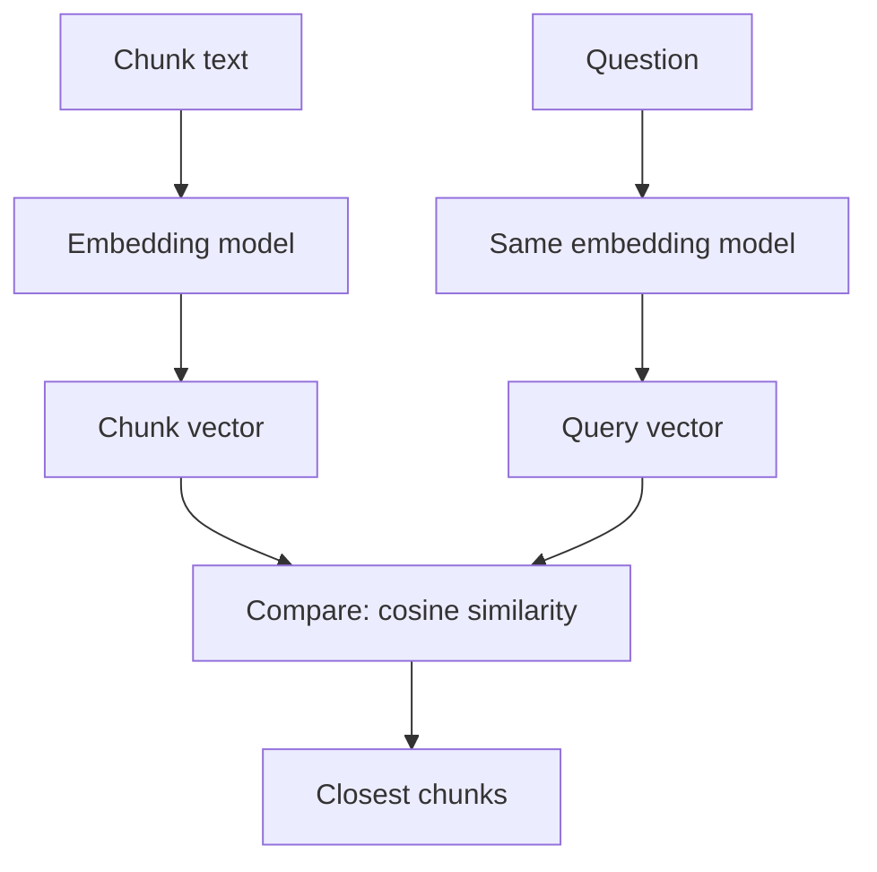

# Embeddings

A librarian can find a book on "monsoon flooding" even if the title says "heavy rain damage". She understands meaning, not just words. Embeddings give search the same skill.

## What it is

An embedding is a list of numbers (a vector) that represents the meaning of a piece of text. An embedding model produces it. Texts with similar meaning get vectors that are close together. Closeness is measured with a distance or similarity score, most often cosine similarity.

Typical vectors have hundreds to a few thousand numbers. This count is the **dimension**. For example, OpenAI documents default sizes of 1536 for `text-embedding-3-small` and 3072 for `text-embedding-3-large`.

## How it works

Most RAG systems use a **bi-encoder**. It embeds the query and each chunk separately, so chunk vectors can be computed once, ahead of time. At query time, only the question is embedded.

*Figure: Query and chunks must be embedded by the same model, so their vectors live in the same space.*

Points to remember:

- **Same model on both sides.** Elastic's docs state that query and document vectors must have the same dimensions and come from the same model. Change the model, and you must re-embed everything.
- **Query and document roles.** Some models are trained for different roles. Cohere's API has an `input_type` field with `search_query` and `search_document`, so you tell it which side you are embedding.
- **Input limit.** OpenAI lists a maximum of 8192 input tokens for its embedding models. Chunks must fit.
- **Normalised vectors.** OpenAI embeddings are normalised to length 1, so cosine similarity equals the dot product, and the ranking matches Euclidean distance.

### Smaller vectors, lower cost

Vector size drives storage, memory and search speed. Two ways to reduce it:

- **Shortened (Matryoshka-style) embeddings.** These models are trained so the first dimensions carry the most information. You can cut the vector short. Hugging Face reports one experiment where 8.3% of the size kept 98.37% of the performance. OpenAI's `dimensions` parameter and Cohere's `output_dimension` offer this for supported models. If you shorten manually, normalise the vector again.
- **Compression.** Store numbers as int8 or binary instead of 32-bit floats. See [the next page on indexes](04-vector-search-and-indexes.md).

## How to pick a model

| Question | What to check |
|---|---|
| Language | Do your users write Hindi, Hinglish or other languages? Test with those |
| Domain | Legal, medical or code text may need a domain-tuned model |
| Size and cost | Dimension, price per token, speed |
| Hosting | API (easy) or self-hosted (data stays with you) |
| Quality | Public leaderboards, then your own test set |

MTEB (Massive Text Embedding Benchmark) is the common public leaderboard. Hugging Face notes that rankings depend on the task and dataset, so an overall average may not match your use case. Leaderboards also change often. Use them to shortlist, and then compare two or three models on your own questions.

## In the AI era

Embeddings also power semantic caching, memory for agents and recommendation systems. The same ideas appear in [Chapter 5](../../module-2/05-feature-stores.md) for recommenders. Plan for model change from day one: store the model name and version with every vector, so you can re-embed in the background and switch over safely.

## Common mistakes

- Mixing vectors from two models in one index.
- Choosing by leaderboard rank alone.
- Ignoring the cost of re-embedding millions of chunks when the model changes.

> [!TIP]
> **Key takeaways**
> - An embedding turns text into a vector so that similar meaning means close vectors.
> - Use the same model for queries and chunks. A model change means re-embedding.
> - Shorter or compressed vectors cut cost. Test the quality loss on your data.
