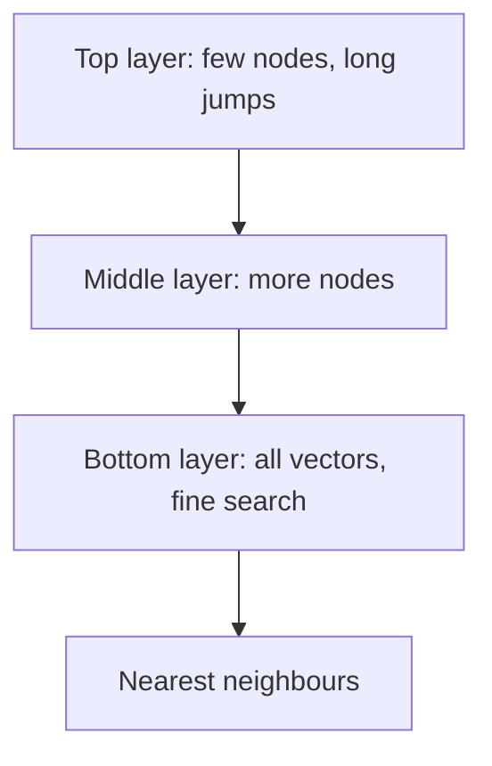

# Vector Search and ANN Indexes

Finding the closest vectors among 10 million is like finding the nearest chai stall in a big city. You can check every stall (slow and exact), or use a map that jumps you to the right neighbourhood first (fast and approximate).

## What it is

Vector search returns the k vectors closest to a query vector. The exact way is **brute force**: compare the query with every stored vector. This is called a flat index. It is perfectly accurate, but its cost grows with the data. FAISS, Meta's open-source similarity search library, advises a flat index when you have few searches or need exact results.

For larger data, systems use **Approximate Nearest Neighbour (ANN)** indexes. They may miss a true neighbour now and then, but they are much faster. The quality is measured by **recall**: of the true top-k, how many did you return?

## How it works

Three ideas cover most indexes.

### HNSW (graph)

Hierarchical Navigable Small World builds layers of graphs over the vectors. The top layer is sparse and allows long jumps. Lower layers are denser. A search starts at the top, jumps close to the target, and then walks down to finer layers. Malkov and Yashunin's paper reports logarithmic scaling.

*Figure: HNSW search zooms in from a coarse layer to the full layer.*

Key knobs (names from FAISS and pgvector): `M` (links per node), `efConstruction` (effort when building), and `efSearch` (effort when querying). Higher values give better recall but cost memory, build time or latency. HNSW is fast and accurate, but uses more memory, and FAISS notes it does not support removing vectors.

### IVF (clusters)

Inverted File index groups vectors into clusters (cells) using k-means. A query is compared with the cluster centres, and only the nearest `nprobe` clusters are scanned. A true neighbour sitting in an unscanned cluster is missed. Raise `nprobe` for better recall at lower speed. IVF needs training on your data, and in pgvector the IVFFlat index should be created after the data is loaded.

### Quantisation (compression)

Quantisation stores vectors with fewer bits. This saves memory and speeds up comparison, with some loss of accuracy.

| Method | Idea | Size effect |
|---|---|---|
| Scalar (SQ) | float32 to 8-bit numbers | About 4x smaller (Qdrant) |
| Product (PQ) | Split the vector into parts, store a code for each part | Up to 64x (Qdrant) |
| Binary | 1 bit per dimension | 32x smaller (Qdrant) |

The standard fix for lost accuracy is **rescoring**: use the compressed index to pick extra candidates, then re-score them with the original full-precision vectors. Qdrant's docs show binary quantisation with rescoring and oversampling reaching 97 to 99% accuracy on a 3072-dimension OpenAI model, but only 71 to 91% on a 512-dimension one. Lower-dimension models lose more, so test on your data.

## Memory maths

*Example (assumed numbers):* 10 million chunks, 1024 dimensions, float32 (4 bytes each).

- Raw vectors: 10M x 1024 x 4 bytes = about 41 GB.
- HNSW adds links. FAISS gives roughly `d x 4 + M x 2 x 4` bytes per vector. With M = 32, that is 4352 bytes, so about 44 GB.
- Binary codes: 1024 bits = 128 bytes each, so about 1.3 GB, plus the original vectors if you keep them for rescoring.

Memory is usually the first limit you hit.

## Trade-offs

| Index | Speed | Recall | Memory | Notes |
|---|---|---|---|---|
| Flat | Slow at scale | Exact | Raw size | Good for small data |
| HNSW | Very fast | High | High | FAISS does not support removing vectors |
| IVF | Fast | Tunable | Lower | Needs training and `nprobe` tuning |
| IVF + PQ | Fast | Lower | Lowest | Large-scale; add rescoring |

A starting recipe from FAISS guidance: plenty of RAM means HNSW with M between 4 and 64; tight memory means IVF with PQ.

## Filters

Real queries have filters, such as "only documents from team HR". pgvector's README warns that with approximate indexes, the filter is applied after the index scan, so you may get fewer results than asked. It suggests partial indexes, partitioning, or iterative scans. Qdrant advises creating payload indexes on filter fields. Always test filtered queries, not just unfiltered ones.

> [!TIP]
> **Key takeaways**
> - Exact search is simple but slow at scale. ANN indexes trade a little recall for big speed.
> - HNSW (graph) is fast and memory hungry. IVF (clusters) is leaner. Quantisation shrinks vectors, and rescoring wins back accuracy.
> - Do the memory maths early, and test recall with real filters.
