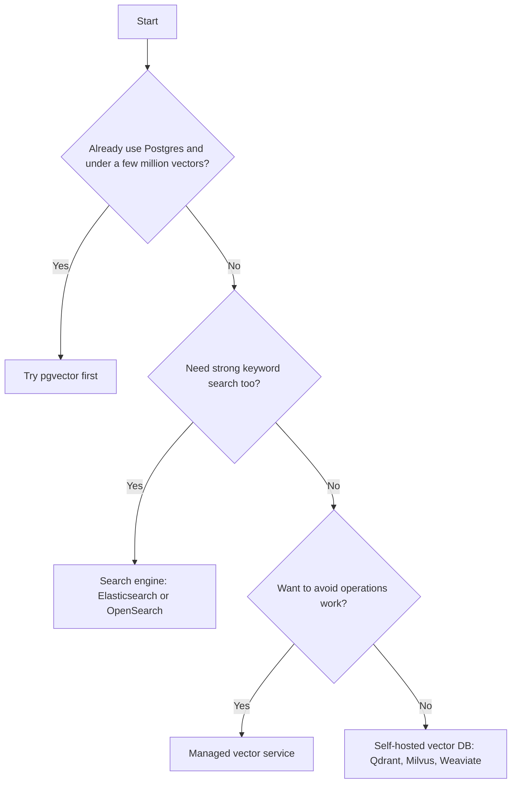

# Vector Database Choices

Choosing a vector store is like choosing where to keep your files: a folder on your laptop, a company drive, or a full document system. The right answer depends on size, team skills and what else you must run.

## What it is

A vector database stores embeddings with their text and metadata, builds an ANN index, and answers "top-k nearest" queries with filters. Options fall into four groups.

| Group | Examples | Idea |
|---|---|---|
| Extension on a database you already run | pgvector for Postgres | One system, one backup, SQL joins |
| Purpose-built vector databases | Qdrant, Milvus, Weaviate, Chroma | Vector features first, many index options |
| Search engines with vector support | Elasticsearch, OpenSearch | Strong keyword search plus vectors in one place |
| Managed vector services | Pinecone; Chroma Cloud and Qdrant Cloud are hosted versions of open-source stores | Less operations work |

This list is not complete, and products change fast. Read current docs before deciding.

## How it works

What each group documents (from vendor docs, last checked November 2026):

- **pgvector:** adds vector types and HNSW and IVFFlat indexes to Postgres. Operators cover L2, inner product and cosine distance. The README lists `halfvec` and binary quantisation to reduce size, and says to consider replicas or Citus for scale. The latest version I could verify was v0.8.7.
- **Qdrant:** recommends one shared collection for many tenants, filtered by a tenant field. Supports scalar, product and binary quantisation.
- **Milvus:** has three modes: Lite (a Python library for prototypes), Standalone (one machine) and Distributed (Kubernetes, aimed at billion-scale). Supports HNSW, IVF, FLAT, DiskANN and others, and can combine dense vectors with BM25 full-text search.
- **Weaviate:** runs vector and BM25 search together as hybrid search.
- **Chroma:** open source (Apache 2.0), runs locally, self-hosted or as Chroma Cloud. Offers vector, full-text and metadata filtering.
- **Elasticsearch:** per its docs, new indexes with float vectors of 384 or more dimensions use a quantised HNSW option (BBQ HNSW) by default. OpenSearch documents k-NN and hybrid queries.
- **Pinecone:** a managed service. Its docs describe namespaces, which partition records inside an index, for example one per customer.

*Figure: A rough decision path. It is a starting point, not a rule.*

The "few million" in the diagram is a rule of thumb, not a verified limit. Test with your own data and queries.

## Trade-offs

Compare on these axes, not on marketing pages:

- **Scale and memory:** how many vectors, what dimension, what index (see the previous page).
- **Filtering quality:** does recall hold when filters are selective?
- **Hybrid search:** is BM25 plus vectors built in?
- **Updates and deletes:** how fast do new chunks become searchable? Can you delete by document?
- **Multi-tenancy:** partitions, namespaces or filters?
- **Operations:** backups, upgrades, monitoring, and who gets paged.
- **Cost:** memory-heavy indexes cost more. Check pricing models, which differ by vendor.
- **Data location and compliance:** where does the data live? See [Chapter 10](../../module-4/10-security-governance.md).

## In the AI era

Vector search is becoming a feature of general databases and search engines, so the line between groups keeps blurring. Keep your own code behind a thin retrieval interface (store, search, delete). Then changing the store later is a migration, not a rewrite. For general database concepts like replication and sharding, see [Chapter 2](../../module-1/02-storage.md).

## Common mistakes

- Picking a new database for 50,000 vectors when Postgres would do.
- Comparing speed without checking recall.
- Forgetting deletes. When a document is removed, its chunks must go too.

> [!TIP]
> **Key takeaways**
> - Four groups: database extension, purpose-built, search engine, managed service.
> - Start with what you already run. Move only when scale, filtering or hybrid needs demand it.
> - Hide the store behind a small interface so you can change it later.
