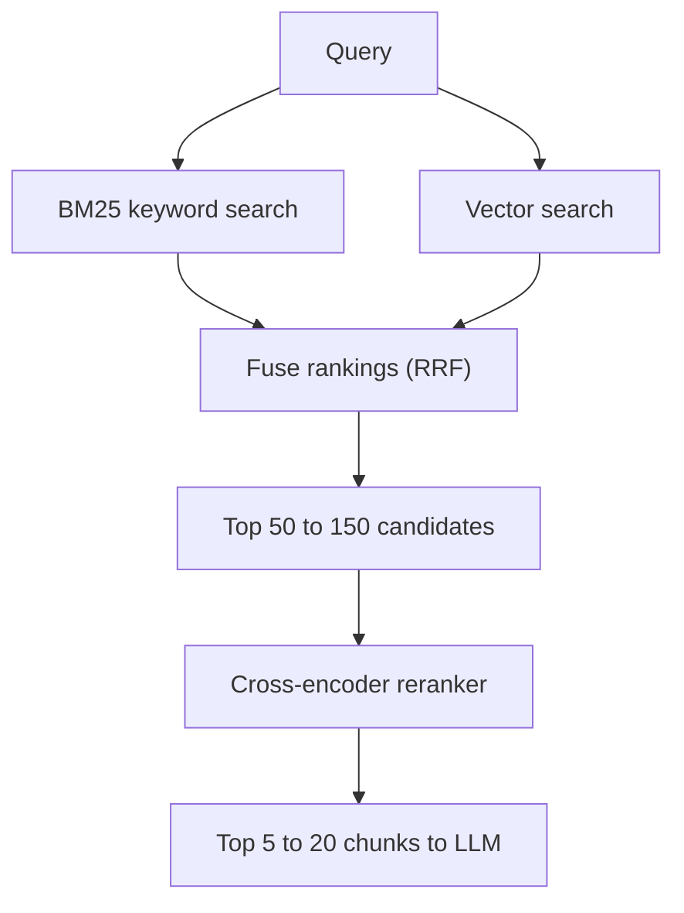

# Hybrid Search and Reranking

Search "Section 80C limit" in your tax notes. A meaning-based search may return general tax saving tips. A keyword search finds the exact "80C" page. Each method fails where the other succeeds, so good systems use both.

## What it is

- **Keyword (lexical) search** matches words. The classic scoring method is **BM25**. It rewards rare words (IDF), gives diminishing returns for repeated words (parameter k1, default 1.2 in Elasticsearch), and adjusts for document length (parameter b, default 0.75).
- **Vector (dense) search** matches meaning. It handles synonyms, but can miss exact codes, names and numbers.
- **Hybrid search** runs both and merges the results.
- **Reranking** takes the merged candidates and re-orders them with a stronger model.

## How it works



*Figure: Cast a wide net with two searches, then let a slower model pick the best few.*

### Merging: Reciprocal Rank Fusion

BM25 scores and vector scores sit on different scales, so adding them is tricky. **Reciprocal Rank Fusion (RRF)** ignores scores and uses only ranks. Each document gets 1 / (k + rank) from each list, and the scores are added. Elastic documents a default constant of 60 and cites Cormack et al. (SIGIR 2009).

```python
def rrf(result_lists, k=60):
    scores = {}
    for results in result_lists:          # each list is ordered best-first
        for rank, doc_id in enumerate(results, start=1):
            scores[doc_id] = scores.get(doc_id, 0) + 1 / (k + rank)
    return sorted(scores, key=scores.get, reverse=True)

print(rrf([["a", "b", "c"], ["b", "d", "a"]]))   # ['b', 'a', 'd', 'c']
```

A document ranked high in both lists beats one that is first in only one list. The other approach is a weighted sum of normalised scores. Weaviate offers both: `rankedFusion` and `relativeScoreFusion` (the default since v1.24), with an `alpha` setting from 0 (keyword only) to 1 (vector only). Its docs advise setting alpha explicitly.

### Reranking with a cross-encoder

The embedding model (bi-encoder) reads query and chunk separately. A **cross-encoder** reads them together and outputs one relevance score. It is more accurate, but too slow to run on millions of chunks. The Sentence Transformers docs describe the standard answer: retrieve about 100 candidates cheaply, then rerank only those.

This matches Anthropic's contextual retrieval tests (September 2024). They retrieved 150 chunks, reranked them with a Cohere reranker, and passed the top 20 to the model. They note that reranking adds latency, so the number of chunks reranked is a trade-off.

### What it buys you

In the same Anthropic tests, the top-20 retrieval failure rate fell from 5.7% (their baseline) to 2.9% with contextual embeddings plus contextual BM25, and to 1.9% with reranking added. Those figures are from their datasets. Your gains will differ, but the direction is common.

## When to use what

| Situation | Use |
|---|---|
| Prototype, plain-language questions | Vector search only |
| IDs, product codes, names, legal clauses | Add BM25 (hybrid) |
| Top results look "almost right" but order is poor | Add a reranker |
| Tight latency budget (for example voice) | Rerank fewer chunks, or skip |

## Common mistakes

- Reranking only 5 candidates. If the right chunk is not in the pool, a reranker cannot save it.
- Adding raw BM25 and cosine scores directly.
- Forgetting that reranking is another model call with its own latency and cost.

> [!TIP]
> **Key takeaways**
> - Keywords catch exact terms. Vectors catch meaning. Hybrid search uses both.
> - RRF merges ranked lists by rank, avoiding score-scale problems.
> - Rerank a wide candidate pool with a cross-encoder, then send only the top few chunks.
