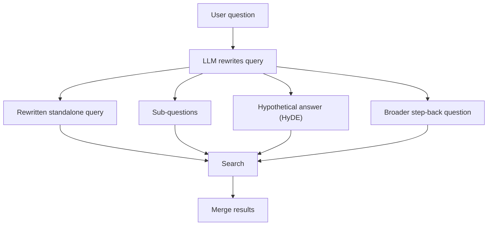
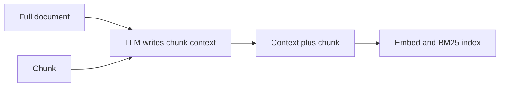

# Query Transformation and Contextual Retrieval

Users ask short, vague questions: "what about last year?". Documents are written in a different style. This page covers two fixes: improve the question before search, and improve the chunk before indexing.

## What it is

- **Query transformation:** rewrite or expand the user's question so retrieval works better.
- **Contextual retrieval:** add a short piece of context to each chunk before it is embedded, so the chunk makes sense on its own.

## How it works

### 1. Transform the query

*Figure: One question can become several better searches. The results are merged, for example with RRF.*

Common techniques:

- **Standalone rewrite.** In a chat, "and for gold loans?" depends on earlier turns. An LLM rewrites it as a complete question using the chat history. This is a design practice, and it is almost always needed in multi-turn chat.
- **Decomposition.** Split a compound question into parts and search each. The seven-failure-points paper (Barnett et al., 2024) gives an example: a question like "What are the key points covered in documents A, B and C?" is better asked as separate questions.
- **HyDE (Hypothetical Document Embeddings).** Gao et al. (2022) ask an LLM to write a hypothetical answer, even if it has wrong details, and embed that instead of the question. The answer looks more like real documents, so the nearest neighbours are better. The retrieved real text grounds the answer.
- **Step-back.** Zheng et al. (2023) first ask a more general question to get the underlying concept, then reason from it. It was proposed as a prompting method for reasoning, and the same idea can be used to widen a search.
- **Metadata extraction.** Turn "invoices from March" into a filter (month = March) plus a search for "invoices".

### 2. Enrich the chunk

A chunk such as "Revenue grew by 3% over the previous quarter" does not say which company or period. Contextual retrieval, published by Anthropic in September 2024, asks an LLM to write a short context for each chunk using the whole document, and prepends it before embedding and before building the BM25 index.

*Figure: The context is generated once, at ingest time, not at query time.*

Anthropic reported these top-20 retrieval failure rates, against a baseline of 5.7%:

| Setup | Failure rate | Reduction |
|---|---|---|
| Contextual embeddings | 3.7% | 35% |
| Plus contextual BM25 | 2.9% | 49% |
| Plus reranking | 1.9% | 67% |

These are the company's own results on its test sets. Prompt caching lets the document be loaded once for all its chunks. With their assumed sizes, they estimated a one-time cost of $1.02 per million document tokens (September 2024 figure).

## Trade-offs

| Technique | Helps with | Cost |
|---|---|---|
| Standalone rewrite | Follow-up questions | One small LLM call |
| Decomposition | Compound questions | More searches, more tokens |
| HyDE | Short or vague queries | LLM latency; a wrong guess can mislead |
| Contextual chunks | Ambiguous chunks | Ingest-time LLM cost; no query latency |

Query rewriting adds latency on every request. Contextual retrieval adds cost once, at ingest. If speed matters most, prefer the second.

## Common mistakes

- Rewriting every query, even clear ones. Rewrite only when needed, or use a cheap model.
- Letting the rewriter invent facts or drop key terms such as IDs.
- Not logging the rewritten query. You will need it when debugging.

> [!TIP]
> **Key takeaways**
> - Rewrite, split or expand the question when users are vague or chat history matters.
> - Contextual retrieval pays an LLM cost at ingest to make each chunk self-explanatory.
> - Log rewritten queries, and measure whether each step really helps.
