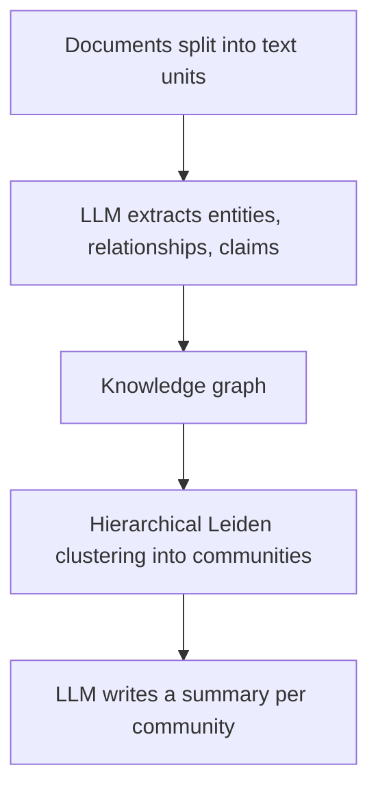
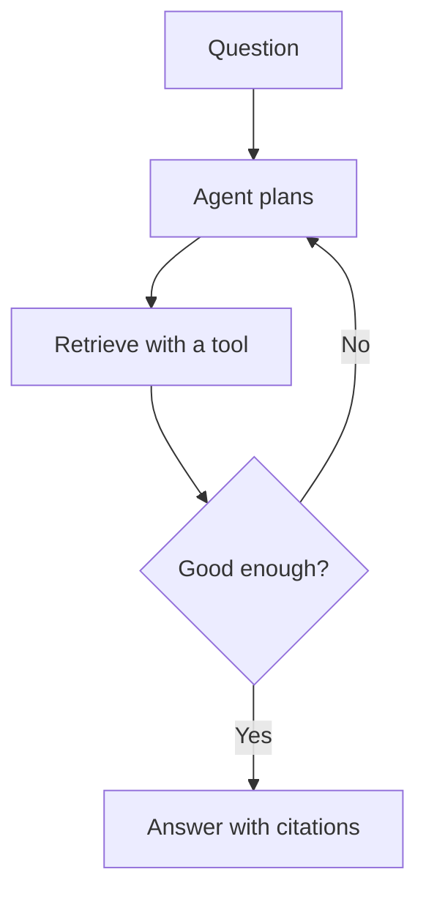

# GraphRAG and Agentic RAG

Basic RAG answers "what does clause 4 say?" well. It struggles with "what are the main themes across all 10,000 complaints?" or "which of our suppliers is linked to the delayed shipments?". Two patterns help here.

## What it is

- **GraphRAG** builds a knowledge graph (entities and their relationships) from your documents, and uses it, with summaries, for retrieval.
- **Agentic RAG** lets an LLM agent decide how to search: what to query, whether the results are good enough, and whether to search again.

## How it works

### GraphRAG

Microsoft's GraphRAG (introduced in a February 2024 post, with a paper titled "From Local to Global") targets two things that Microsoft says baseline RAG does badly: connecting the dots across pieces of information, and answering holistic questions about a whole dataset. Per the GraphRAG docs, indexing works like this:

*Figure: GraphRAG indexing. The expensive part is the LLM reading all the text.*

At query time there are modes:

- **Global:** answers whole-corpus questions using community summaries. The paper describes a map-reduce style: each summary gives a partial answer, and the partial answers are combined.
- **Local:** starts from specific entities and explores their neighbours.
- **DRIFT:** like local search, with community context added.
- **Basic:** plain vector top-k, for questions that do not need the graph.

The paper reports better comprehensiveness and diversity of answers than a conventional RAG baseline on global questions over datasets of around one million tokens.

The cost is clear: an LLM must process the whole dataset to build the graph, and the graph must be rebuilt or updated when data changes. Use GraphRAG when questions are about relationships or themes. For plain lookup questions, hybrid search with reranking is cheaper.

### Agentic RAG

In classic RAG, the flow is fixed: one retrieval, then one answer. Anthropic's agent guidance defines workflows as paths fixed by code, and agents as systems where the LLM directs its own process and tool use. Agentic RAG is the second kind.

*Figure: The agent loops until retrieval looks sufficient, within a step limit.*

A 2025 survey (Singh et al.) names four patterns agents bring to RAG: reflection, planning, tool use and multi-agent collaboration. Research examples:

- **Self-RAG** (Asai et al., 2023): a trained model decides when to retrieve and critiques its own output using reflection tokens.
- **Corrective RAG** (Yan et al., 2024): a retrieval evaluator scores the results, falls back to web search when they are weak, and filters out irrelevant parts.

With tool calling, the agent can choose between several sources: a vector index, a SQL database, a web search, or a graph. See [Chapter 8](../../module-4/08-agentic-architectures.md) for the agent loop and [Chapter 9](../../module-4/09-mcp.md) for exposing data sources as tools.

## Trade-offs

| Pattern | Best for | Cost and risk |
|---|---|---|
| Basic or hybrid RAG | Lookup questions | Cheap, fast, predictable |
| GraphRAG | Themes, relationships, multi-hop links | Heavy indexing cost; rebuild on change |
| Agentic RAG | Vague or multi-step questions, many sources | More LLM calls, higher latency, harder to test |

## Common mistakes

- Reaching for GraphRAG or agents before fixing chunking and hybrid search.
- Giving an agent no step limit. Loops can run up cost.
- Judging only the final answer, not the agent's searches.

> [!TIP]
> **Key takeaways**
> - GraphRAG builds a graph and community summaries for whole-corpus and relationship questions, at a high indexing cost.
> - Agentic RAG lets the model plan, search, check and retry. It adds latency and complexity.
> - Start simple. Add these patterns only when measured failures call for them.
