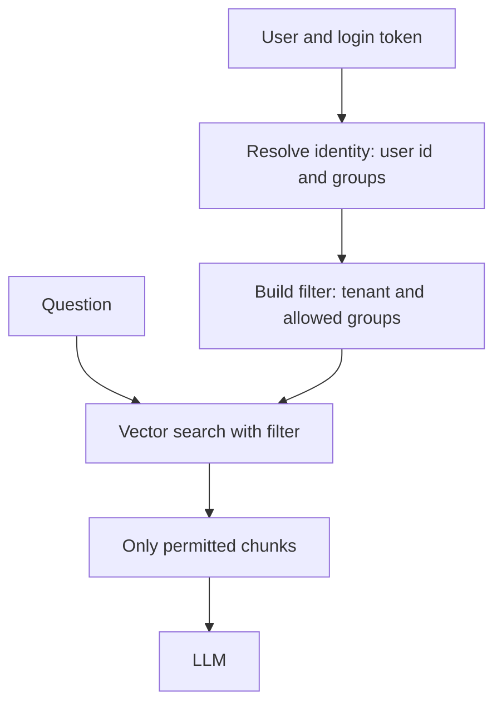
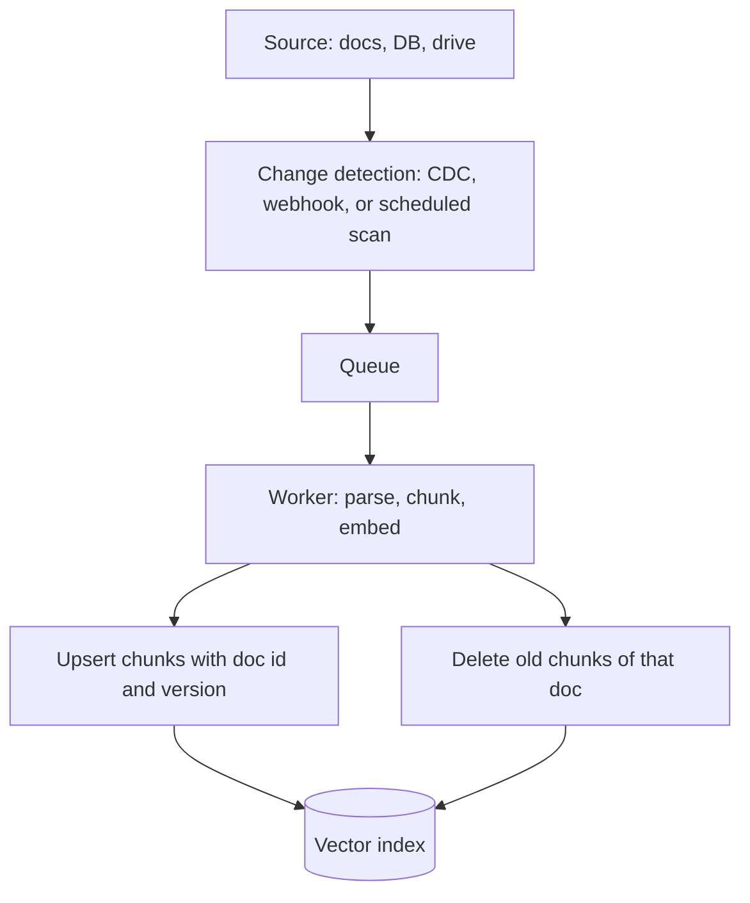

# Access Control, Multi-Tenancy and Freshness

A RAG assistant that shows one customer's salary sheet to another customer is worse than no assistant. And one that quotes last year's policy is almost as bad. The index must be right for the right person at the right time.

## What it is

- **Access control:** each user sees only the chunks they are allowed to see.
- **Multi-tenancy:** many customers (tenants) share one system, with their data kept apart.
- **Freshness:** changes in the source (new, edited or deleted documents) reach the index quickly and correctly.

OWASP's LLM Top 10 (2025 edition) lists this as LLM08, Vector and Embedding Weaknesses. It warns that weak access controls in RAG can expose personal or proprietary data, and that data can leak between users when many groups share one vector database. Its mitigations include permission-aware stores, strict logical partitioning and detailed retrieval logs.

## How it works

### Enforce permissions at retrieval, not in the prompt

Never rely on the prompt ("do not reveal HR files"). The LLM only sees what retrieval gives it, so filter before retrieval returns.

*Figure: The filter is built from the verified identity on the server, never from text the user typed.*

Azure AI Search documents this as the security filter pattern: store group or user IDs on each document in a filterable field, and add a filter with the caller's groups to every query. Its docs stress that the principal is just a string in a filter, so your application must supply the verified identity. Also, hiding a field from results is not a security mechanism.

Each chunk therefore carries `tenant_id` and `allowed_groups` metadata, copied from the source document's permissions at ingest.

### Isolation options

| Option | How | Notes from vendor docs |
|---|---|---|
| Filter on a tenant field | One shared index, filter every query | Qdrant recommends one shared collection for many small tenants |
| Namespace or partition per tenant | Separate partition inside an index | Pinecone: one namespace per customer |
| Dedicated shard or index | Stronger isolation | Higher cost; suited to few, large tenants |
| Database-level partitioning | For example list partitioning in Postgres | pgvector README mentions it for multi-tenant isolation |

pgvector adds a warning: approximate indexes apply filters after the index scan, so a strict filter can return fewer results than you asked for. Test selective filters and use iterative scans or partitions. Qdrant also notes that BM25 statistics can be shared across tenants in a shared collection unless you scope them.

Permissions change. When someone leaves a team, update chunk permissions quickly. Check permissions at retrieval time if the source of truth changes often.

### Freshness: the ingestion pipeline

*Figure: Every document change flows through a queue so that updates and deletes are handled the same way.*

Design points:

- **Detect changes.** Change data capture (CDC) tools such as Debezium stream row-level changes from databases. Others use webhooks or scheduled scans.
- **Skip unchanged content.** Store a content hash per document and re-embed only when it changes. This is a common design choice, not a vendor feature.
- **Handle deletes.** Keep a document-to-chunks mapping so you can remove all chunks of a deleted document.
- **Version the embedding model.** If you change models, build a new index and switch over, since old and new vectors cannot be mixed.
- **Know your lag.** Do not assume new chunks are searchable instantly. Measure the delay in your own store.
- **Show dates.** Store `updated_at` and show it in citations.

For queues and logs, see [Chapter 2](../../module-1/02-storage.md). For privacy rules and governance, see [Chapter 10](../../module-4/10-security-governance.md).

## Common mistakes

- Filtering in the UI after retrieval, so private text already reached the LLM.
- Forgetting to copy permission changes from the source system.
- Leaving deleted documents in the index.

> [!TIP]
> **Key takeaways**
> - Enforce permissions as a filter inside retrieval, using the verified identity.
> - Choose tenant isolation by size and risk: filter, namespace, or dedicated shard.
> - Build ingestion as a pipeline with change detection, hashing, deletes and a measured lag.
