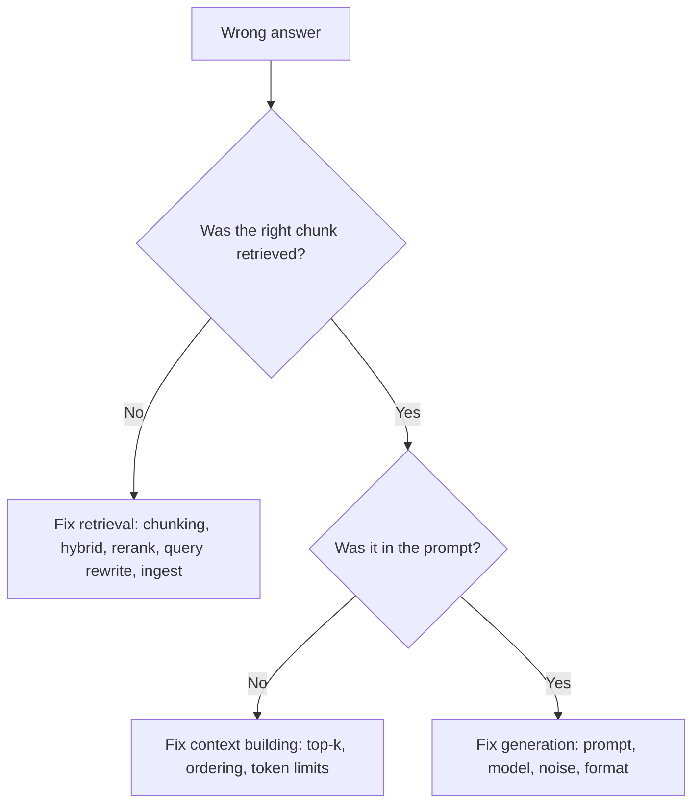

# Failure Modes and Evaluation

When a RAG answer is wrong, the cause is rarely "the LLM is bad". Usually retrieval returned the wrong text, or the right text never reached the prompt. To fix it, you need to know where it broke.

## What it is

- **Failure modes** are the common ways a RAG pipeline goes wrong.
- **Evaluation** is measuring each stage, retrieval and generation, so you can find and fix the weak one.

## How it works

### Seven failure points

Barnett et al. (2024) studied three real RAG projects and listed seven failure points:

| # | Failure point | Meaning |
|---|---|---|
| 1 | Missing content | The answer is not in the documents, yet the system answers anyway |
| 2 | Missed top-ranked documents | The answer exists but did not rank high enough |
| 3 | Not in context | Retrieved, but dropped before reaching the prompt |
| 4 | Not extracted | The answer is in the prompt, but the LLM missed it, often due to noise or conflicting text |
| 5 | Wrong format | The LLM ignored the requested table or list format |
| 6 | Incorrect specificity | The answer is too general or too detailed |
| 7 | Incomplete | The answer misses information that was in the context |

The authors' conclusion is useful: a RAG system can only be validated while running, and its robustness is built over time rather than designed in at the start.

*Figure: A simple debugging path. Always check the retrieved chunks first.*

Related causes to watch: the "lost in the middle" effect (Liu et al.) for long contexts, stale or deleted documents (see the previous page), and permission filters that remove the right chunk.

### Measure the two halves separately

Ragas, a RAG evaluation framework (Es et al., 2023), is described as reference-free, meaning many of its metrics do not need human-written answers. Its docs list these metrics:

| Metric | Stage | Plain meaning |
|---|---|---|
| Context precision | Retrieval | Are relevant chunks ranked above irrelevant ones? |
| Context recall | Retrieval | Did retrieval return everything needed? |
| Faithfulness | Generation | Are the answer's claims supported by the retrieved context? Computed as supported claims divided by total claims |
| Response relevancy | Generation | Does the answer address the question? |

Some of these use an LLM as a judge, which has its own weaknesses. [Chapter 12](../../module-5/12-evaluation-safety.md) covers judges, golden datasets and regression tests in depth.

### A minimum evaluation set

1. Collect 50 to 200 real questions from users (an *Example* size, grow it over time).
2. For each, note the document or chunk that holds the answer.
3. Measure retrieval alone: is the right chunk in the top-k? Compare changes (chunk size, hybrid, reranker) on this set.
4. Then measure answer quality and faithfulness.
5. Run it on every change, and add each production failure as a new test.

## In the AI era

Production RAG needs tracing: log the question, rewritten query, retrieved chunk IDs and scores, the final prompt and the answer. See [Chapter 11](../../module-5/11-observability.md). Also test "no answer" cases. Failure point 1 shows that a system should say "I don't know" when the documents do not contain the answer.

## Common mistakes

- Judging only by how the final answer reads.
- Changing three things at once, then not knowing which helped.
- Evaluating on easy, hand-picked questions.

> [!TIP]
> **Key takeaways**
> - Most RAG failures start in retrieval or context building, not in the LLM.
> - Evaluate retrieval and generation separately, using a small set of real questions.
> - Trace every request, and turn each production failure into a test case.
