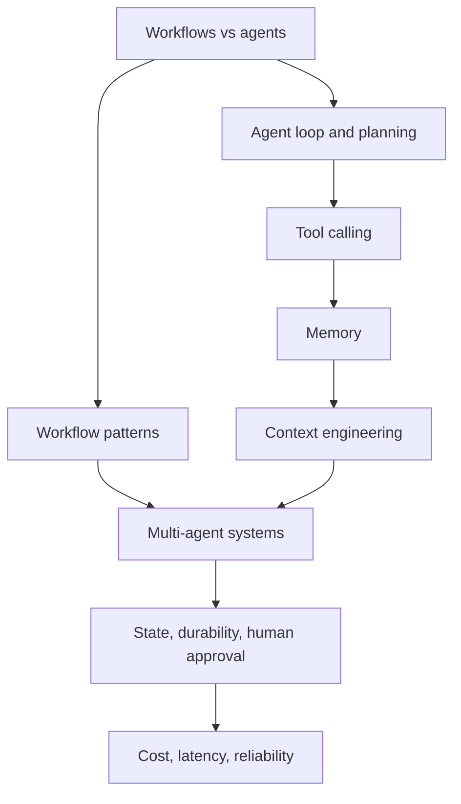

# Chapter 8: Agentic AI Architectures

A chatbot answers. An agent *does things*. It reads a ticket, looks up the order, checks the refund policy, and issues the refund. That jump from "answer" to "action" is why agentic systems are the big design topic of the AI era.

It is also where systems break in new ways. Every extra step costs money and time. Every wrong step can build on the last one. And the model, not your code, now decides what happens next.

This chapter teaches you to build agentic systems like an engineer, not like a magician. The main idea is simple: **use the least autonomy that solves the problem**. Start with a fixed workflow. Give the model more freedom only when you must.

You will see how an agent works inside (the loop, tools, planning, memory), how to control what it sees (context engineering), when several agents help and when they hurt, and how to make long jobs survive crashes and wait for human approval.

This chapter builds on [Chapter 6](../module-3/06-llm-serving.md) (how LLMs are served) and [Chapter 7](../module-3/07-rag-architectures.md) (retrieval). The next chapters go deeper on tool connectivity ([Chapter 9: MCP](09-mcp.md)) and safety ([Chapter 10](10-security-governance.md)).

*Figure: How the concepts in this chapter fit together.*

## What you will learn

- **Workflows vs Agents**: who controls the next step, your code or the model.
- **The Agent Loop and Planning**: ReAct-style loops, stop conditions, plan-and-execute.
- **Tool Calling**: how a model asks your code to act, and how to design good tools.
- **Workflow Patterns: Chaining, Routing, Parallelisation**: the simple building blocks.
- **Workflow Patterns: Orchestrator-Workers and Evaluator-Optimiser**: the two flexible blocks.
- **Memory**: short-term and long-term memory for agents.
- **Context Engineering**: keeping the context window small and useful.
- **Multi-Agent Systems**: when they help, when not to use them, and A2A in brief.
- **State, Durable Execution and Human Approval**: long jobs that survive crashes and pauses.
- **Cost, Latency and Reliability**: the trade-offs that decide if an agent ships.
