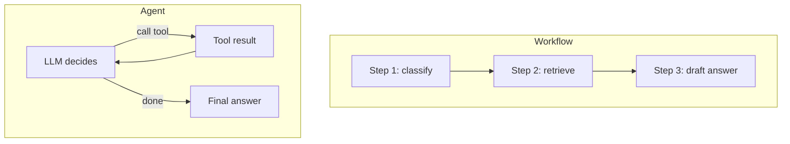
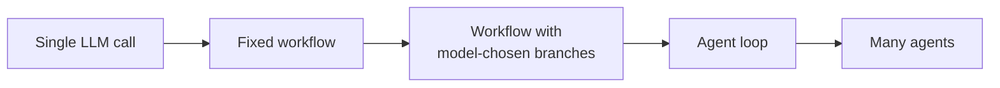

# Workflows vs Agents

Think of a railway ticket counter and a travel agent. At the counter, the clerk follows fixed steps: ask the train, ask the date, print the ticket. A travel agent listens to your goal, tries options, and changes plan when a train is full. Both are useful. They are not the same thing.

## What it is

Anthropic's widely used guide "Building effective agents" draws a clear line:

- **Workflow**: LLMs and tools are orchestrated through *predefined code paths*. Your code decides the next step.
- **Agent**: the LLM *directs its own process and tool use*, deciding the next step at run time.

Both are called "agentic systems". The difference is **who holds the steering wheel**.

*Figure: In a workflow the path is fixed in code. In an agent the model picks the path in a loop.*

## How to choose

The guide's advice is to find the simplest solution that works and add complexity only when it clearly improves results. Sometimes that means a single LLM call with good retrieval and a few examples. No agent needed.

| Question | Workflow fits | Agent fits |
|---|---|---|
| Can you list the steps in advance? | Yes | No, steps depend on what is found |
| How many steps? | Known, small | Unpredictable |
| Cost of a wrong step | High (money, legal) | Low or recoverable |
| Need for predictable latency | High | Can tolerate variation |
| Testing | Easier, fixed paths | Harder, many possible paths |

The same source says agents suit open-ended problems where you cannot hard-code a path. It also warns that agents bring higher cost and the chance of errors piling up, so you should test them in sandboxes with guardrails.

## A spectrum, not two boxes

Real systems sit on a spectrum of autonomy.

*Figure: More autonomy to the right. Start from the left and move right only when needed.*

Each step to the right gives you more flexibility. It also gives you more cost, more latency and less predictability. So move right slowly.

## Example

A bank wants to answer "Why was my UPI payment declined?"

- **Workflow version**: classify the question, fetch the transaction by ID, fetch the decline code, fill a template. Three known steps. Fast, cheap, easy to test.
- **Agent version**: needed only if cases vary a lot. The agent may check the transaction, then the account status, then a limits table, then a known-outage page, choosing each step by what it finds.

Start with the workflow. Add agent freedom only for the cases it cannot handle.

## Frameworks

Agent frameworks can help you start fast. The same guide cautions that their extra layers can hide the prompts and responses, which makes debugging harder. It suggests starting with direct API calls and understanding any framework code you use. This is a good habit for interviews too: explain the loop yourself before naming a library.

## Common mistakes

- Using an agent because it sounds modern, when a three-step workflow would do.
- Giving the model many tools and no stopping rule.
- Skipping evaluation. You cannot tell if more autonomy helped without a test set (see [Chapter 12](../../module-5/12-evaluation-safety.md)).

> [!TIP]
> **Key takeaways**
> - A workflow follows paths written in code. An agent chooses its own path at run time.
> - Use the simplest design that works. Add autonomy only when fixed steps cannot cover the cases.
> - More autonomy means more cost, more latency and harder testing.
