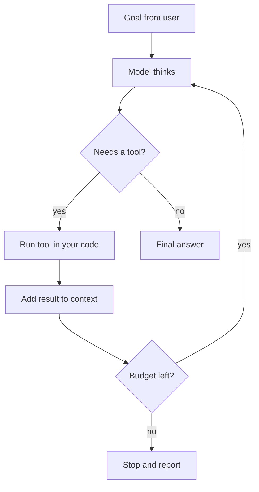
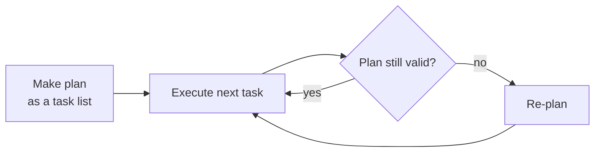

# The Agent Loop and Planning

Imagine a plumber fixing a leak. He looks, thinks "probably the joint", tightens it, looks again, and sees it still drips. So he tries another thing. He repeats until the leak stops. That "look, think, act, look again" cycle is the agent loop.

## What it is

An agent is an LLM running in a loop with tools. The best-known pattern is **ReAct** (Reasoning + Acting), from the paper by Yao et al., submitted in 2022 and published at ICLR 2023. The idea: let the model interleave short reasoning with actions. Reasoning helps it track and revise a plan. Actions let it fetch real information instead of guessing. The authors report fewer hallucinations than reasoning alone on question-answering tasks.

## How it works

Each turn follows the same cycle. The model thinks, picks an action (a tool call), your code runs it, and the result goes back into the context. Anthropic's documentation describes the same shape as a `while` loop that continues while the model asks for a tool and exits on any other stop reason.



*Figure: The agent loop with a budget check. Without the budget check, a confused agent can loop forever.*

A minimal version in Python, using the Anthropic SDK shape (a `tool_use` stop reason, then a `tool_result` block):

```python
MAX_STEPS = 10          # hard stop: never loop without a limit

def run_agent(client, model, tools, run_tool, user_goal):
    messages = [{"role": "user", "content": user_goal}]
    for _ in range(MAX_STEPS):
        reply = client.messages.create(
            model=model, max_tokens=1024, tools=tools, messages=messages)
        if reply.stop_reason != "tool_use":
            return reply                      # final answer (or other stop)
        results = []
        for block in reply.content:
            if block.type == "tool_use":
                out = run_tool(block.name, block.input)   # your code runs it
                results.append({"type": "tool_result",
                                "tool_use_id": block.id, "content": out})
        messages.append({"role": "assistant", "content": reply.content})
        messages.append({"role": "user", "content": results})
    raise RuntimeError("Agent hit the step limit")
```

## Stop conditions

A loop needs ways to end. Good agents have several:

- The model gives a final answer.
- A **step limit** (above) or a **token/cost budget**.
- A **time limit** for the whole run.
- A **human check-in** at a risky step (see the page on human approval).
- A repeat detector: same tool, same arguments, three times means stop.

Anthropic's guide also says agents should include stopping conditions to keep control.

## Planning

Pure ReAct decides one step at a time. For longer tasks, it helps to plan first. The Plan-and-Solve paper (ACL 2023) found that asking a model to first make a plan and then carry it out beat plain "think step by step" prompting on the reasoning tasks it tested.

In agent systems this becomes **plan-and-execute**:



*Figure: Plan first, then execute, and re-plan when reality differs.*

| Style | Good for | Weakness |
|---|---|---|
| ReAct (step by step) | Exploration, unknown terrain | Can wander; no overview |
| Plan-and-execute | Long tasks with clear parts | A wrong plan wastes work; needs re-planning |
| Plan visible to user | Trust and debugging | Extra tokens |

Anthropic's guide lists "make planning steps transparent" as a core principle. A plan written as a visible to-do list helps humans review it and helps the model stay on track across many steps.

## Common mistakes

- No step limit, or a limit with no clear failure message.
- Letting the loop keep every tool result forever, which fills the context window (see the context engineering page).
- Planning once and never checking if the plan still fits.

> [!TIP]
> **Key takeaways**
> - An agent is an LLM in a loop: think, act with a tool, observe, repeat.
> - Always add stop conditions: step limit, budget, time limit and repeat detection.
> - For long tasks, plan first, show the plan, and re-plan when results surprise you.
