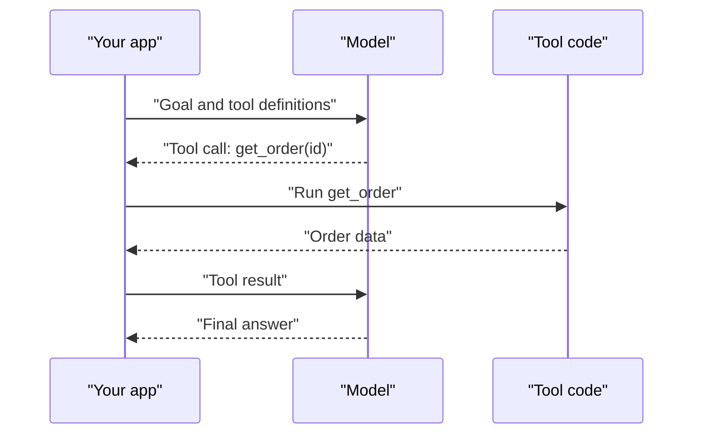
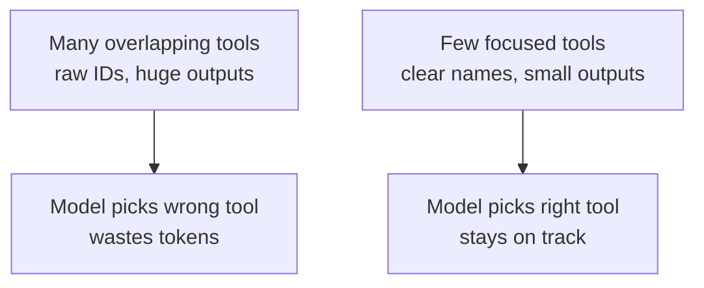

# Tool Calling

A model on its own can only produce text. It cannot check your order status or send an email. Tool calling is how it asks *your* code to do that work, like a customer filling a form at a counter and the clerk doing the actual task.

## What it is

Tool use (also called function calling) lets a model call functions that you define. According to Anthropic's documentation, the model never runs anything itself. It emits a structured request. Your code (or the provider's servers) runs the operation, and the result goes back into the conversation.

You describe each tool with a **name**, a **description** and an **input schema** (a JSON Schema listing the arguments).

## How it works



*Figure: One round trip of tool calling. The model asks, your code runs, the result returns.*

In Anthropic's API, the model replies with `stop_reason: "tool_use"` and one or more `tool_use` blocks. You send back `tool_result` blocks that carry the matching `tool_use_id`. A tool definition looks like this:

```json
{
  "name": "get_order_status",
  "description": "Get the status of one order. Use when the user asks where their order is. Needs the order ID, not the phone number.",
  "input_schema": {
    "type": "object",
    "properties": {
      "order_id": {"type": "string", "description": "Order ID, e.g. ORD-10293"}
    },
    "required": ["order_id"]
  }
}
```

## Where tools run

The docs group tools by where the code runs:

| Kind | Who runs it | Examples |
|---|---|---|
| Your own tools | Your application | Database query, internal API |
| Provider-defined schema, run by you | Your application | Shell, file editor, memory |
| Server tools | Provider's servers | Web search, code execution |

Details vary by provider, so check your vendor's docs.

## Useful controls

- **Tool choice**: let the model decide (auto), or force a tool call when you need one.
- **Parallel calls**: the model may ask for several independent tools in one turn. Run them together to save time. You can switch this off if order matters.
- **Strict schemas**: Anthropic offers a `strict` option so calls always match your schema. Other providers have similar features.
- **Errors**: return errors as tool results (Anthropic uses an `is_error` flag) so the model can recover instead of crashing the loop.

## Designing good tools

Tool quality often decides agent quality. Anthropic's engineering guidance on writing tools for agents says:

- **Do not just wrap every API endpoint.** Build a few tools for high-value jobs. Combine steps, for example one `schedule_event` that checks availability and books.
- **Name clearly**, with consistent prefixes for related tools.
- **Return meaningful, small outputs.** Use readable names rather than raw IDs, and add pagination, filtering and truncation.
- **Write errors that tell the model what to do next**, not just a code.
- **Describe tools like onboarding a new hire.** Make parameter names unambiguous (`user_id`, not `user`).

The "Building effective agents" guide adds a useful test: if a human cannot tell which tool to use from the descriptions, the model likely cannot either. It also suggests making mistakes hard, for example requiring absolute file paths so a changed working directory causes no errors.



*Figure: Tool design directly shapes agent behaviour.*

## In the AI era

Real systems may have dozens or hundreds of tools. Sending every definition on each call wastes tokens and confuses the model. Common answers are loading tools on demand (Anthropic offers a tool search tool for this) and a shared standard for connecting tools. That standard is [Model Context Protocol](../09-mcp.md), the subject of the next chapter.

> [!WARNING]
> Tool results are untrusted input. A web page or email returned by a tool can contain text that tries to give the model new instructions. See [Chapter 10](../10-security-governance.md).

> [!TIP]
> **Key takeaways**
> - The model only requests a call. Your code runs it and returns the result.
> - Good tools are few, clearly named, and return small, readable outputs.
> - Return errors as results so the agent can recover, and treat all tool output as untrusted.
