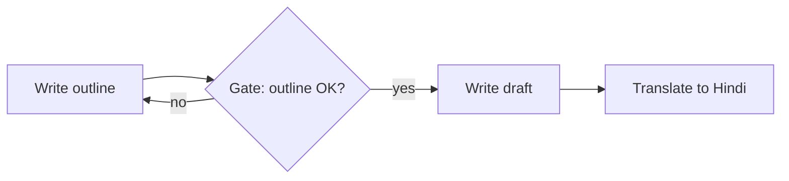
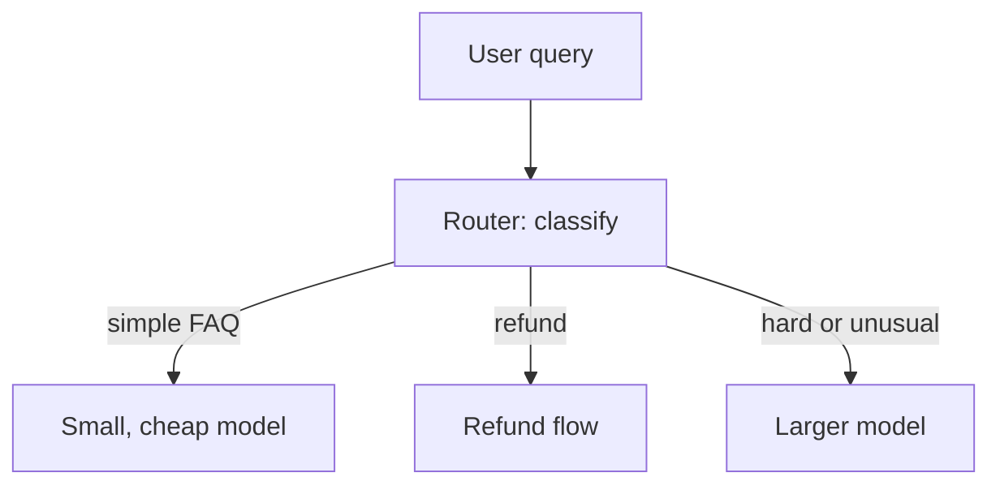
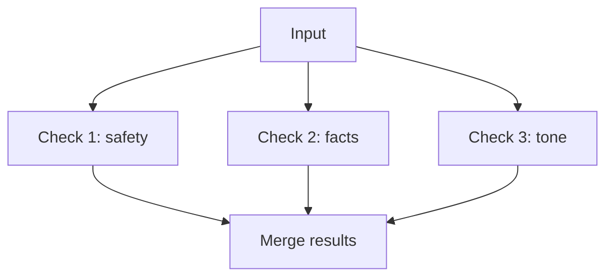

# Workflow Patterns: Chaining, Routing, Parallelisation

Before you build an agent, learn the three simplest building blocks. Think of a Swiggy order: one team confirms it, then the kitchen cooks, then a rider delivers (a chain). A call centre sends billing calls to one desk and delivery calls to another (routing). The kitchen cooks the biryani and the dessert at the same time (parallel).

All three come from Anthropic's "Building effective agents" guide. In each, *your code* controls the flow, so they are workflows, not agents.

## 1. Prompt chaining

**What it is**: split a task into a sequence of steps. Each LLM call works on the previous output. You can add a **gate** (a simple check) between steps.

*Figure: A chain with a quality gate after the first step.*

- **Use when** the task splits cleanly into fixed subtasks.
- **Trade-off**: you spend extra latency to get higher accuracy, because each call is a simpler job.
- **Example**: generate marketing copy, then translate it.

## 2. Routing

**What it is**: classify the input first, then send it to a specialised path. The paths can have different prompts, tools or even different models.

*Figure: A router sends each query to the cheapest path that can handle it.*

- **Use when** inputs fall into distinct categories that need different handling and classification is reliable.
- **Benefit**: the guide notes you can send easy questions to smaller, cheaper models and harder ones to stronger models.
- **Risk**: a wrong route sends the query down a path that cannot answer. Keep a fallback route.

The router itself can be an LLM call, a small classifier, or plain rules. Use rules where rules work. They are free and predictable. For gateway-level model routing, see [Chapter 6](../../module-3/06-llm-serving.md).

## 3. Parallelisation

**What it is**: run several LLM calls at the same time and combine results. The guide names two variants:

- **Sectioning**: split the work into independent parts that run together.
- **Voting**: run the same task several times and compare, to get higher confidence.

*Figure: Sectioning. Independent checks run together, so total time is about the slowest one.*

- **Use when** subtasks are independent and you want speed, or when several attempts raise confidence.
- **Example**: one call answers the user while another screens the request for policy problems. The guide gives guardrails like this as a use case.
- **Trade-off**: you pay for every call. Voting multiplies cost by the number of votes.

## Comparison

| Pattern | Main benefit | Main cost | Fails when |
|---|---|---|---|
| Chaining | Accuracy via simpler steps | Higher latency | An early step's mistake flows forward |
| Routing | Cost and specialisation | Extra classify step | Router picks the wrong path |
| Parallelisation | Speed or confidence | More tokens spent | Parts are not truly independent |

## Combine them

These blocks compose. A common production shape is: route, then chain inside each route, with parallel guardrail checks on the side. Keep each piece simple and measure it.

> [!TIP]
> **Key takeaways**
> - Chaining trades latency for accuracy, routing sends work to the right (and cheapest) path, parallelisation trades tokens for speed or confidence.
> - In all three, your code controls the flow. That makes them predictable and testable.
> - Add gates, fallbacks and caps so one bad step does not ruin the whole run.
