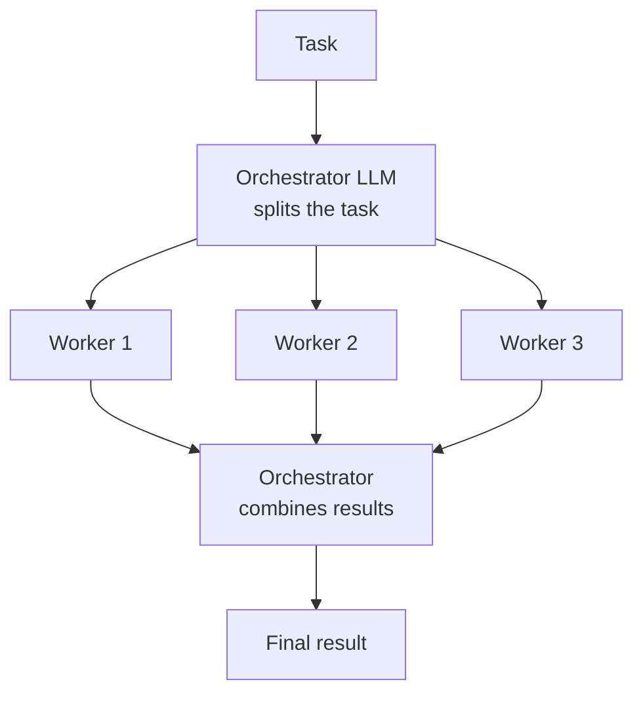
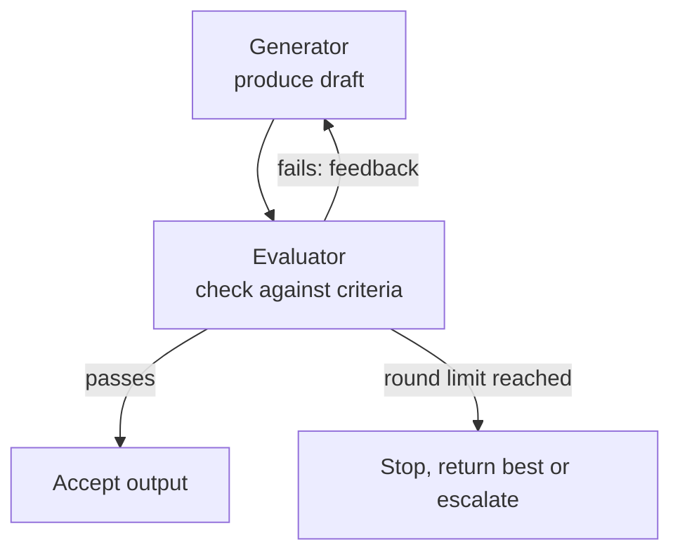

# Workflow Patterns: Orchestrator-Workers and Evaluator-Optimiser

The three basic patterns have fixed shapes. These two are more flexible. They sit close to the agent end of the spectrum, because the model now decides *what* subtasks exist or *how many* rounds to run.

## Orchestrator-workers

Think of a site engineer on a building project. She reads the job, decides which tasks are needed (plumbing, wiring, painting), hands each to a worker, and checks the final result. She does not know the task list before she sees the job.

In "Building effective agents", this pattern has a central LLM that **dynamically breaks a task into subtasks, delegates them to worker LLMs, and synthesises the results**.

*Figure: The orchestrator decides the subtasks at run time. Workers do focused jobs.*

**How it differs from parallelisation**: in parallelisation, you know the subtasks in advance and write them in code. Here, the orchestrator invents them from the input.

- **Use when** you cannot predict the subtasks. The guide's example is coding changes that touch an unknown number of files.
- **Watch out for**:
  - The orchestrator must give each worker a clear goal, output format and boundary. Otherwise workers overlap or leave gaps.
  - The orchestrator is a single point of failure. If its plan is wrong, all workers do the wrong work.
  - Workers do not see each other's work unless you pass it on. This is the root of the problems in the multi-agent page.

## Evaluator-optimiser

Think of a teacher and a student. The student writes an essay, the teacher marks it with comments, the student rewrites. They repeat until the essay is good enough.

In this pattern, one LLM call **generates** and another **evaluates** and gives feedback, in a loop.

*Figure: Generate, evaluate, improve. The round limit is not optional.*

The idea is related to the Self-Refine research (Madaan et al., 2023, an arXiv preprint). There, one model drafts, critiques and revises its own output. The authors report that results were preferred over single-pass output on the tasks they tested.

**Use when**:

- You have clear criteria that can be checked. Examples: "code passes unit tests", "translation keeps all names", "answer cites a source".
- Iteration measurably improves the result.

**Strong evaluators are the key.** The best evaluator is often not an LLM at all but a **test or a rule**. Compile the code. Run the unit tests. Validate the JSON. An LLM evaluator can be fooled or can agree with weak output (see LLM-as-judge pitfalls in [Chapter 12](../../module-5/12-evaluation-safety.md)).

## Trade-offs

| | Orchestrator-workers | Evaluator-optimiser |
|---|---|---|
| Who decides the structure | Model, at run time | Fixed loop; model decides rounds |
| Main gain | Handles unpredictable subtasks | Better quality on checkable tasks |
| Main cost | Many LLM calls, merging effort | Extra rounds of calls |
| Main risk | Bad plan, inconsistent workers | Endless loop, weak or biased judge |

## Common mistakes

- No round limit in the evaluator loop.
- An evaluator with vague criteria such as "make it better".
- Using an orchestrator for tasks that a simple chain or parallel step would handle at a fraction of the cost.

> [!TIP]
> **Key takeaways**
> - Orchestrator-workers: the model decides the subtasks at run time and delegates them. Use it when subtasks are unpredictable.
> - Evaluator-optimiser: generate, check, improve. Use it only with clear, checkable criteria, and always cap the rounds.
> - Prefer tests and rules as evaluators when you can. They are cheaper and harder to fool.
