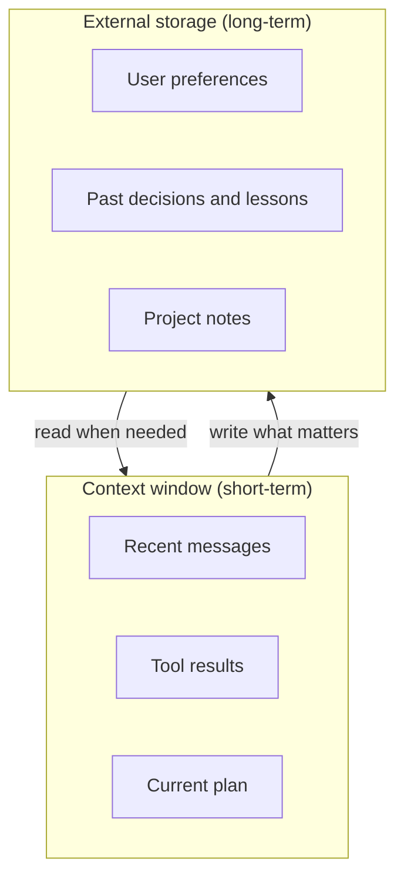

# Memory

You remember what a friend said five minutes ago (you are still in the chat). You also remember his birthday from last year (you stored it somewhere). Agents need both kinds of memory. But an LLM has neither by default: it only sees what you put in the context window on each call.

## What it is

**Agent memory** is any mechanism that lets an agent use information beyond the current model call. There are two broad kinds.

- **Short-term memory**: what is in the context window right now. This is the conversation so far, tool results and the current plan. It vanishes when the session ends.
- **Long-term memory**: information stored *outside* the model and brought back when needed. It survives across sessions.

*Figure: Short-term memory lives in the context. Long-term memory lives outside and is loaded on demand.*

## How it works

Memory for agents is mostly ordinary engineering: a database, files, or a vector index, plus read and write rules. The model is given **tools** to read and write them.

Anthropic's memory tool is one concrete example. Claude asks for file operations (view, create, edit, delete, rename) under a `/memories` directory, and *your application* carries them out against storage you control. The documentation notes that memory stays entirely in your application, so you decide where and how long data is kept. Other vendors and frameworks have their own designs, so details vary.

A common frame, used in the LangGraph docs, separates two stores:

- **Checkpoints**: save the state of one thread (one conversation or run). This gives short-term, thread-scoped memory.
- **A store**: keeps application data across threads, giving long-term memory.

## What goes in long-term memory

| Kind | Example | Typical storage |
|---|---|---|
| Facts about the user | "Prefers email follow-ups" | Key-value or document store |
| Past episodes | "Last refund failed because of KYC" | Documents, searchable |
| Rules and skills | "Always check stock before promising delivery" | Files, prompt library |
| Project progress | "Feature 3 done, feature 4 next" | Progress file |
| Large knowledge | Policies, manuals | Vector index (see [Chapter 7](../../module-3/07-rag-architectures.md)) |

## A pattern for long jobs

Anthropic's engineering post on long-running agents describes a simple, effective approach. A first "initializer" session sets up a progress log, a feature list and a start script. Each later session starts by reading these files, works on one feature, tests it, and updates the log before ending. Git commits help a fresh session see what changed and undo bad changes. The authors found JSON feature lists were less likely to be overwritten by mistake than Markdown, and that marking features done too early was a failure mode to guard against.

The lesson: **memory can be a plain file** that is read at the start and updated at the end.

## Design questions

- **What to write?** Not everything. Store decisions, preferences and lessons, not raw chat logs.
- **When to read?** At session start, or just in time when the task needs it.
- **How to forget?** Memories go stale. The memory tool docs suggest expiring files that have not been accessed for a long time. Give users a way to view and delete their data.
- **Who can read it?** Memory is per user or per tenant. A leak across users is a serious bug.
- **Is it safe?** Anything written to memory later returns to the context. A poisoned note can steer the agent in future sessions. Validate what is written, and see [Chapter 10](../10-security-governance.md).
- **How big?** Cap file sizes and the characters returned by a read.

## Common mistakes

- Storing full transcripts and calling it memory. It bloats the context on every read.
- Writing sensitive data (passwords, personal IDs) into memory with no filter. Stored personal data also falls under privacy law (see Chapter 10).
- No separation by user or tenant.

> [!TIP]
> **Key takeaways**
> - Short-term memory is the context window. Long-term memory is external storage the agent reads and writes through tools.
> - Store decisions and lessons, not raw logs. Plan how memory is expired, deleted and isolated per user.
> - For long jobs, a progress file read at start and updated at the end is a simple, strong pattern.
