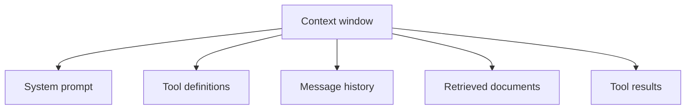
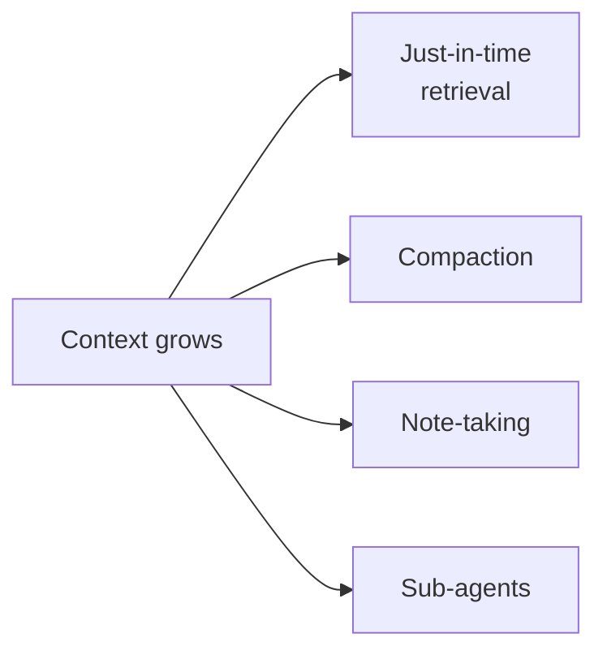

# Context Engineering

Your phone has a limited screen. If you open fifty tabs, you cannot find the one you need. A model's context window is similar. More text does not always mean better answers. The skill is to show the model only what helps *right now*.

## What it is

Anthropic describes **context engineering** as the natural step beyond prompt engineering. Prompt engineering is about writing good instructions. Context engineering is about curating *all* the tokens the model sees on each call: system prompt, tools, message history, retrieved data and tool results. The guiding question in their post is which configuration of context is most likely to produce the behaviour you want.

Why it matters: the same post says that as the context grows, the model's ability to recall information tends to drop. They call this **context rot**. Context is a limited resource, so the aim is the smallest set of high-signal tokens that gets the job done.

For how the window and costs work inside the model, see [Chapter 6](../../module-3/06-llm-serving.md).

## What fills the window

*Figure: Everything here competes for the same limited space. In long agent runs, tool results often grow the fastest.*

## Four techniques

The Anthropic post names these approaches for long-running agents.

*Figure: Four ways to keep the context lean.*

### 1. Just-in-time retrieval

Do not load everything up front. Keep light references such as file paths, saved queries or links. Let the agent load the full content with a tool only when needed. Names, folder structure and timestamps help the agent judge what is relevant. The trade-off is that exploring at run time is slower than having data pre-loaded. The post says a hybrid (some data upfront, the rest on demand) can suit stable domains.

### 2. Compaction

When the conversation nears the limit, summarise it and start a new window from the summary. The post advises tuning the summary prompt first for recall (do not lose key facts), then trimming extras. The lightest form is **clearing old tool results**, which it calls one of the safest types of compaction.

### 3. Structured note-taking

The agent writes notes (a to-do list, a NOTES file) outside the context and reads them back later. This keeps progress across many tool calls and across window resets. It is the same idea as in the [memory page](06-memory.md).

### 4. Sub-agents with clean windows

A lead agent hands focused work to sub-agents. Each explores in its own fresh window and returns a short, distilled summary. The lead's context stays clean. See the [multi-agent page](08-multi-agent-systems.md) for the risks.

## Choosing a technique

| Problem | Try first |
|---|---|
| Tool results flooding the window | Clear or trim old results |
| Long single conversation | Compaction |
| Work spanning sessions | Notes or progress file |
| Wide search, many dead ends | Sub-agent with its own window |
| Huge data store | Just-in-time retrieval |

## Other good habits

- **Right altitude for prompts**: specific enough to guide, loose enough to allow judgement. Avoid long lists of brittle rules. Use a few diverse, canonical examples.
- **Keep the tool set small.** Overlapping tools confuse the model and use tokens.
- **Return compact tool output.** Filter, paginate, truncate.
- **Cache stable parts.** Many providers can cache a repeated prompt prefix to cut cost and latency; see [Chapter 6](../../module-3/06-llm-serving.md). Check your provider for details.

## Common mistakes

- Pasting whole documents into the prompt "just in case".
- Compacting without testing whether the summary kept the critical facts.
- Treating a bigger context window as a reason to stop curating.

> [!TIP]
> **Key takeaways**
> - Context engineering means curating every token the model sees, not only writing the prompt.
> - Long contexts can reduce recall (context rot). Aim for the smallest high-signal context.
> - Four tools: just-in-time retrieval, compaction, note-taking and sub-agents with clean windows.
