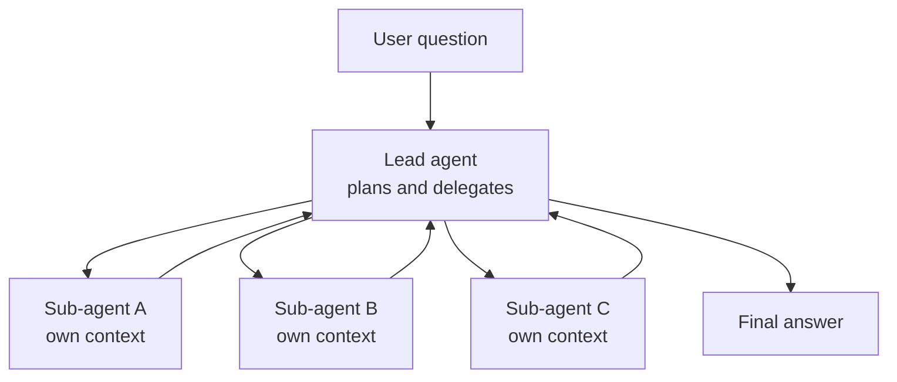

# Multi-Agent Systems

A cricket team has many players. But in a tight chase, the captain does not ask five players to decide the next ball by vote. Some jobs need many hands. Others need one clear mind. Multi-agent design is about knowing which is which.

## What it is

A **multi-agent system** uses more than one LLM-driven agent, each with its own context, instructions and often its own tools. The most common shape is the orchestrator-workers pattern: a **lead agent** plans and spawns **sub-agents**.

*Figure: A lead agent with parallel sub-agents. Each sub-agent works in a clean window and returns a summary.*

## When it helps

Anthropic's engineering post on its multi-agent research system gives a real example. A lead agent plans a research task and starts sub-agents that search in parallel. In their internal evaluation, this beat a single-agent setup by 90.2%, and parallel work cut research time by up to 90% for complex queries (figures reported by Anthropic in 2025, for their own research task).

They list good fits:

- **Breadth-first** tasks, with many independent directions.
- Heavy **parallel** work.
- Information that **exceeds one context window**.
- Many complex tools.

## The price

The same post reports that agents use about 4 times the tokens of a chat, and multi-agent systems about 15 times (as measured by Anthropic, 2025). So the task's value must justify the cost. They also found that token usage alone explained 80% of the performance variance in one browsing benchmark. Part of the multi-agent gain is simply spending more tokens.

## When NOT to use it

The company Cognition published "Don't build multi-agents". Its argument rests on two principles:

1. **Share full context.** Sub-agents need the whole trace, not just a task line.
2. **Actions carry implicit decisions.** Each step bakes in assumptions. If parallel parts act on conflicting assumptions, the results clash.

Their example: one sub-agent builds a game background in one style, another builds the character in a different style, and the pieces do not fit. The author prefers a single-threaded linear agent for such work, and notes that agents today are weak at long back-and-forth communication with each other.

Anthropic's post agrees on the limit. It says tasks needing shared context or many dependencies between agents are a poor fit, and that most coding tasks have fewer parallelisable parts than research.

| Situation | Choice |
|---|---|
| Wide research, independent searches | Multi-agent can help |
| Tightly coupled work (one codebase, one design) | One agent, or sub-agents only for read-only lookups |
| Simple Q&A | Single call or workflow |
| Tight budget or latency target | Fewer agents |

A good rule: **start with one agent. Add a sub-agent only for a clear reason**, such as isolating a noisy search so it does not fill the main context.

## Making it work

- Give each sub-agent an explicit objective, output format, tool guidance and boundaries, to avoid duplicated work (Anthropic's post).
- Set rules for effort. Their early agents started 50 sub-agents for simple queries, so they added scaling guidance to the prompts.
- Prefer sub-agents that *read and report* over ones that *write* in parallel.
- Trace every agent step. See [Chapter 11](../../module-5/11-observability.md).

## Agent-to-agent protocols in brief

When agents live in different teams or companies, they need a shared way to talk. **A2A (Agent2Agent)** is an open protocol for this, originally developed by Google and now donated to the Linux Foundation. Its documentation lists these core ideas:

- **Agent Card**: a JSON profile with identity, endpoint, skills and authentication needs.
- **Task**: a stateful unit of work with an ID and lifecycle.
- **Message** and **Artifact**: a conversation turn, and a concrete output of a task.

The A2A docs say it complements MCP: A2A connects agents to each other, while MCP connects each agent to its own tools. Its documentation includes a "What's New in v1.0" page, so v1.0 is a documented version; check the A2A site for the latest. We cover MCP in [Chapter 9](../09-mcp.md).

> [!TIP]
> **Key takeaways**
> - Multi-agent helps on broad, parallel, read-heavy work, and it costs many more tokens.
> - It hurts on tightly coupled tasks, because agents do not share full context or assumptions.
> - Start with one agent. A2A links agents across teams, and MCP links an agent to its tools.
