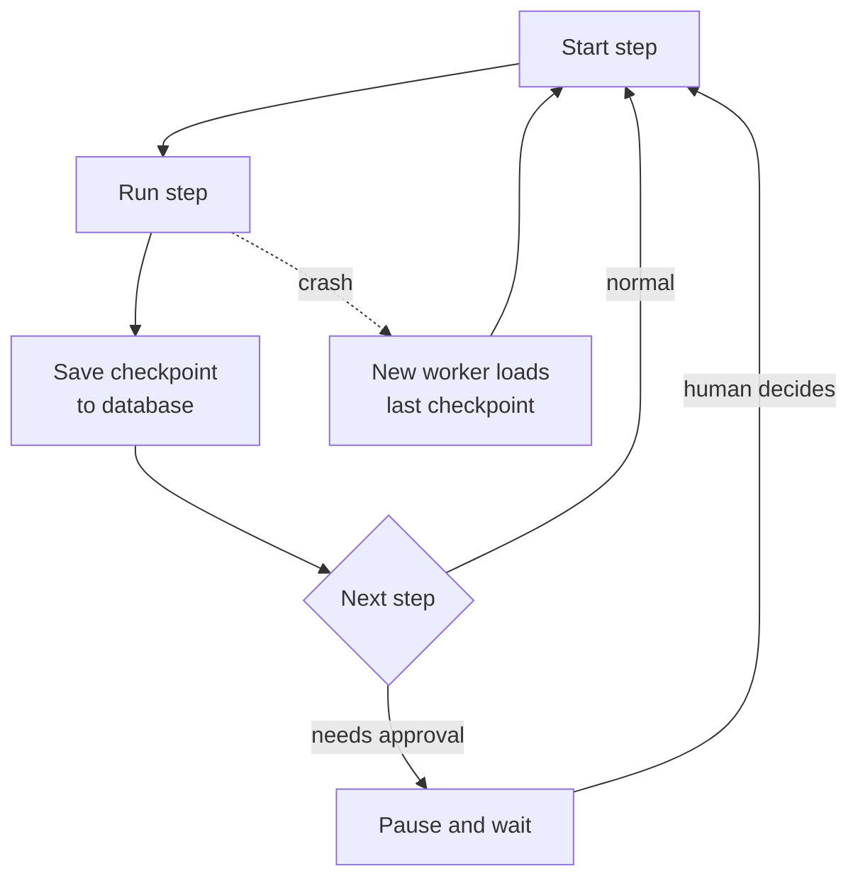

# State, Durable Execution and Human Approval

An IRCTC booking can take minutes: you pick a train, wait on the payment page, and come back. If the server crashed in between, you would not want to start again. Long agent runs have the same need. They can take minutes or hours, call many tools, and sometimes must wait for a person.

## What it is

Agents are **stateful**. State includes the messages so far, tool results, the plan and any partial work. Anthropic's multi-agent post notes that errors compound in such systems, and that restarting from the beginning is costly, so their team resumes from where an error happened, using checkpoints and retry logic.

Three ideas fit together:

- **Checkpoint**: save the run's state after each step.
- **Durable execution**: a run survives crashes and continues from its last saved point.
- **Human-in-the-loop (HITL)**: the run pauses for a person to approve, edit or answer, then resumes.

## How it works



*Figure: State is saved after each step. After a crash or a pause, a worker resumes from the saved state.*

### Durable execution engines

Temporal describes durable execution as keeping a workflow running to completion even if the process crashes. Your logic runs as a **workflow** (which must be deterministic). Work that touches the outside world, like API calls and database writes, runs as **activities**. Everything is recorded in an **event history**. After a failure, a new worker replays the history to rebuild state and continues. Activity retries come from a retry policy, not from code you write.

Agent frameworks offer a lighter version. In LangGraph, a **checkpointer** saves graph state per thread, which supports conversation continuity, human-in-the-loop, and fault tolerance. In-memory checkpointers lose data on restart, so production needs a database-backed one.

### Human approval

LangGraph's `interrupt()` pauses the run at a point in the code, returns a value to the caller, and waits until the run is resumed with a decision. This needs a checkpointer and a thread ID so the saved state can be found. Common patterns from its docs:

- **Approve or reject** an action.
- **Review and edit** generated content.
- **Review a tool call** before it runs, and approve, cancel or change its arguments.

Other tools use other APIs. The idea is the same. The A2A protocol also has this idea built in: a task can enter an `input-required` or `auth-required` state, and the agent waits.

## The idempotency rule

On resume, a step may run again. The LangGraph docs say a node restarts from its beginning after an interrupt, so side effects before the pause should be idempotent. Temporal's replay model also needs deterministic workflow code.

This links to [Chapter 3](../../module-1/03-reliability.md): use idempotency keys so "send refund" never pays twice.

```python
def issue_refund(order_id, amount, run_id):
    key = f"refund:{order_id}:{run_id}"   # same key on every retry, so retries are safe
    return payments_api.refund(order_id, amount, idempotency_key=key)
```

## Where to put human checks

Do not ask a human about everything. People get tired and click "approve" blindly. Ask where mistakes are costly or cannot be undone.

| Action type | Suggested control |
|---|---|
| Read-only lookup | Run automatically |
| Reversible change (draft email) | Run, show a preview |
| Irreversible or costly (payment, delete, send to customer) | Ask a human first |
| Low-confidence or out-of-policy case | Escalate |

## Deployment note

Anthropic's post says running agents are hard to update safely. They use "rainbow deployments", shifting traffic gradually from the old version to the new so in-flight agents are not broken. Your saved state must stay readable across versions.

> [!TIP]
> **Key takeaways**
> - Save state after each step so a long run can resume after a crash or a pause.
> - Use a durable engine or a framework checkpointer. Make every side effect idempotent.
> - Ask humans only at costly or irreversible steps, and design resume as a normal path.
