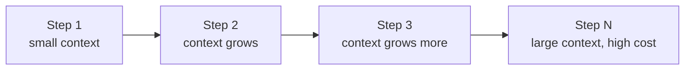
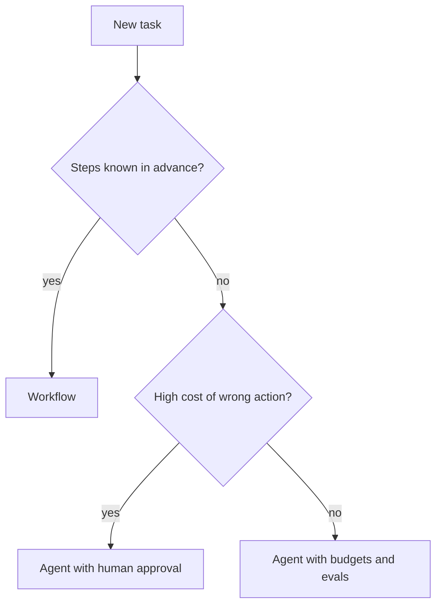

# Cost, Latency and Reliability

An agent demo looks magical. Then it meets real traffic. Each run costs money, takes seconds or minutes, and sometimes goes wrong in a new way. In a system design round, this is the page that shows you think like an engineer.

## What it is

Three trade-offs decide whether an agent can ship:

- **Cost**: tokens used per task.
- **Latency**: time until the user gets a result.
- **Reliability**: how often the task is done *correctly*.

You rarely win all three. Making an agent more careful (more steps, more checks) usually raises cost and latency.

## Why cost grows fast

Every loop turn is a new model call that carries the whole context so far. A 10-step run does not cost 10 times a single call. It costs more, because the history is sent again at every step. Tool definitions and results add to it.

Anthropic reported that agents use about 4 times the tokens of a chat, and multi-agent systems about 15 times (Anthropic engineering post, 2025). Your numbers will differ, so measure your own.

*Figure: Each step re-sends the history, so cost per step rises as the run goes on.*

## Why latency grows

Steps in an agent loop are mostly **sequential**: think, call tool, wait, think again. Total time is the sum of model time and tool time. Ways to cut it:

- **Run independent tool calls in parallel** (many APIs allow parallel tool calls).
- **Use a smaller model** for easy steps and a bigger one only for hard steps (routing).
- **Cache** repeated prompt prefixes, if your provider supports it.
- **Stream** progress to the user so the wait feels shorter. The plan-as-checklist idea helps here.
- **Move long jobs to the background** and notify the user. This needs the durability ideas from the previous page.

## Why reliability drops

Errors compound. Anthropic's guide warns about higher costs and the potential for errors to pile up in agents. A simple *example* shows why.

> **Example (illustration only):** assume each step is correct 95% of the time, and steps are independent. After 10 steps, the chance that all are correct is about 0.95 multiplied by itself 10 times, which is about 60%.

Real steps are not fully independent, but the lesson holds: **long chains need checks**.

## Levers to pull

| Goal | Lever | Cost of the lever |
|---|---|---|
| Lower cost | Smaller model for easy steps, compact tool output, trimmed context | May drop quality |
| Lower latency | Parallel tool calls, fewer steps, streaming | More complex code |
| Higher reliability | Evaluator checks, tests, human approval at risky steps | More latency and cost |
| Predictability | Use a workflow instead of an agent | Less flexibility |
| Safety under failure | Step limits, budgets, timeouts, idempotent tools | Tasks may stop early |

## A reliability checklist

- **Budgets**: max steps, max tokens, max wall-clock time, per run. Fail clearly when exceeded.
- **Validation**: check tool arguments against the schema. Check outputs before using them.
- **Retries with backoff** for flaky tools, and circuit breakers for broken ones (see [Chapter 3](../../module-1/03-reliability.md)).
- **Idempotent actions**, so a retry never double-charges.
- **Fallbacks**: if the agent fails, hand over to a simpler workflow or to a human.
- **Evaluation**: Anthropic's team suggests starting with about 20 real-use queries rather than waiting for a large test set. Grow it as you learn. See [Chapter 12](../../module-5/12-evaluation-safety.md).
- **Tracing**: log every step, tool call and token count so you can debug a bad run. See [Chapter 11](../../module-5/11-observability.md).

## Deciding in an interview

When asked "should this be an agent?", walk through:

1. Can fixed steps solve it? Then use a workflow.
2. What is the cost of a wrong action? Add approvals if high.
3. What is the latency target? If seconds, limit steps. If minutes, go async.
4. What is the budget per task? Set a hard cap.
5. How will you measure quality? Name your eval set.

*Figure: A simple decision path from task to design.*

> [!TIP]
> **Key takeaways**
> - Agent cost grows with steps because history is re-sent. Latency grows because steps run one after another.
> - Errors compound across steps, so long runs need checks, budgets and fallbacks.
> - Measure on real tasks, set hard caps, and choose the least autonomy that meets the quality bar.
