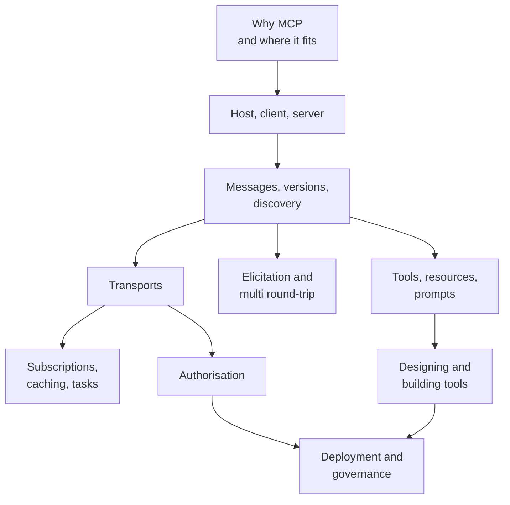

# Chapter 9: Model Context Protocol (MCP)

An AI agent is only as useful as the things it can reach: your calendar, your database, your ticketing tool, your files. Before MCP, every AI app wrote its own custom code for every tool. The same Slack or GitHub integration was built again and again, by different teams, in slightly different ways.

The **Model Context Protocol (MCP)** is an open standard that fixes this. It is a common language between AI applications and the systems they use. Build a tool server once, and any MCP-aware app can use it.

In [Chapter 8](08-agentic-architectures.md) you saw how an agent loop calls tools. This chapter shows the standard way to plug those tools in, how to secure them, and how to run them in production.

> [!NOTE]
> **Which version of MCP is this chapter about?** This chapter follows the MCP specification revision **2026-07-28**, the current revision on modelcontextprotocol.io as of 2 November 2026. This revision made MCP *stateless* and removed the old `initialize` handshake. Older articles and tutorials describe the earlier, session-based protocol (2025-11-25 and before), so details may differ from what you read elsewhere.

*Figure: Map of the chapter. Read top to bottom; the middle row can be read in any order.*

## What you will learn

- **Why MCP and Where It Fits**: the problem MCP solves, and how it differs from plain function calling and A2A.
- **Hosts, Clients and Servers**: the three roles and the design rules behind them.
- **Messages, Versions and Discovery**: JSON-RPC, the stateless request, and `server/discover`.
- **Tools, Resources and Prompts**: the three things a server can offer, and who controls each.
- **Elicitation and Multi Round-Trip Requests**: how a server asks the user for more input.
- **Transports**: stdio for local servers, Streamable HTTP for remote ones.
- **Subscriptions, Caching and Tasks**: change notifications, cache hints, and long-running work.
- **Authorisation with OAuth**: how a remote server knows who is calling.
- **Designing and Building Tools**: what makes a tool easy for a model to use, with a small Python server.
- **Deployment and Governance**: running MCP servers at scale, and controlling which ones your teams may use.
- **Recap and Practice**: summary, interview questions and sources.
