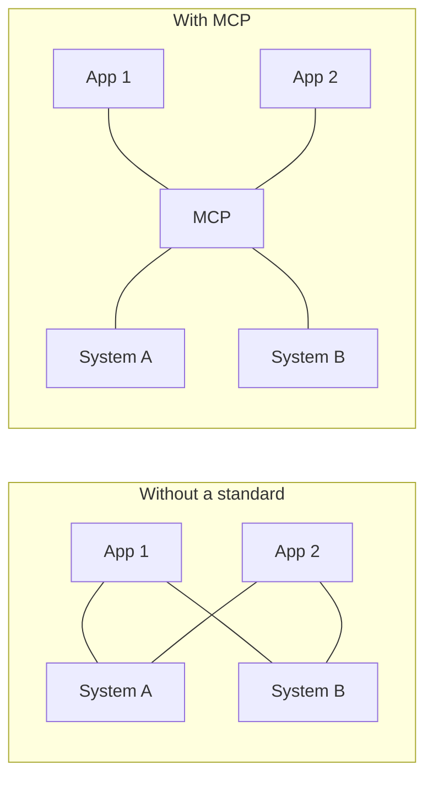

# Why MCP and Where It Fits

Think of the chargers in your home. Before USB-C, every phone, laptop and earphone needed its own cable. One standard port removed the mess.

AI apps had the same mess with tools. MCP is the "USB-C port" for connecting AI applications to outside systems. The official MCP documentation uses exactly this comparison.

## What it is

The **Model Context Protocol (MCP)** is an open-source standard for connecting AI applications to external systems: data sources (files, databases), tools (search, calculators) and workflows (ready-made prompts).

Anthropic announced it on 25 November 2024. The problem it named: each new data source needed its own custom code, so connected systems were hard to scale.

Count the work. Say you have 4 AI apps and 6 systems to connect. Without a standard, that is up to 24 custom integrations (4 x 6, an *Example*). With a standard, each app learns MCP once and each system exposes MCP once. That is 4 + 6 = 10 pieces of work.

*Figure: Many-to-many custom links become many-to-one-to-many through a shared protocol.*

## How it grew

MCP revisions are named by date, such as `2025-11-25`. The date marks the last time a backward-incompatible change was made.

| Revision | What to remember |
|---|---|
| 2024-11-05 | Earliest revision (HTTP+SSE transport) |
| 2025-03-26 | Introduced Streamable HTTP transport |
| 2025-11-25 | Last revision with sessions and the `initialize` handshake |
| **2026-07-28** | **Current.** Stateless protocol, no handshake |

In December 2025, Anthropic announced it was donating MCP to the Agentic AI Foundation, a directed fund under the Linux Foundation. MCP's own governance page describes the project as "Model Context Protocol a Series of LF Projects, LLC". Governance is covered in [Deployment and Governance](10-deployment-and-governance.md).

## Where MCP sits: three things people confuse

| | Function calling | MCP | A2A |
|---|---|---|---|
| What it is | A feature of a model API | A protocol between an AI app and tool servers | A protocol between agents |
| Question it answers | "How does the model ask for a tool call?" | "How does the app find, call and secure tools from many servers?" | "How does one agent work with another agent?" |
| Who runs the tool? | Your own app code | The MCP server | The other agent |
| Direction | Model to app | App to tools | Agent to agent |

Function calling is how a model *says* "call `get_weather` with Pune". Anthropic's tool-use documentation describes it this way: the model returns a structured call, and your application runs it.

MCP is how the app *finds* those tools and talks to them, without custom code for each one. The two work together. The app lists tools from MCP servers, gives them to the model, and sends the model's call back to the right server.

The A2A project describes A2A and MCP as complementary. In its words, "A2A connects the agents to each other; MCP connects each agent to its own tools." MCP is for discrete tool calls. A2A is for longer, multi-turn teamwork between agents. See [Chapter 8](../08-agentic-architectures.md) for agent-to-agent ideas.

## In the AI era

Agents may use dozens of tools. A shared protocol means a new tool shows up for every compatible agent without rewriting code. The official docs list Claude, ChatGPT, Visual Studio Code and Cursor among the clients that support MCP.

## Common mistakes

- Saying "MCP replaces function calling". It does not. It standardises the layer *behind* it.
- Reading old MCP tutorials without checking the revision. The 2026-07-28 revision changed the handshake, sessions and server-to-client requests.

> [!TIP]
> **Key takeaways**
> - MCP is an open standard that turns many custom integrations into one shared protocol.
> - Function calling is how a model requests a tool. MCP is how apps discover and reach tools. A2A connects agents to agents.
> - This chapter follows revision 2026-07-28, which is stateless and has no `initialize` handshake.
