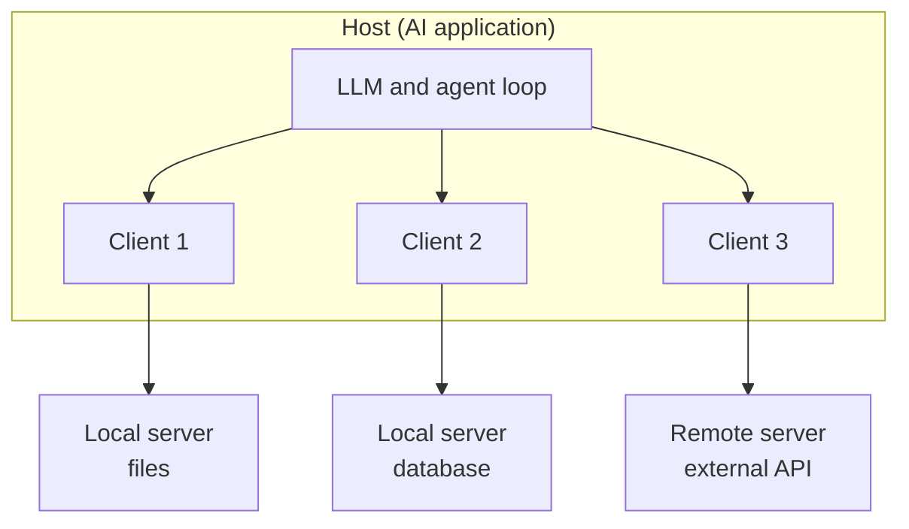

# Hosts, Clients and Servers

When you open a food app, there is the app on your phone, a delivery partner and a restaurant. Each has one job. MCP also has three roles, and keeping them straight makes everything else easier.

## What it is

MCP follows a **host - client - server** design.

- **Host**: the AI application the user actually uses, such as an AI code editor or a chat assistant. It decides which servers to connect to and what the user must approve.
- **Client**: a small component *inside* the host. Each client talks to exactly one server. If the host connects to three servers, it creates three clients.
- **Server**: a program that provides context and abilities (tools, resources, prompts) to clients.

The MCP docs give an example: Visual Studio Code is the host. When it connects to the Sentry MCP server, it creates one client for that connection. When it also connects to a local filesystem server, it creates another client.

## How it works

*Figure: One host, many clients, each linked to one server.*

The word "server" does not mean "a machine in a data centre". It means the program that serves context. It may run on your laptop or on the internet.

Two layers make this work:

- **Data layer**: the JSON-RPC messages and the meaning of tools, resources, prompts and notifications. You will meet it in the next pages.
- **Transport layer**: how those messages travel (stdio or Streamable HTTP) and how authorisation is done.

## The four design principles

The specification lists these goals. They explain many later choices.

1. **Servers should be extremely easy to build.** The host handles the hard orchestration. A server stays small and focused.
2. **Servers should be highly composable.** Many small servers can be combined.
3. **Servers should not read the whole conversation or "see into" other servers.** The full chat stays with the host. Each server gets only what it needs.
4. **Features are added progressively.** The core is small. Extra abilities are negotiated.

Principle 3 matters for security. A weather server never needs to see your chat history, and it must not see what your calendar server returned. The host controls what moves between servers.

## Local and remote servers

| | Local server | Remote server |
|---|---|---|
| Runs | On the user's machine, started by the client | On the internet or inside a company network |
| Typical transport | stdio | Streamable HTTP |
| Usually serves | One client | Many clients |
| Credentials | Taken from the environment (the spec says stdio servers should not use the OAuth flow) | OAuth-based authorisation |
| Example from docs | Local filesystem server | Sentry MCP server |

## In the AI era

The host is where the LLM lives. It collects tools from all clients, shows them to the model, and decides which calls are allowed. The spec says hosts create clients, control their permissions and lifecycle, enforce security policies and consent, and coordinate AI integration.

So when you design an agent product, "MCP support" mostly means building a good **host**: tool registry, user approvals, and safe handling of results.

## Common mistakes

- Thinking one client can talk to many servers. In MCP, it is one client per server.
- Putting business rules in the host that belong in the server. Keep servers focused and let them own their domain.

> [!TIP]
> **Key takeaways**
> - The host is the AI app. It creates one client per server and enforces user consent.
> - A server is just a program that offers tools, resources and prompts. It can be local or remote.
> - Servers should not see the whole conversation or each other. The host sits in the middle.
