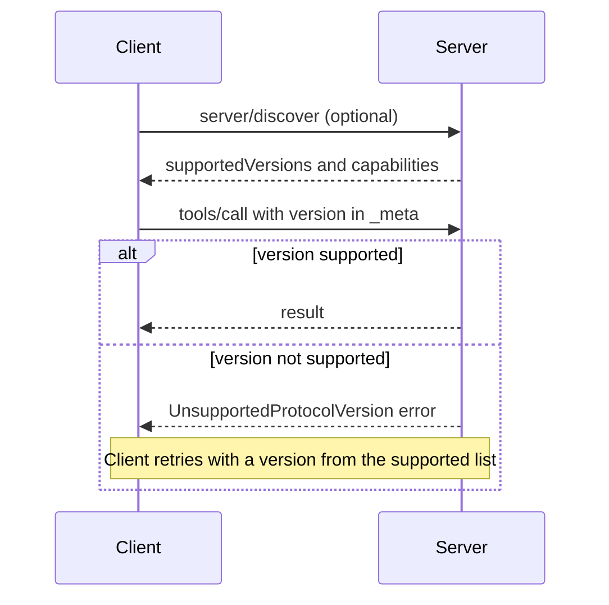

# Messages, Versions and Discovery

When you pay with UPI, the request carries everything needed: who pays, who gets paid, how much. The bank does not need to remember your last payment to process this one.

The 2026-07-28 revision of MCP works the same way. Every request is self-contained.

## What it is

MCP messages use **JSON-RPC 2.0**, a simple format for calling remote functions with JSON. There are three message types:

- **Request**: has an `id`, a `method` and `params`. The `id` must not be `null`.
- **Response**: has the same `id`, and either a `result` or an `error`.
- **Notification**: like a request but with no `id`. The receiver sends no reply.

MCP is also **stateless**. A server must not rely on earlier requests on the same connection to know the protocol version, the client's capabilities or the client's identity. Each request brings them along in a field called `_meta`.

## How it works

A real `tools/call` request looks like this (taken from the spec's HTTP example):

```json
{
  "jsonrpc": "2.0",
  "id": 1,
  "method": "tools/call",
  "params": {
    "name": "get_weather",
    "arguments": { "location": "Seattle, WA" },
    "_meta": {
      "io.modelcontextprotocol/protocolVersion": "2026-07-28",
      "io.modelcontextprotocol/clientInfo": { "name": "ExampleClient", "version": "1.0.0" },
      "io.modelcontextprotocol/clientCapabilities": {}
    }
  }
}
```

| `_meta` key | Required? | Meaning |
|---|---|---|
| `io.modelcontextprotocol/protocolVersion` | Yes | Version used for this request |
| `io.modelcontextprotocol/clientCapabilities` | Yes | What this client supports for this request |
| `io.modelcontextprotocol/clientInfo` | Should | Client name and version, for logs and debugging |

If a required field is missing, the server rejects the request with error `-32602` (on HTTP, status `400`).

Every successful result has a `resultType`: `"complete"` for a normal result, or `"input_required"` when the server needs more information from the user (see [Elicitation and Multi Round-Trip Requests](05-elicitation-and-mrtr.md)). Servers should also add their name and version in the result's `_meta`.

## Discovery and version negotiation

There is **no handshake** in this revision. The old `initialize` and `notifications/initialized` messages were removed.

Instead, servers must implement `server/discover`. A client may call it first to learn the server's `supportedVersions`, its `capabilities` (tools, resources, prompts and so on) and its identity. It may also skip it and just send a request.



*Figure: No handshake. The server accepts or rejects every request on its own.*

An unsupported version returns error code `-32022` with a `data.supported` list. The client picks a version from that list and retries.

## MCP error codes

| Code | Name | When |
|---|---|---|
| `-32602` | Invalid params | Missing required `_meta`, unknown tool, resource not found |
| `-32020` | HeaderMismatch | HTTP headers do not match the body |
| `-32021` | MissingRequiredClientCapability | Server needs a capability the client did not declare |
| `-32022` | UnsupportedProtocolVersion | Server does not speak the requested version |

The range `-32020` to `-32099` is reserved for the MCP specification itself.

## Working with older servers

Some servers still speak the older session-based protocol (2025-11-25 and before). A client that wants to work with both sends `server/discover` first on stdio. If it gets a modern answer, it stays modern. If it gets an unrecognised error or no reply, it falls back to `initialize`. On HTTP, it tries a modern request and inspects the `400` response before falling back. A modern client talking to a server that only speaks the old protocol fails.

## Common mistakes

- Assuming a connection is a conversation. A stdio process can serve unrelated requests, so servers must not treat the process as a session.
- Storing per-user state in memory and expecting the next call to find it. State now travels as explicit identifiers (see [Designing and Building Tools](09-designing-and-building-tools.md)).

> [!TIP]
> **Key takeaways**
> - MCP uses JSON-RPC 2.0, and every request carries its own protocol version and capabilities in `_meta`.
> - There is no `initialize` handshake in 2026-07-28. `server/discover` is optional for clients but mandatory for servers.
> - Results carry a `resultType`, and version mismatches return error `-32022` so the client can retry.
