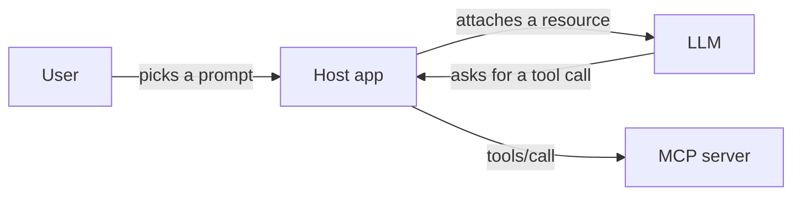

# Tools, Resources and Prompts

A restaurant gives you three things: a kitchen that cooks on request, a menu to read, and set thalis you can just point at. MCP servers also offer three kinds of things. The key difference is *who decides* to use each one.

## What it is

| Primitive | What it is | Examples | Who controls it |
|---|---|---|---|
| **Tools** | Functions the model can call; they can have side effects | Search flights, create a calendar event | The **model** decides |
| **Resources** | Read-only data for context, each with a URI | A file, a database schema, API docs | The **application** decides |
| **Prompts** | Reusable instruction templates | "Plan a vacation", "Summarise my meetings" | The **user** decides |

This table follows the MCP docs on server concepts. A server declares what it supports as `capabilities` (`tools`, `resources`, `prompts`) in its `server/discover` reply.



*Figure: The user picks prompts, the app picks resources, the model picks tools.*

## Tools

Each tool has a `name`, an optional `title`, a `description`, an `inputSchema` (JSON Schema for the arguments) and optionally an `outputSchema`. Clients call `tools/list` to discover tools and `tools/call` to run one.

A tool result carries a `content` array. Items can be text, image, audio, resource links or embedded resources. A tool may also return `structuredContent` that follows its `outputSchema`. For compatibility, a tool that returns structured content should also put the same JSON in a text block.

There are two kinds of errors:

- **Protocol errors**: unknown tool or malformed request. These are JSON-RPC errors.
- **Tool execution errors**: API failure, bad date, broken business rule. These come back as a normal result with `isError: true`, so the model can read the message and try again.

```json
{
  "resultType": "complete",
  "content": [{ "type": "text", "text": "Invalid departure date: must be in the future." }],
  "isError": true
}
```

The spec says there **should** always be a human in the loop who can deny tool calls. Tool annotations are only hints and must be treated as untrusted unless the server is trusted.

## Resources

A resource is identified by a URI such as `file:///project/README.md`. Clients call `resources/list` to see resources and `resources/read` to fetch the contents (text, or base64 for binary).

**Resource templates** use URI templates, for example `weather://forecast/{city}/{date}`. One definition then covers many resources. If a resource does not exist, the server returns error `-32602`.

Resources are application-driven. The host may show a file-picker style list, let users search, or pick resources automatically.

## Prompts

A prompt has a `name`, a description and optional `arguments`. `prompts/get` returns the filled-in messages. Hosts usually show prompts as slash commands or buttons, because the **user** chooses to run them.

## When to use what

- Use a **tool** when the model needs to *do* or *look up* something on demand.
- Use a **resource** when you want to hand stable data to the app as context.
- Use a **prompt** when you want to give users a tested starting workflow for your server.

List results can be paged with a `cursor`, and they carry cache hints (see [Subscriptions, Caching and Tasks](07-subscriptions-caching-tasks.md)). A list may differ between callers only because of the authorisation on the request, never because of connection state.

## In the AI era

Most real-world MCP use is tools, because agents act through them. Resources and prompts are used less. A good server can ship a prompt that shows users how to combine its tools, and a resource that gives an agent the database schema before it writes a query.

> [!TIP]
> **Key takeaways**
> - Tools are model-controlled actions, resources are application-controlled context, prompts are user-controlled templates.
> - Tool failures the model can fix go in the result with `isError: true`. Broken requests are JSON-RPC errors.
> - Servers must validate inputs and check access on every call. Hints and annotations are not security.
