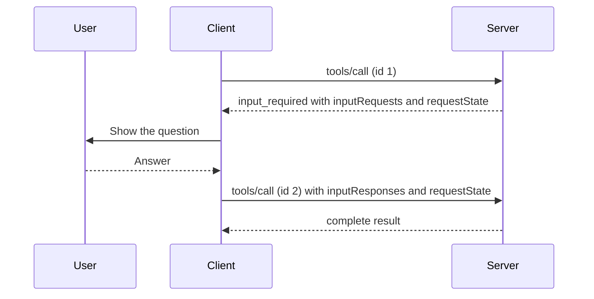

# Elicitation and Multi Round-Trip Requests

You call your bank to block a card. Midway, the agent says, "I need to confirm it is you." The job pauses, you give the detail, and the job continues.

MCP tools face the same thing. A tool may need a confirmation, a missing detail, or a login halfway through its work.

## What it is

**Elicitation** is how a server asks the *user* for more input, through the client. **Multi Round-Trip Requests (MRTR)** is the pattern that carries such asks in the 2026-07-28 revision.

Older revisions let a server send its own request to the client on an open stream while the first request was still running. That needed the server to keep a connection and some state. The new revision removes it. Servers must now use MRTR, and the spec calls this a breaking change.

## How it works

The server does not send a new request. It *replies* to the original request with a special result, and the client retries.



*Figure: The first call ends with an interim result. The retry carries the answers.*

The interim result looks like this (shortened):

```json
{
  "resultType": "input_required",
  "inputRequests": {
    "github_login": {
      "method": "elicitation/create",
      "params": {
        "mode": "form",
        "message": "Please provide your GitHub username",
        "requestedSchema": {
          "type": "object",
          "properties": { "name": { "type": "string" } },
          "required": ["name"]
        }
      }
    }
  },
  "requestState": "opaque-string-from-server"
}
```

The retry repeats the original parameters and adds `inputResponses` (keyed by the same names) plus the exact `requestState`. The retry needs a **new** JSON-RPC `id`. Only `tools/call`, `prompts/get` and `resources/read` may return an `input_required` result.

The benefit: the retry is a normal, independent request. Any server instance behind a load balancer can handle it, with no shared storage or sticky routing.

## Keeping requestState safe

`requestState` passes through the client, so treat it as attacker-controlled. The spec says:

- If it affects authorisation, resource access or business logic, protect it with an HMAC or AEAD and reject anything that fails verification.
- Include the user identity, a short expiry and the original request details inside the protected payload.
- Clients must not read, change or guess its contents. They echo it back as is.

## Two modes of elicitation

| | Form mode | URL mode |
|---|---|---|
| Use for | Simple structured input: name, choice, yes/no | Sensitive or external steps: API keys, payments, OAuth to a third party |
| Data goes through client? | Yes | No, the user goes to a web page |
| Schema | Flat object with simple fields (string, number, boolean, enum) | A `url` and a `message` |

Servers **must not** ask for passwords, API keys, tokens or payment details in form mode. Use URL mode instead. In URL mode the client must show the full URL, get consent, and open it safely.

The user's answer is always one of three actions: `accept`, `decline` or `cancel`. Servers must handle all three. A client declares what it supports in its per-request capabilities, for example `"elicitation": { "form": {}, "url": {} }`.

## Sampling and roots are deprecated

Two other client features also use MRTR:

- **Sampling**: the server asks the client's LLM for a completion.
- **Roots**: the server asks which folders the client works in.

The 2026-07-28 revision marks Sampling, Roots and Logging as **deprecated**. They still work, but new implementations should not add them. The suggested migrations are: call LLM provider APIs directly instead of Sampling; pass folders or files as tool parameters instead of Roots; log to `stderr` or use OpenTelemetry instead of Logging. Deprecated features stay for at least twelve months before they can be removed.

## Common mistakes

- Asking for an API key with form mode. Use URL mode.
- Forgetting that a user can decline or cancel. Plan a fallback.
- Trusting `requestState` without a signature.

> [!TIP]
> **Key takeaways**
> - A server never sends its own request in 2026-07-28. It returns `input_required`, and the client retries with the answers.
> - Sign or encrypt `requestState`, and bind it to the user and the request.
> - Use URL mode for secrets. Sampling, Roots and Logging are deprecated.
