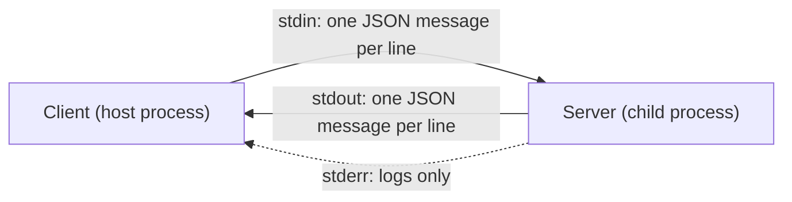
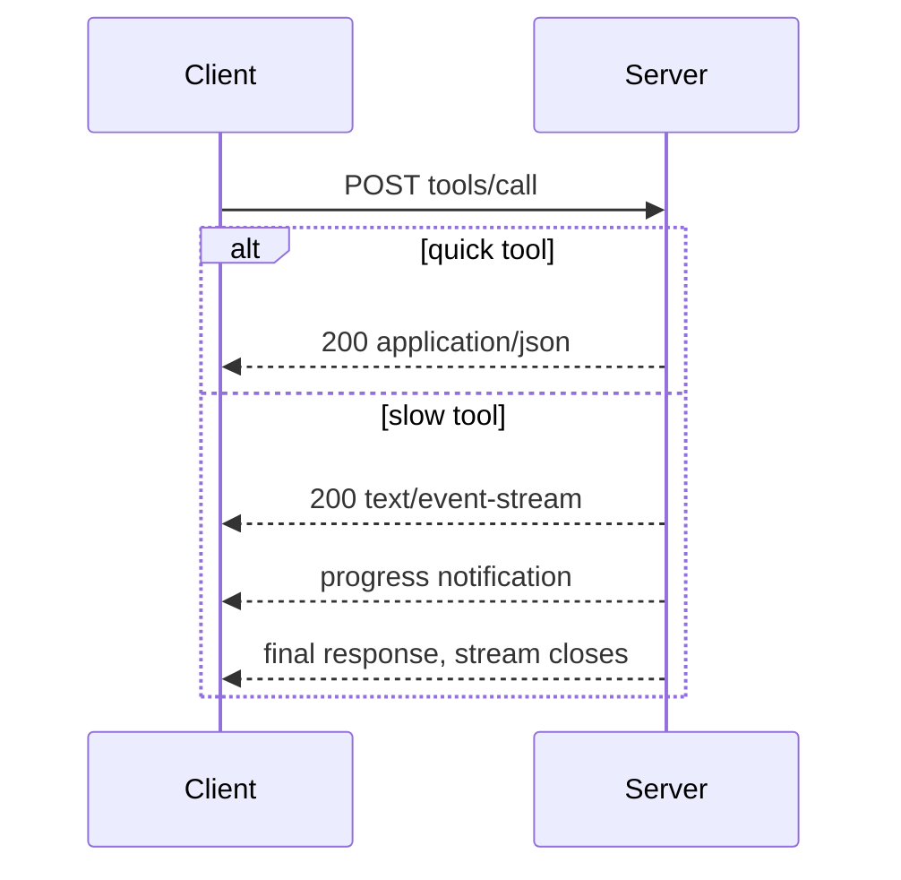

# Transports

The same letter can go by speed post or by a hand delivery from your neighbour. The letter is the same; only the delivery differs. MCP messages are the letter. A **transport** is the delivery.

## What it is

MCP defines two standard transports:

- **stdio**: the client starts the server as a child process on the same machine and talks over standard input and output.
- **Streamable HTTP**: the server runs as an independent web service with a single HTTP endpoint, for example `https://example.com/mcp`.

Both carry the same JSON-RPC messages. Pick stdio for local tools and Streamable HTTP for anything shared or remote.

## stdio

*Figure: stdio uses three streams. Only stdin and stdout carry MCP messages.*

Key rules from the spec:

- Messages are separated by newlines and must not contain embedded newlines.
- The server must write **only valid MCP messages** to `stdout`. Anything else corrupts the stream. This is why `print()` in a Python stdio server is a bug. Log to `stderr` instead.
- To cancel a request, the client sends `notifications/cancelled`.
- To shut down, the client closes the server's input and waits. Servers should exit when stdin closes. If the server does not exit, the client forces it.
- If the server crashes, the client may restart it and retry. Because the protocol is stateless, in-flight requests are simply lost.

## Streamable HTTP

Every client message is its own `POST` to the MCP endpoint. The client sends `Accept: application/json, text/event-stream`. The server answers each request in one of two ways:

1. A single JSON response (`Content-Type: application/json`).
2. A **Server-Sent Events (SSE)** stream scoped to that request. It may carry progress notifications and ends with the final response. (SSE is covered in [Chapter 1](../../module-1/01-networking.md).)

*Figure: The server chooses a JSON reply or an SSE stream for each request.*

What changed in 2026-07-28:

- No `Mcp-Session-Id` and no sessions.
- No standalone `GET` stream. A server answers `GET` or `DELETE` with `405`. Long-lived notifications now use `subscriptions/listen` (see [Subscriptions, Caching and Tasks](07-subscriptions-caching-tasks.md)).
- Servers cannot send their own requests on the stream (see [Elicitation and Multi Round-Trip Requests](05-elicitation-and-mrtr.md)).
- Streams are not resumable. If a stream breaks, the client re-issues the request with a new id.
- Closing the stream is itself the cancellation signal.

### Headers for gateways

The spec copies key fields from the body into HTTP headers so load balancers and gateways can route without parsing JSON:

| Header | Taken from | Required on |
|---|---|---|
| `MCP-Protocol-Version` | `_meta` version | Every POST |
| `Mcp-Method` | `method` | Every request |
| `Mcp-Name` | `params.name` or `params.uri` | `tools/call`, `resources/read`, `prompts/get` |

A server may also mark a tool parameter with `x-mcp-header`, which is then mirrored as `Mcp-Param-<Name>`. Do not mark secrets this way, because headers are visible to intermediaries. A server that reads the body must check that headers match it, and reply `400` with error `-32020` if not. Otherwise a gateway and a server could disagree about what is being called.

### Security on HTTP

- Servers **must** validate the `Origin` header and return `403` if it is invalid. This blocks DNS rebinding attacks from web pages.
- A server running locally should bind to `127.0.0.1`, not `0.0.0.0`.
- Servers should authenticate every connection (see [Authorisation with OAuth](08-authorisation.md)).
- Servers should send `X-Accel-Buffering: no` on SSE so proxies like nginx do not hold back events.

## Trade-offs

| | stdio | Streamable HTTP |
|---|---|---|
| Setup | Client launches a process | Deploy a web service |
| Users | One client | Many clients |
| Auth | Environment credentials | OAuth |
| Scaling | One process per client | Normal web scaling |
| Typical use | Local files, dev tools | SaaS tools, shared company servers |

The deprecated **HTTP+SSE** transport from 2024-11-05 should not be used in new work.

> [!TIP]
> **Key takeaways**
> - stdio is for local child processes: only protocol messages on stdout, logs on stderr.
> - Streamable HTTP uses one POST per message, with a JSON or SSE reply, and no sessions.
> - Mirrored headers let gateways route requests, and servers must check they match the body.
