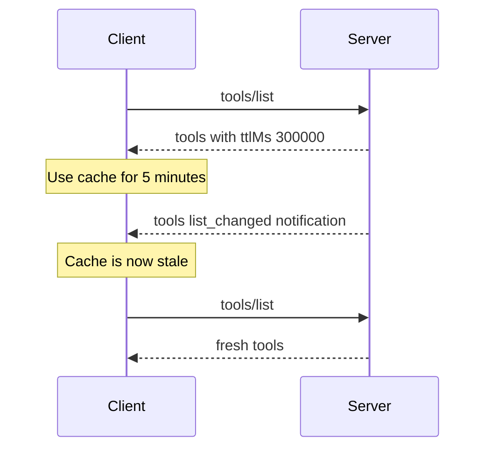
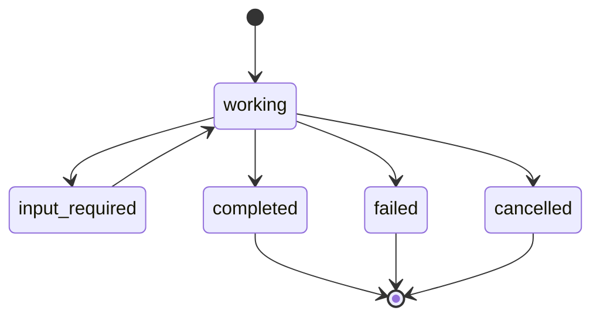

# Subscriptions, Caching and Tasks

To know where your train is, you can refresh the app every minute (polling), or wait for an SMS when something changes (push). MCP supports both ideas for different jobs: **subscriptions** for change alerts, **caching** to avoid needless fetches, and **tasks** for work that takes a long time.

## Subscriptions: change alerts

Tools and resources can change. A server may add a tool, or a watched file may be edited. In 2026-07-28, a client opts in to such alerts by sending a `subscriptions/listen` request with a filter:

| Filter field | You get |
|---|---|
| `toolsListChanged` | `notifications/tools/list_changed` |
| `promptsListChanged` | `notifications/prompts/list_changed` |
| `resourcesListChanged` | `notifications/resources/list_changed` |
| `resourceSubscriptions` (list of URIs) | `notifications/resources/updated` for those URIs |

The server replies with `notifications/subscriptions/acknowledged` (listing what it agreed to send), then keeps the response stream open. Every notification carries `io.modelcontextprotocol/subscriptionId` in `_meta`, which is the `id` of the listen request. The server must not send types the client did not ask for.

The client cancels by closing the stream (HTTP) or sending `notifications/cancelled` (stdio). This replaces the old `resources/subscribe` method and the HTTP `GET` stream.

Notifications are best-effort. The MCP docs say clients should also rely on polling to keep results fresh, especially after reconnects.

## Caching: ttlMs and cacheScope

Listing tools on every turn wastes time. Cacheable results carry two hints:

- `ttlMs`: how long, in milliseconds, the client may treat the result as fresh. It works like HTTP `max-age`. `0` means immediately stale.
- `cacheScope`: `"public"` (safe to share between users, even through a shared gateway) or `"private"` (reuse only for the same authorisation context).

These fields are required on `server/discover`, `tools/list`, `prompts/list`, `resources/list`, `resources/templates/list` and `resources/read`. Results from the `input_required` flow are never cached.

*Figure: TTL avoids refetching; a change notification cancels the TTL early. (5 minutes is the spec's example value.)*

Two cautions. TTL is a freshness hint, not a promise. And a server must not rely on `cacheScope` for security. It must still enforce access control on every primitive. A `"public"` result may be reused across different access tokens.

Servers should also return tools in a deterministic order. This helps client caching and prompt caching.

## Tasks: long-running work

Some tools run for minutes: a CI pipeline, a data export, a human approval. Holding an HTTP request open that long is fragile.

The **Tasks** extension (`io.modelcontextprotocol/tasks`) lets a server return a durable handle instead of the result. It is an *extension*, not part of the core protocol. Both sides must opt in through capabilities. A server must never return a task to a client that did not declare support.

*Figure: Task states. Completed, failed and cancelled are final.*

How it works:

1. The client calls `tools/call`. The server replies with `resultType: "task"` and a `taskId`, a `ttlMs` and a polling interval `pollIntervalMs`.
2. The client polls with `tasks/get` until a final state. On `completed`, the response includes the `result`.
3. If the task needs input, its status becomes `input_required`. The client answers with `tasks/update`.
4. The client can call `tasks/cancel`. Cancellation is cooperative; the server may still finish.

Save the `taskId` durably. If the client restarts, it can resume polling. The Tasks overview also describes optional `notifications/tasks` pushes through `subscriptions/listen`. The roadmap says work continues toward moving Tasks into the core protocol.

## When to use what

| Need | Use |
|---|---|
| Know when tool list or a file changes | `subscriptions/listen` |
| Avoid refetching stable lists | `ttlMs` and `cacheScope` |
| Work longer than a few seconds | Tasks extension |

> [!TIP]
> **Key takeaways**
> - Subscriptions are opt-in streams of change alerts. They are best-effort, so keep caches and polling as a backup.
> - `ttlMs` and `cacheScope` tell clients and gateways what they may cache. They are not access control.
> - Tasks give long-running work a durable `taskId` that the client polls with `tasks/get`.
