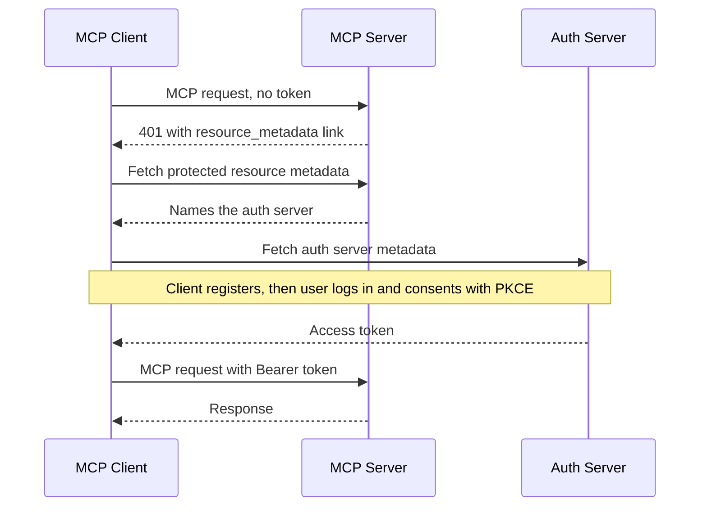

# Authorisation with OAuth

Think of a corporate office. At reception you show your ID and get a visitor pass. The guard at your floor does not check your ID again. He only checks that the pass is real, is for *this* floor, and has not expired.

MCP authorisation works the same way, using **OAuth**, the standard system behind "Sign in with Google".

## What it is

Authorisation in MCP is optional, and it applies to **HTTP-based transports**. Servers using stdio should not follow it; they read credentials from the environment instead.

The spec is built on OAuth 2.1 (an IETF draft, not yet a final RFC) and several related standards. There are three roles:

- **MCP server**: the OAuth *resource server*. It accepts and checks access tokens.
- **MCP client**: the OAuth *client*. It asks for tokens on behalf of the user.
- **Authorisation server (AS)**: logs the user in, asks for consent and issues tokens. It can be part of the MCP server or a separate service.

## How it works

*Figure: Discovery first, then the OAuth login, then normal MCP calls.*

Step by step:

1. **Challenge.** The client calls the MCP server without a token. The server replies `401 Unauthorized` with a `WWW-Authenticate` header that points to its *Protected Resource Metadata* (RFC 9728). A well-known URL such as `/.well-known/oauth-protected-resource` is the fallback. This document lists the `authorization_servers`.
2. **Find the auth server.** The client reads the auth server's metadata (RFC 8414 or OpenID Connect discovery).
3. **Register the client.** The client needs a client ID. Options, in the order clients should prefer: pre-registered details; **Client ID Metadata Documents**, where the client's ID is an HTTPS URL pointing to a JSON file describing it; and **Dynamic Client Registration** (RFC 7591), which is now deprecated and kept for older servers.
4. **Log in.** The user logs in at the auth server in a browser. The client uses **PKCE** and sends a `resource` parameter (RFC 8707) naming the MCP server. This ties the token to that one server.
5. **Call MCP.** Every HTTP request carries `Authorization: Bearer <token>`. Tokens must never go in the URL query string.

New in this revision: clients must check the `iss` value from the authorisation response against the issuer they recorded earlier (RFC 9207). This blocks "mix-up" attacks where a bad auth server tricks the client.

## Rules for the server

- Validate that every token was issued **for this server** (the audience). Accept no other tokens.
- Do not pass the client's token on to other APIs. This anti-pattern is called **token passthrough**, and it is forbidden. If your server needs to call a third-party API, get separate credentials for it (for example through URL-mode elicitation).
- Return `401` for missing, invalid or expired tokens.
- Return `403` with `error="insufficient_scope"` and the needed `scope` when the token is valid but too weak. The client then runs a **step-up** flow to get a token with more scope.

| Status | Meaning |
|---|---|
| 401 | Authorisation needed, or token invalid |
| 403 | Token valid, but scope or permission insufficient |
| 400 | Malformed authorisation request |

## Scopes: ask for little

Servers should name the needed scopes in the `WWW-Authenticate` challenge. Clients should request only those. Avoid catch-all scopes such as `all` or `*`. Start with read-only access and raise it when a risky tool is first used. A stolen narrow token does less damage.

## In the AI era

An agent is not always a person at a browser. It may be a background job acting for a user who is away. The MCP roadmap (last updated 22 August 2026) lists agent identity and enterprise security as a priority, including DPoP, workload identity and token exchange. These are plans, not features of the current revision.

One official extension already exists: **Enterprise-Managed Authorization**. Here the company's identity provider decides which MCP servers each employee may use. The client gets an ID-JAG token from the IdP and exchanges it for an MCP access token. Access is managed and revoked in one place. Deeper identity topics are in [Chapter 10](../10-security-governance.md).

## Common mistakes

- Accepting any valid-looking JWT without checking its audience.
- Forwarding the user's token to a downstream API.
- Publishing every scope in `scopes_supported`, so clients ask for everything.

> [!TIP]
> **Key takeaways**
> - Remote MCP servers are OAuth resource servers. They send a 401 with a link to their metadata, and clients discover the auth server from it.
> - Tokens are tied to one server with the `resource` parameter, and the server must check the audience and never pass tokens through.
> - Use least-privilege scopes and step-up with `403 insufficient_scope`. Large companies can use Enterprise-Managed Authorization.
