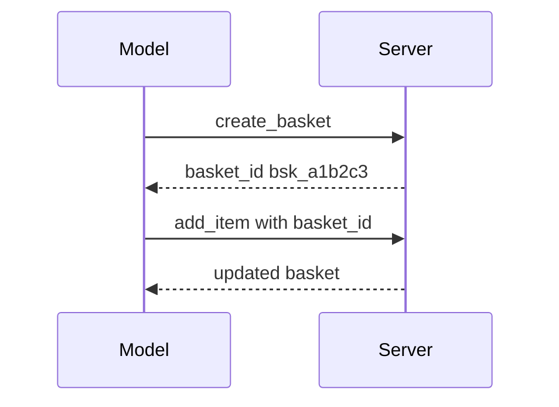

# Designing and Building Tools

A tool description is a note you write for a new colleague on their first day. If the note is vague, they will make mistakes. A language model reading your tool is that new colleague, and it cannot ask you questions.

## What it is

Good MCP tool design means making each tool easy for a model to *choose*, *call correctly* and *recover from errors*. The MCP spec sets the format. Anthropic's engineering guidance on writing tools for agents adds practical rules.

## Design rules

| Rule | Why | Example |
|---|---|---|
| Build a few purposeful tools, not one tool per API endpoint | Too many overlapping tools confuse the model | One `schedule_meeting` tool instead of `list_slots` + `create_event` + `send_invite` |
| Use clear names | Spec: 1 to 128 characters, letters, digits, `_`, `-`, `.` | `orders.get_status` |
| Describe the tool like a new hire's brief | The model decides from the text | State what it does, when to use it, and sample input |
| Use unambiguous parameter names | Prevents wrong guesses | `user_id`, not `user` |
| Return only high-signal data | Saves tokens and attention | Names and status, not internal row IDs |
| Offer paging, filters and detail levels | Large outputs flood the context | `limit`, `detail: "brief" or "full"` |
| Write actionable errors | The model can fix and retry | "Order not found. IDs look like ORD-1001." |
| Validate every input and check access | Spec: servers must validate inputs and rate limit | Reject bad IDs, check the caller owns the order |
| Add an `outputSchema` when output is structured | Clients can validate and plan | Typed fields for status and ETA |

Errors the model can fix should come back as a tool result with `isError: true`, not as a protocol error. Return tools in a stable order so client caches and LLM prompt caches keep working.

## State without sessions

There are no protocol sessions in 2026-07-28. If your tools need state (a shopping basket, an open transaction), return an explicit **handle** from a creation tool. The model passes it back on later calls.



*Figure: State travels as an ordinary argument, so any server instance can serve the next call.*

The spec's guidance for handles:

- A handle is a name, not a permission. Check the caller's authorisation on every call, and tie the handle to the verified user.
- Make it opaque and random, so it cannot be guessed or parsed.
- Say how long it lives in the tool description (for example, "baskets expire after 24 hours").
- If a handle is unknown or expired, return a tool error so the model can create a new one.

## Too many tools?

Hosts connected to many servers can load thousands of tool definitions into the prompt. The MCP client guide suggests **progressive discovery**: give the model a small `search_tools` tool, and load full definitions only when needed. Switch to this once tool definitions take a notable share of the context window. Its example threshold is 1% to 5%.

## Build a small server

This example uses the Python SDK (the MCP quickstart says version 2.0.0 or higher). Install with `uv add "mcp[cli]"`. The order data is made up for the *Example*.

```python
import logging
from mcp.server import MCPServer

logger = logging.getLogger(__name__)  # logs go to stderr, safe for stdio
mcp = MCPServer("orders")

# Example data. A real server would call your order service.
ORDERS = {
    "ORD-1001": "Out for delivery, arriving today by 7 pm",
    "ORD-1002": "Delivered on 1 November",
}

@mcp.tool()
def get_order_status(order_id: str) -> str:
    """Get the delivery status of one order.

    Args:
        order_id: Order number, for example ORD-1001.
    """
    logger.info("status lookup for %s", order_id)
    status = ORDERS.get(order_id)
    if status is None:
        return f"No order found for {order_id!r}. Order numbers look like ORD-1001."
    return status

@mcp.resource("orders://{order_id}")
def order_record(order_id: str) -> str:
    """Read-only record for one order."""
    return ORDERS.get(order_id, "Not found")

if __name__ == "__main__":
    mcp.run(transport="stdio")
```

The SDK builds the tool definition and `inputSchema` from the type hints and docstring. Run it with `uv run server.py`. Never use `print()` here: it writes to stdout and breaks the stdio stream.

To serve it over Streamable HTTP, the SDK README gives `uv run mcp run server.py --transport streamable-http`. To try it in the MCP Inspector, use `uv run mcp dev server.py`. Check your SDK's documentation for how it reports tool errors as `isError`. SDKs adopt new revisions on their own schedules.

> [!TIP]
> **Key takeaways**
> - A model picks tools from names and descriptions, so write them like a brief to a new colleague.
> - Return small, useful results and fixable errors. Always validate and authorise.
> - With no sessions, state lives in explicit handles that are random, expiring and bound to the user.
