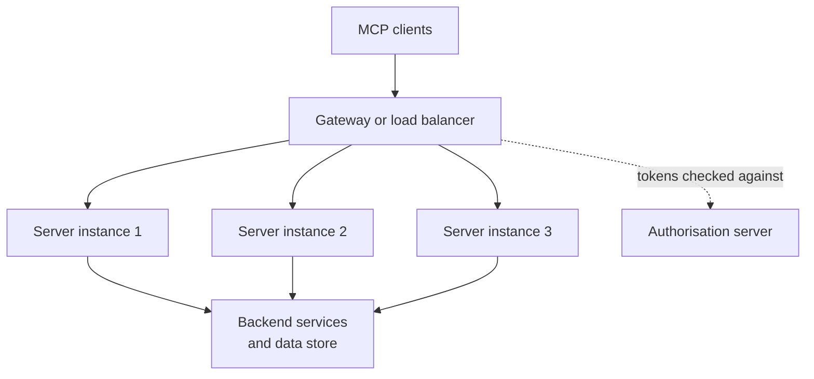

# Deployment and Governance

Lending your house key to a plumber is fine. Lending it to anyone who asks is not. An MCP server is a key to your systems, so you need to decide *how to run it* and *who may use it*.

## What it is

**Deployment** is how you run MCP servers (on laptops, or as web services). **Governance** is how you control which servers exist, who can add them, and who can call what. Both matter more in the AI era because agents call tools automatically.

## Deployment patterns

| Pattern | Transport | Good for | Watch out for |
|---|---|---|---|
| Local server per user | stdio | Dev tools, local files | Runs with the user's privileges; needs sandboxing and consent |
| Remote server per team or product | Streamable HTTP | SaaS tools, shared internal tools | Needs OAuth, rate limits and monitoring |
| Remote servers behind a gateway | Streamable HTTP | Central policy, logging and routing | The gateway must validate, not just trust, headers |

### Scaling a remote server

The 2026-07-28 revision was designed so a remote MCP server is a normal HTTP workload. There are no protocol sessions, and multi-step flows use retries (MRTR) instead of open server-initiated requests. So the spec says no shared storage or stateful load balancing is needed for those flows. Any instance can serve any request.

*Figure: Stateless servers behind a normal load balancer. Handles and long jobs live in a shared store.*

Practical points, all from the spec and docs:

- **Handles and tasks need shared storage.** Statelessness moves state out of the connection, not out of the system. A basket or task ID must be readable by every instance.
- **Route on headers.** `Mcp-Method` and `Mcp-Name` let a gateway route or rate-limit without parsing JSON. Servers still verify they match the body.
- **Turn off proxy buffering for SSE.** Send `X-Accel-Buffering: no`.
- **Use Tasks for long jobs.** Do not hold requests open for minutes.
- **Support more than one version.** Servers may speak several revisions at once, and a dual-era server can serve old and new clients on one endpoint.
- **Trace across hops.** The spec reserves `traceparent`, `tracestate` and `baggage` in `_meta` for OpenTelemetry trace context. See Chapter 11 in [Observability](../../module-5/11-observability.md).

## Governance of servers

Treat a third-party MCP server like a third-party library with network access.

| Control | What to do |
|---|---|
| Source | Prefer servers whose namespace is verified. The official MCP Registry uses reverse-DNS names such as `io.github.user/server`, verified via GitHub, DNS or HTTP challenges |
| Scanning | The Registry does not scan code. It leaves scanning to package registries (npm, PyPI, Docker Hub) and downstream marketplaces. Do your own review |
| Private servers | The public Registry does not accept private servers. Host your own registry that follows its OpenAPI spec |
| Access | Central approval of servers via the Enterprise-Managed Authorization extension, with one place to grant and revoke |
| Local servers | Hosts must show the exact command and ask consent before running a one-click local server. Run in a sandbox |
| Scopes | Least privilege, step-up on demand |
| Audit | Clients should log tool usage. Servers should rate limit and validate |

The MCP Registry is in **preview** (as of November 2026), so breaking changes or data resets may occur. It holds metadata in a `server.json` file, not the code itself. It is meant to be used mainly by marketplaces, not directly by host apps.

The official security guidance names the main risks: confused deputy attacks on proxy servers, token passthrough, server-side request forgery (SSRF) during OAuth discovery, local server compromise, state handle hijacking and over-broad scopes. [Chapter 10](../10-security-governance.md) covers threat models in depth.

## Governance of the protocol

Knowing how MCP itself changes helps you plan upgrades.

- MCP is run as a Linux Foundation project, and was donated to the Agentic AI Foundation in December 2025. Its own governance has Lead Maintainers, Core Maintainers and Maintainers.
- Changes come through **Specification Enhancement Proposals (SEPs)**.
- Features move through Active, Deprecated and Removed. A deprecated feature stays at least twelve months before removal. Current deprecated items include Roots, Sampling, Logging, HTTP+SSE and Dynamic Client Registration.
- Extensions such as Tasks, MCP Apps and Enterprise-Managed Authorization are opt-in and negotiated through capabilities.

Plan to track the changelog. The 2026-07-28 revision removed things that older servers relied on.

> [!TIP]
> **Key takeaways**
> - Stateless MCP servers scale like any web service, but handles, tasks and tokens still need shared storage.
> - Vet third-party servers: verified namespace, your own code review, sandboxed local runs, least-privilege scopes.
> - Follow the changelog and deprecation registry. Deprecated features stay for at least twelve months.
